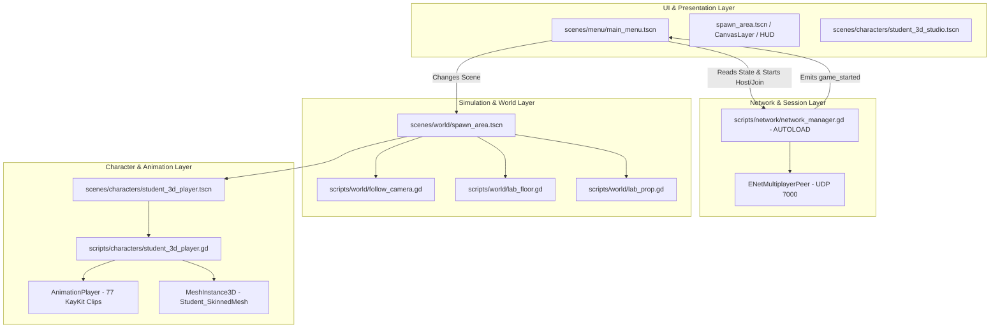

# 02 PROJECT ARCHITECTURE: Codebase Structure & System Interactions

## 1. Repository Directory Structure

Below is the verified file tree of the active repository (excluding Git metadata, `.godot/` cache, and `.venv/`):

```text
past-future/
├── .gitattributes
├── .gitignore
├── GAME_DESIGN_DOCUMENT.md
├── icon.svg
├── icon.svg.import
├── project.godot
├── 3d/                                        <- (Reserved directory, currently empty)
├── assets/
│   ├── characters/
│   │   ├── ART_NOTES.md
│   │   ├── STUDENT_MODEL.md
│   │   ├── references/                        <- Excluded from Godot (.gdignore)
│   │   │   ├── .gdignore
│   │   │   ├── README.md
│   │   │   ├── backview.png
│   │   │   ├── frontview.png
│   │   │   ├── sideview1.png
│   │   │   └── sideview2.png
│   │   ├── student_2d/                        <- Legacy 2D prototype files
│   │   │   ├── atlas_regions.json
│   │   │   ├── generation_prompts.json
│   │   │   └── README.md
│   │   └── student_3d/                        <- ACTIVE 3D character assets
│   │       ├── manifest.json                  <- Model geometry, bone retarget & provenance
│   │       ├── README.md
│   │       ├── REFERENCE_STUDY.md
│   │       ├── student.glb                    <- Compiled 3D skinned mesh (7.33 MB)
│   │       ├── student.glb.import
│   │       ├── VALIDATION.md
│   │       ├── review/                        <- Renders & turnaround evidence (.gdignore)
│   │       └── source/                        <- Blender editable project (.gdignore)
│   │           └── student.blend
│   ├── third_party/
│   │   └── kaykit_character_animations/       <- Source CC0 animation packs (.gdignore)
│   │       ├── .gdignore
│   │       ├── License.txt
│   │       ├── Mannequin_Medium.glb
│   │       ├── README.md
│   │       └── Rig_Medium_*.glb (8 files)
│   ├── ui/
│   │   ├── temporal_background.svg
│   │   └── temporal_background.svg.import
│   └── world/                                 <- Legacy & active 2D/vector decors
│       ├── cabinet.svg, console.svg, pill.svg, table.svg
│       ├── spawn_ring.svg
│       └── spawn_ring.svg.import
├── scenes/
│   ├── characters/
│   │   ├── student_2d_player.tscn             <- (Legacy, broken: missing PNGs)
│   │   ├── student_3d_player.tscn             <- ACTIVE gameplay character scene
│   │   ├── student_3d_studio.tscn             <- In-game 3D animation inspection studio
│   │   ├── student_animation_studio.tscn      <- (Legacy 2D studio)
│   │   ├── student_model.tscn                 <- (Legacy, broken: missing student_v2.glb)
│   │   ├── student_paper_rig.tscn             <- (Legacy 2D paper rig)
│   │   └── student_player.tscn                <- (Legacy, broken: missing student_v2.glb)
│   ├── menu/
│   │   └── main_menu.tscn                     <- Title screen, settings, credits, LAN lobby
│   ├── props/
│   │   ├── cabinet_visual.tscn                <- Reusable 3D painted cabinet mesh
│   │   ├── console_visual.tscn                <- Reusable 3D painted computer console mesh
│   │   ├── lab_prop.tscn                      <- Prop base: collision footprint + visual loader
│   │   └── table_visual.tscn                  <- Reusable 3D painted workbench mesh
│   └── world/
│       └── spawn_area.tscn                    <- ACTIVE testbed room (Signal Laboratory greybox)
├── scripts/
│   ├── characters/
│   │   ├── student_2d_player.gd
│   │   ├── student_3d_player.gd               <- ACTIVE player controller (movement & animator)
│   │   ├── student_3d_studio.gd               <- ACTIVE studio UI controller
│   │   ├── student_animation_studio.gd
│   │   ├── student_atlas_regions.gd
│   │   ├── student_direction_poses.gd
│   │   ├── student_paper_rig.gd
│   │   └── student_player.gd
│   ├── menu/
│   │   ├── main_menu.gd                       <- Main menu, settings & LAN UI logic
│   │   └── temporal_backdrop.gd               <- Procedural canvas item clock & particle motion
│   ├── network/
│   │   └── network_manager.gd                 <- AUTOLOAD singleton: ENet LAN host/join & state
│   └── world/
│       ├── follow_camera.gd                   <- Fixed-angle perspective follow camera
│       ├── lab_floor.gd                       <- Floor procedural tile setup & timeline tint
│       ├── lab_prop.gd                        <- Prop collision shape configuration & shader tint
│       └── spawn_area.gd                      <- Room coordinator, timeline switcher & pause
├── shaders/
│   ├── lab_floor.gdshader                     <- Procedural tile grid & timeline color switch
│   └── painted_prop.gdshader                  <- Unshaded Lambertian face lighting for furniture
├── tests/
│   ├── lan_peer.gd                            <- Multi-process headless LAN verification
│   ├── run_lan_smoke.py                       <- Python orchestrator for loopback testing
│   ├── spawn_area.gd                          <- Godot headless scene & physics verification
│   ├── student_2d.gd                          <- Legacy 2D test (currently fails)
│   ├── student_3d.gd                          <- Godot headless 77-clip skeletal animation test
│   └── student_3d_assets.py                   <- Python GLB asset provenance & skin validator
└── tools/
    ├── assemble_student_review.py             <- Generates HTML and turnaround review sheet
    ├── build_student_kaykit.py                <- Primary procedural mesh authoring tool
    ├── build_student_model.py                 <- Legacy student_v2 procedural builder
    ├── gltf_tools.py                          <- Binary glTF/GLB reader/writer library
    ├── ground_student_clips.py                <- 60 Hz skinned surface floor clearance optimizer
    ├── inspect_student_atlases.py             <- Inspects legacy 2D sprite sheets
    ├── preview_student.gd / preview_student_3d.gd
    ├── render_student_review.gd               <- Godot script capturing neutral poses & clips
    ├── requirements-character.txt             <- Python dependencies (NumPy, Pillow, bpy)
    ├── student_blender.py                     <- Blender creation, export, and rendering
    ├── student_mesh.py                        <- Geometry classes & glTF packaging
    └── student_rig.py                         <- Retargeting & bone length delta scaling
```

---

## 2. Godot Project Configuration (`project.godot`)

The engine configuration file defines critical system-level defaults:

- **Application**:
  - `config/name="Past-Future"`
  - `run/main_scene="res://scenes/menu/main_menu.tscn"`
  - `config/features=PackedStringArray("4.7", "GL Compatibility")`
- **Autoloads**:
  - `NetworkManager="*res://scripts/network/network_manager.gd"` (Singleton running across all scenes)
- **Display & Viewport**:
  - `window/size/viewport_width=1600`
  - `window/size/viewport_height=900`
  - `window/size/window_width_override=1280`
  - `window/size/window_height_override=720`
  - `window/stretch/mode="canvas_items"`
- **Physics**:
  - `3d/physics_engine="Jolt Physics"` (Uses the Jolt 3D physics library)
- **Input Map**:
  - `move_left`: Key `A` (Physical keycode 65)
  - `move_right`: Key `D` (Physical keycode 68)
  - `move_up`: Key `W` (Physical keycode 87)
  - `move_down`: Key `S` (Physical keycode 83)
- **Rendering**:
  - `renderer/rendering_method="gl_compatibility"`
  - `rendering_device/driver.windows="d3d12"`

---

## 3. High-Level Architectural Layers

The architecture consists of four distinct operational layers:



---

## 4. System Interactions & Event Flow

### 4.1 LAN Connection & Game Launch Flow
1. **User Action**: In `main_menu.gd`, the player clicks "HOST ON WI-FI" or "JOIN ON WI-FI".
2. **Host**: Calls `NetworkManager.host_game(7000)`. Sets `role = "past"`, state to `HOSTING`, binds `ENetMultiplayerPeer`.
3. **Guest**: Enters host IP and calls `NetworkManager.join_game(address, 7000)`. Sets `role = "future"`, state to `CONNECTING`.
4. **Handshake**:
   - `multiplayer.connected_to_server` triggers `_register_client.rpc_id(1, PROTOCOL_VERSION)` on the guest.
   - Host verifies protocol version ($2$), sets `guest_id`, switches state to `CONNECTED`, and sends `_apply_lobby.rpc_id(guest_id)`.
5. **Ready State**:
   - Guest clicks "I'M READY". Calls `NetworkManager.set_ready(true)`, sending `_request_ready.rpc_id(1, true)`.
   - Host records `guest_ready = true` and updates guest via `_apply_lobby`.
6. **Game Start**:
   - Host clicks "START GAME". Calls `NetworkManager.start_game()`.
   - Host broadcasts `_begin_game.rpc()` (authority, call_local).
   - Both peers receive `_begin_game()`, set `in_game = true`, and emit `game_started`.
   - `main_menu.gd` receives `game_started` and executes:
     ```gdscript
     get_tree().change_scene_to_file.call_deferred("res://scenes/world/spawn_area.tscn")
     ```

### 4.2 Room Setup & Timeline Application
1. In `spawn_area.gd`, `_ready()` detects whether the game is networked:
   ```gdscript
   _networked = NetworkManager.in_game
   if _networked:
       timeline = "Past" if NetworkManager.role == "past" else "Future"
   ```
2. `_apply_timeline()` executes:
   - Configures `Floor.future` (setting `future` uniform on `shaders/lab_floor.gdshader`).
   - Iterates through all `Actors/` props and sets `prop.future = future` (recoloring materials via `shaders/painted_prop.gdshader`).
   - Tints the player's jacket material: ochre (`#e4bf7f`) for Past, cold cyan (`#89ccd4`) for Future.
   - Hides the "VIEW FUTURE" button in networked sessions (timeline switching is restricted to solo preview).

### 4.3 Locomotion & Visual Update
1. `student_3d_player.gd` processes player input in `_physics_process`:
   - Gets 2D movement vector from `move_left`, `move_right`, `move_up`, `move_down`.
   - Unprojects input into ground-plane vectors relative to `Camera3D`'s right and forward basis.
   - Calculates velocity with optional sprint (`KEY_SHIFT`).
   - Calls `move_and_slide()` using Jolt Physics.
   - Rotates visual root smoothly toward movement direction:
     ```gdscript
     $Visual.rotation.y = rotate_toward($Visual.rotation.y, atan2(ground_direction.x, ground_direction.z), delta * 12.0)
     ```
   - Blends `AnimationPlayer` clips (`Idle_A`, `Walking_A`, `Running_A`, `Holding_A`).

---

## 5. Autoloads, Signals & RPC API

### 5.1 Autoload: `NetworkManager` (`scripts/network/network_manager.gd`)

| Member / Signal / RPC | Type / Scope | Description |
|---|---|---|
| `signal state_changed` | Signal | Emitted when connection status, lobby state, or role changes. |
| `signal game_started` | Signal | Emitted when host authorizes start and both clients launch. |
| `state: State` | Enum (`IDLE`, `HOSTING`, `CONNECTING`, `CONNECTED`) | Current network lifecycle state. |
| `role: String` | Variable (`"past"` or `"future"`) | Assigned player timeline role. |
| `guest_ready: bool` | Variable | Whether the guest (Future) player has marked ready. |
| `in_game: bool` | Variable | True when actively inside the game level. |
| `_register_client(version)` | `@rpc("any_peer", "call_remote", "reliable")` | Sent from client to host to register protocol version. |
| `_apply_lobby(id, ready)` | `@rpc("authority", "call_remote", "reliable")` | Sent from host to client to synchronize lobby status. |
| `_request_ready(ready)` | `@rpc("any_peer", "call_remote", "reliable")` | Sent from client to host to request ready status change. |
| `_begin_game()` | `@rpc("authority", "call_local", "reliable")` | Broadcast from host to both peers to transition to gameplay. |

### 5.2 Character Signals (`scripts/characters/student_3d_player.gd`)
- `signal action_finished(action: String)`: Emitted when an action clip (e.g. `pick_up`, `interact`, `inspect`) completes.

### 5.3 Studio Signals (`scripts/characters/student_3d_studio.gd`)
- `signal close_requested`: Emitted when the character review studio is closed via Esc or UI button.

---

## 6. Architectural Deficiencies & Missing Systems

While the repository has clean separation between menu, network, world, and character visuals, several core architecture components specified in `GAME_DESIGN_DOCUMENT.md` **do not exist in the code**:

1. **Missing `PuzzleManager` Autoload**:
   - GDD Section 9 specifies a central, host-authoritative `puzzle_manager.gd`.
   - Currently, there is no puzzle manager, state dictionary, revision tracker, or RPC broadcast handler for game puzzles.
2. **Missing Interaction Architecture**:
   - There are no `Area3D` interaction zones, interaction prompt widgets, or raycast detectors.
   - Keys `F`, `I`, and `E` only trigger isolated character animation clips and attach a temporary document mesh to the hand socket.
3. **Missing Split-Screen Architecture**:
   - `LocalButton` in `main_menu.tscn` is disabled (`disabled = true`).
   - There is no dual `SubViewportContainer` or input router for simultaneous same-PC play.

