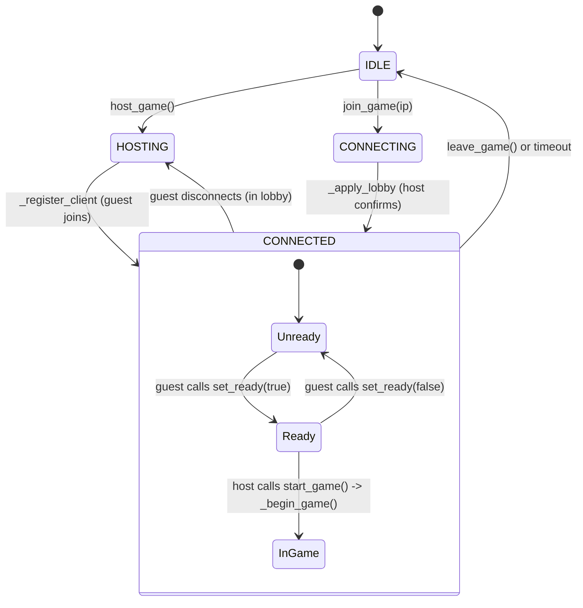

# 04 GAMEPLAY SYSTEMS: Controls, Physics, Cameras & Networking

This document provides a technical breakdown of all functioning and partially implemented gameplay systems within the repository.

---

## 1. Character Locomotion & Physics

- **Source Code**: [scripts/characters/student_3d_player.gd](file:///c:/Users/hanwd/OneDrive/Desktop/past-future/scripts/characters/student_3d_player.gd)
- **Scene File**: [scenes/characters/student_3d_player.tscn](file:///c:/Users/hanwd/OneDrive/Desktop/past-future/scenes/characters/student_3d_player.tscn)
- **Base Node**: `CharacterBody3D`
- **Physics Engine**: Godot Jolt Physics 3D (`3d/physics_engine="Jolt Physics"` in `project.godot`)
- **Status**: **COMPLETE & VERIFIED**

### 1.1 Collision Footprint & Ground Anchoring
To avoid sprite clipping or uneven floor collisions, the character root is anchored at floor level ($Y = 0$).
- **Collision Shape**: Cylinder shape with radius $0.28\text{ m}$ and height $0.4\text{ m}$, centered at $Y = 0.2\text{ m}$.
  ```gdscript
  [node name="Footprint" type="CollisionShape3D" parent="."]
  position = Vector3(0, 0.2, 0)
  shape = SubResource("Footprint")
  ```
- **Floor Snapping**: `floor_snap_length = 0.25` ensures smooth travel over minor seams.
- **Shadow**: A flat cylinder mesh ($0.43\text{ m}$ radius, $0.006\text{ m}$ height) positioned at $Y = 0.012\text{ m}$ casts a faux circular shadow on the floor without requiring dynamic shadow mapping.

### 1.2 Movement Calculation & Camera-Relative Vectors
Movement is processed in `_physics_process(delta)`. The system combines UI arrow keys and WASD actions:

```gdscript
var direction := Vector2.ZERO
if controls_enabled and _action.is_empty():
    direction = (Input.get_vector("move_left", "move_right", "move_up", "move_down") 
               + Input.get_vector("ui_left", "ui_right", "ui_up", "ui_down")).limit_length(1.0)
```

To maintain consistent orientation regardless of camera placement, input is unprojected into the camera's ground-projected horizontal basis vectors:
```gdscript
var right := Vector3.RIGHT
var down := Vector3.BACK
if is_instance_valid(view_camera):
    right = view_camera.global_basis.x
    right.y = 0.0
    right = right.normalized()
    down = view_camera.global_basis.z
    down.y = 0.0
    down = down.normalized()
var ground_direction := right * direction.x + down * direction.y
```

### 1.3 Speeds, Sprinting & Turning
- **Base Walk Speed**: `speed = 2.8` m/s.
- **Sprint Modifier**: Sprinting is enabled by holding `Shift` (`run_multiplier = 1.55`), yielding a run speed of $\approx 4.34\text{ m/s}$. Sprinting is disabled while carrying items.
- **Velocity & Gravity**:
  ```gdscript
  velocity.x = ground_direction.x * movement_speed
  velocity.z = ground_direction.z * movement_speed
  velocity.y = -0.5 if is_on_floor() else velocity.y - 9.8 * delta
  move_and_slide()
  ```
- **Smooth Rotation**: When moving, the character's visual child (`$Visual`) smoothly rotates toward the travel angle:
  ```gdscript
  if not ground_direction.is_zero_approx():
      $Visual.rotation.y = rotate_toward($Visual.rotation.y, atan2(ground_direction.x, ground_direction.z), delta * 12.0)
  ```

---

## 2. Animation & Action State Machine

- **Source Code**: [scripts/characters/student_3d_player.gd](file:///c:/Users/hanwd/OneDrive/Desktop/past-future/scripts/characters/student_3d_player.gd)
- **Model Scene**: [assets/characters/student_3d/student.glb](file:///c:/Users/hanwd/OneDrive/Desktop/past-future/assets/characters/student_3d/student.glb)
- **Status**: **COMPLETE & VERIFIED**

### 2.1 Animation Library Isolation
In Godot, imported GLB animations share resource instances by default. To prevent animation conflicts in multiplayer or studio inspection, `student_3d_player.gd` duplicates the library at runtime:
```gdscript
var library: AnimationLibrary = animator.get_animation_library("").duplicate(true)
animator.remove_animation_library("")
animator.add_animation_library("", library)
```
Looping is explicitly set per clip: locomotion clips in `LOOP_CLIPS` are assigned `LOOP_LINEAR`, while action clips use `LOOP_NONE`.

### 2.2 Locomotion Blending
When no action is active (`_action.is_empty()`):
- If stationary: Plays `Holding_A` (if `carrying == true`) or `Idle_A` (crossfade $0.12\text{ s}$).
- If moving: Plays `Running_A` (if sprint is held) or `Walking_A`.

### 2.3 One-Shot Action Locking
Actions lock character locomotion until the animation completes:
- `play_action(action: String) -> bool`
  - Valid actions: `"interact"` (`Interact`), `"inspect"` (`Use_Item`), `"pick_up"` (`PickUp`), `"put_down"` (`PickUp`), `"wave"` (`Waving`).
  - Sets velocity to zero and triggers `_play(ACTIONS[action], 0.1, true)`.
  - While `_action != ""`, movement input is ignored.
- **Action Completion**:
  When `AnimationPlayer.animation_finished` fires:
  ```gdscript
  func _on_animation_finished(_clip: StringName) -> void:
      var finished := _action
      if finished == "pick_up": carrying = true
      elif finished == "put_down": carrying = false
      _held_document.visible = carrying
      _action = ""
      action_finished.emit(finished)
  ```

### 2.4 Hand Prop Socket
A `BoneAttachment3D` node is dynamically parented to the skeleton joint `handslot.l`. It holds a procedural 3D paper mesh (`BoxMesh` $0.16 \times 0.012 \times 0.21\text{ m}$), toggled visible when `carrying == true`.

---

## 3. Fixed Perspective Follow Camera

- **Source Code**: [scripts/world/follow_camera.gd](file:///c:/Users/hanwd/OneDrive/Desktop/past-future/scripts/world/follow_camera.gd)
- **Scene File**: [scenes/world/spawn_area.tscn](file:///c:/Users/hanwd/OneDrive/Desktop/past-future/scenes/world/spawn_area.tscn) (under `CameraRig`)
- **Status**: **COMPLETE & VERIFIED**

### 3.1 Projection & Angles
The camera is configured to maintain a consistent high-angle perspective view:
- **Projection**: `Camera3D.PROJECTION_PERSPECTIVE`
- **Field of View (FOV)**: $48^\circ$
- **Pitch**: Fixed at $35^\circ$ downward pitch (`rotation.x = -deg_to_rad(35.0)`).
- **Distance**: $20.0\text{ m}$ along the viewing axis.
- **Positioning**:
  ```gdscript
  var pitch := deg_to_rad(pitch_degrees)
  camera.position = Vector3(0, sin(pitch) * distance, cos(pitch) * distance)
  ```

### 3.2 Target Smoothing
In `_process(delta)`, the camera rig smoothly tracks the player using asymptotic smoothing:
```gdscript
func _process(delta: float) -> void:
    global_position = global_position.lerp(_focus_position(), 1.0 - exp(-8.0 * delta))

func _focus_position() -> Vector3:
    return target.global_position + Vector3.UP * 0.7 - global_basis.z * look_ahead
```
- `look_ahead = 2.0` shifts the camera slightly in front of the target to prioritize the forward view.
- `snap_to_target()` is called during level spawn and respawns (`R` key) to eliminate interpolation lag.

---

## 4. Multiplayer Network Session Management

- **Source Code**: [scripts/network/network_manager.gd](file:///c:/Users/hanwd/OneDrive/Desktop/past-future/scripts/network/network_manager.gd)
- **Status**: **COMPLETE & VERIFIED** (Autoload Singleton)

### 4.1 Topology & Peer Assignment
- **Transport**: `ENetMultiplayerPeer` over UDP port `7000`.
- **Maximum Peers**: 1 remote peer (2 players total).
- **Host Role**: Peer `1` = Student / Past Timeline.
- **Client Role**: Peer $> 1$ = Professor / Future Timeline.

### 4.2 State Lifecycle & Handshake
The network manager transitions through `State`: `IDLE` $\rightarrow$ `HOSTING` / `CONNECTING` $\rightarrow$ `CONNECTED`.



### 4.3 Key Network Security & Validation Rules
- **Sender Validation**: Host methods verify `multiplayer.get_remote_sender_id() == guest_id` before modifying state.
- **Version Compatibility**: Rejects mismatched client versions using `PROTOCOL_VERSION = 2`.
- **Disconnect Protection**: When a peer disconnects during gameplay, `in_game` is set to `false`, the game freezes character input, and the pause menu displays `"The connection was lost"`.

---

## 5. Interaction System: Current Reality vs. Required Architecture

| Capability | Current Reality in Codebase | What Needs to be Built |
|---|---|---|
| **Trigger Mechanism** | Direct keyboard events (`F`, `I`, `E`) in `_unhandled_key_input`. | `Area3D` proximity trigger attached to interactable props. |
| **Target Detection** | None. Character plays animation anywhere in space. | Player detects nearest interactable within $1.5\text{ m}$. |
| **UI Prompt** | Fixed footer label in HUD showing all controls. | Dynamic contextual prompt (e.g. `[F] Calibrate Radio`). |
| **Object Highlighting** | None. Props remain visually static. | Outline shader or emission glow on approaching target. |
| **State Synchronization** | None. Action affects only local document prop. | RPC action request to Host $\rightarrow$ Host validation $\rightarrow$ State update. |

---

## 6. Timeline Preview System (Solo Mode)

- **Source Code**: [scripts/world/spawn_area.gd](file:///c:/Users/hanwd/OneDrive/Desktop/past-future/scripts/world/spawn_area.gd)
- **Status**: **COMPLETE & VERIFIED**

In solo mode (launching from the menu via "EXPLORE THE LAB" or running F6), the player can test visual states without launching a second peer:
- Clicking "VIEW FUTURE" / "VIEW PAST" toggles `timeline` between `"Past"` and `"Future"`.
- `_apply_timeline()` updates:
  1. `$Floor.future`: Updates shader parameter `future` on `shaders/lab_floor.gdshader`.
  2. `$Actors/*`: Iterates over each prop, toggling `future`, which applies `PAST_COLORS` or `FUTURE_COLORS` via `shaders/painted_prop.gdshader`.
  3. `player.body_color`: Lerps the student's jacket albedo between ochre and cyan.
- In networked mode (`NetworkManager.in_game == true`), the toggle button is hidden, and `timeline` is strictly locked to the assigned network role.

