# 06 SCENES AND LEVELS: Environments, Props & Level Architecture

This document catalogs all scene files, room layouts, physical boundaries, lighting configurations, and level transition flows in the game.

---

## 1. Complete Scene Inventory

| Scene Path | Root Node | Script / Controller | Purpose / Current State |
|---|---|---|---|
| [scenes/menu/main_menu.tscn](file:///c:/Users/hanwd/OneDrive/Desktop/past-future/scenes/menu/main_menu.tscn) | `Control` | [main_menu.gd](file:///c:/Users/hanwd/OneDrive/Desktop/past-future/scripts/menu/main_menu.gd) | **ACTIVE**. Title screen, audio/video settings, credits, and LAN lobby UI. |
| [scenes/world/spawn_area.tscn](file:///c:/Users/hanwd/OneDrive/Desktop/past-future/scenes/world/spawn_area.tscn) | `Node3D` | [spawn_area.gd](file:///c:/Users/hanwd/OneDrive/Desktop/past-future/scripts/world/spawn_area.gd) | **ACTIVE**. Greybox testing environment (Signal Laboratory prototype). |
| [scenes/characters/student_3d_player.tscn](file:///c:/Users/hanwd/OneDrive/Desktop/past-future/scenes/characters/student_3d_player.tscn) | `CharacterBody3D` | [student_3d_player.gd](file:///c:/Users/hanwd/OneDrive/Desktop/past-future/scripts/characters/student_3d_player.gd) | **ACTIVE**. The playable 3D student character with KayKit animations. |
| [scenes/characters/student_3d_studio.tscn](file:///c:/Users/hanwd/OneDrive/Desktop/past-future/scenes/characters/student_3d_studio.tscn) | `Control` | [student_3d_studio.gd](file:///c:/Users/hanwd/OneDrive/Desktop/past-future/scripts/characters/student_3d_studio.gd) | **ACTIVE**. In-game 3D inspection studio for animations and turntable. |
| [scenes/props/lab_prop.tscn](file:///c:/Users/hanwd/OneDrive/Desktop/past-future/scenes/props/lab_prop.tscn) | `StaticBody3D` | [lab_prop.gd](file:///c:/Users/hanwd/OneDrive/Desktop/past-future/scripts/world/lab_prop.gd) | **ACTIVE**. Reusable base prop with collision footprint and dynamic mesh loader. |
| [scenes/props/table_visual.tscn](file:///c:/Users/hanwd/OneDrive/Desktop/past-future/scenes/props/table_visual.tscn) | `Node3D` | None (Mesh container) | **ACTIVE**. 3D painted workbench with terminal base and documents. |
| [scenes/props/cabinet_visual.tscn](file:///c:/Users/hanwd/OneDrive/Desktop/past-future/scenes/props/cabinet_visual.tscn) | `Node3D` | None (Mesh container) | **ACTIVE**. 3D painted storage cabinet with drawers and shelves. |
| [scenes/props/console_visual.tscn](file:///c:/Users/hanwd/OneDrive/Desktop/past-future/scenes/props/console_visual.tscn) | `Node3D` | None (Mesh container) | **ACTIVE**. 3D painted scientific computer terminal with dual displays. |
| [scenes/characters/student_player.tscn](file:///c:/Users/hanwd/OneDrive/Desktop/past-future/scenes/characters/student_player.tscn) | `CharacterBody3D` | [student_player.gd](file:///c:/Users/hanwd/OneDrive/Desktop/past-future/scripts/characters/student_player.gd) | **BROKEN**. Missing `student_v2.glb`. |
| [scenes/characters/student_model.tscn](file:///c:/Users/hanwd/OneDrive/Desktop/past-future/scenes/characters/student_model.tscn) | `Node3D` | None | **BROKEN**. Missing `student_v2.glb`. |
| [scenes/characters/student_2d_player.tscn](file:///c:/Users/hanwd/OneDrive/Desktop/past-future/scenes/characters/student_2d_player.tscn) | `CharacterBody3D` | [student_2d_player.gd](file:///c:/Users/hanwd/OneDrive/Desktop/past-future/scripts/characters/student_2d_player.gd) | **BROKEN**. Missing 2D atlas PNGs. |
| [scenes/characters/student_paper_rig.tscn](file:///c:/Users/hanwd/OneDrive/Desktop/past-future/scenes/characters/student_paper_rig.tscn) | `Node2D` | [student_paper_rig.gd](file:///c:/Users/hanwd/OneDrive/Desktop/past-future/scripts/characters/student_paper_rig.gd) | **BROKEN**. Missing 2D atlas PNGs. |
| [scenes/characters/student_animation_studio.tscn](file:///c:/Users/hanwd/OneDrive/Desktop/past-future/scenes/characters/student_animation_studio.tscn) | `Control` | [student_animation_studio.gd](file:///c:/Users/hanwd/OneDrive/Desktop/past-future/scripts/characters/student_animation_studio.gd) | **BROKEN**. Legacy 2D character studio. |

---

## 2. Active Level: The Signal Laboratory (`spawn_area.tscn`)

The active playable environment serves as both the testing playground and the initial room of Chapter 0.

```mermaid
graph TD
    SpawnArea[SpawnArea - Node3D]
    SpawnArea --> Env[WorldEnvironment - SubResource]
    SpawnArea --> KeyLight[CharacterKeyLight - DirectionalLight3D]
    SpawnArea --> Floor[Floor - Node3D / lab_floor.gd]
    Floor --> FloorMesh[Surface - MeshInstance3D / PlaneMesh]
    Floor --> FloorRim[Rim - 4 Border Rim Meshes]
    Floor --> SpawnRing[SpawnRing - Sprite3D / Decal]
    SpawnArea --> Bounds[Bounds - StaticBody3D / Low Border Walls]
    SpawnArea --> SpawnPoint[SpawnPoint - Marker3D at 0, 0, 3.7]
    SpawnArea --> Actors[Actors - Node3D]
    Actors --> LeftTable[LeftTable - lab_prop.tscn Kind 0]
    Actors --> RightTable[RightTable - lab_prop.tscn Kind 0]
    Actors --> LeftCabinet[LeftCabinet - lab_prop.tscn Kind 1]
    Actors --> RightCabinet[RightCabinet - lab_prop.tscn Kind 1]
    Actors --> Console[Console - lab_prop.tscn Kind 2]
    Actors --> Player[Player - student_3d_player.tscn]
    SpawnArea --> CameraRig[CameraRig - Node3D / follow_camera.gd]
    CameraRig --> Camera3D[Camera3D - Perspective 48 deg, pitch 35 deg]
    SpawnArea --> HUD[HUD - CanvasLayer]
```



### 2.1 Physical Dimensions & Boundary Collisions
- **Floor Surface**: Dimensions $24.8\text{ m} \times 15.6\text{ m}$ on the X/Z plane ($Y = 0$).
- **Low Perimeter Walls**:
  - Four `CollisionShape3D` boxes under `Bounds/StaticBody3D`:
    - **North Wall**: Centered at $(0, 0.5, -7.96)$, size $25.44 \times 1.0 \times 0.32\text{ m}$.
    - **South Wall**: Centered at $(0, 0.5, 7.96)$, size $25.44 \times 1.0 \times 0.32\text{ m}$.
    - **West Wall**: Centered at $(-12.56, 0.5, 0)$, size $0.32 \times 1.0 \times 16.24\text{ m}$.
    - **East Wall**: Centered at $(12.56, 0.5, 0)$, size $0.32 \times 1.0 \times 16.24\text{ m}$.
  - **Height**: Low walls ($1.0\text{ m}$ high) are used intentionally so they do not occlude the camera's high top-down perspective while still preventing the player from walking outside the room bounds.

### 2.2 Lighting & Atmosphere
- **WorldEnvironment**:
  - Background Mode: Clear color (`#090f13`).
  - Ambient Light: Source = Color (`#d6e6ff`), Energy = $0.65$. Provides a cool atmospheric fill light.
- **Directional Keylight**:
  - `CharacterKeyLight`: DirectionalLight3D pitched at $(-40^\circ, -32^\circ, 0^\circ)$, light color `#fff0dc` (warm sun/fluorescent tone), energy $1.15$. Casts defined highlights on character and furniture geometry.

---

## 3. Reusable Prop System (`scenes/props/`)

Instead of unique models for every room, furniture is modularized into reusable composite scenes driven by [scripts/world/lab_prop.gd](file:///c:/Users/hanwd/OneDrive/Desktop/past-future/scripts/world/lab_prop.gd).

### 3.1 Prop Architecture & Footprint Collision
A `LabProp` is an instance of `StaticBody3D` with:
1. `CollisionShape3D` (`Footprint`): Sized to the physical ground footprint of the furniture.
2. `MeshInstance3D` (`Shadow`): A flattened circular shadow cylinder at floor contact level.
3. `Node3D` (`Visual`): Dynamically instantiates one of three visual scenes based on the exported `kind` enum:
   - `0 = Table` $\rightarrow$ `table_visual.tscn` (Footprint: $4.32 \times 1.5 \times 0.8\text{ m}$)
   - `1 = Cabinet` $\rightarrow$ `cabinet_visual.tscn` (Footprint: $1.65 \times 3.2 \times 0.8\text{ m}$)
   - `2 = Console` $\rightarrow$ `console_visual.tscn` (Footprint: $1.65 \times 2.45 \times 0.8\text{ m}$)

### 3.2 Visual Construction & Face Shading
Each visual scene is assembled from multiple solid primitive `BoxMesh` instances. Every mesh part contains metadata defining its palette slot (e.g. `meta/palette_slot = "top"`, `"frame"`, `"body"`, `"screen"`, `"signal"`):
- In `_apply_tint()`, `lab_prop.gd` assigns [shaders/painted_prop.gdshader](file:///c:/Users/hanwd/OneDrive/Desktop/past-future/shaders/painted_prop.gdshader) to each child mesh.
- It supplies the appropriate color from either `PAST_COLORS` or `FUTURE_COLORS`.
- The shader calculates custom directional face shading, giving furniture an authored low-poly painted appearance without textures.

---

## 4. UI Overlay & Head-Up Display (HUD)

The HUD is attached to `scenes/world/spawn_area.tscn` via a `CanvasLayer`:
- **Top Header Bar**:
  - Timeline indicator: `"I / PAST"` (in ochre) or `"II / FUTURE"` (in cyan).
  - Role indicator: `"THE STUDENT"` or `"THE PROFESSOR"`.
  - Room title: `"SIGNAL LABORATORY"`.
  - Action buttons:
    - `"VIEW FUTURE"` / `"VIEW PAST"`: Switches local timeline in solo preview (hidden in LAN mode).
    - `"CHARACTER / F2"`: Opens `scenes/characters/student_3d_studio.tscn`.
    - `"PAUSE"`: Opens the in-game pause modal.
- **Bottom Footer Bar**:
  - Displays persistent control hints: `WASD / ARROWS · MOVE | SHIFT · RUN | F · INTERACT | I · USE ITEM | E · PICK UP/PUT DOWN | F2 · STUDIO | R · RESPAWN | ESC · PAUSE`.
- **Pause Panel Modal**:
  - Full-screen modal overlay providing "RESUME", "RETURN TO MENU", and "QUIT GAME" options. Automatically halts player movement when open.

---

## 5. Room Progression & Missing Levels

Per the GDD v0.16 design, the Game Jam demo requires three connected rooms:

```text
[Room A: Signal Laboratory]  --->  [Room B: Maintenance Corridor]  --->  [Room C: Temporal Research Core]
  (spawn_area.tscn greybox)             (NOT CREATED YET)                       (NOT CREATED YET)
```

1. **Room A (Signal Laboratory)**: Currently prototyped as `spawn_area.tscn`. Needs the addition of the interactive communication array and the locking security exit door.
2. **Room B (Maintenance Corridor)**: Not yet built. Requires a narrower passage layout with 3 adjustable hydraulic support props and a collapsed ceiling mesh that shifts dynamically between timelines.
3. **Room C (Temporal Research Core)**: Not yet built. Requires the central reactor pedestal, temporal fracture visual effect, control consoles, and the end-of-demo trigger zone.

