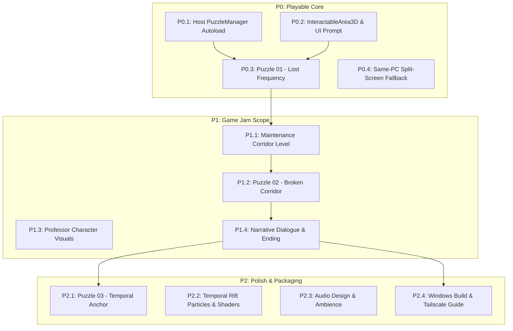

# 12 ROADMAP AND NEXT STEPS: Prioritized Task Backlog & Implementation Plan

This document outlines the engineering and design roadmap for taking **Past-Future** from its current prototype state to a complete, winning Game Jam submission for the **Reboot CHECKPOINT Game Jam 2026**.

---

## 1. Priority Tiers Overview

- **P0: Critical Playable Prototype**: The minimal set of features required to transform the current greybox sandbox into a functioning, verifiable cooperative game.
- **P1: Game Jam Submission Scope**: Content, assets, and level design required for a polished Chapter 0 demo submission.
- **P2: Polish & Extended Experience**: Audio, particle effects, countdown puzzles, and export packaging.



---

## 2. P0: Critical Prototype Tasks (Immediate Focus)

### Task P0.1: Host-Authoritative `PuzzleManager` Autoload
- **Description**: Implement `scripts/puzzles/puzzle_manager.gd` as an Autoload singleton. The host (Peer 1) owns the authoritative state dictionary. Clients submit action requests via reliable RPC; the host validates player roles, prerequisites, and parameters, mutates canonical state, and broadcasts state revisions to all peers.
- **Relevant Files**:
  - `scripts/puzzles/puzzle_manager.gd` (New)
  - `project.godot` (Register Autoload)
  - `scripts/network/network_manager.gd` (Coordinate session resets)
- **Dependencies**: `NetworkManager`
- **Estimated Difficulty**: **Medium**
- **Acceptance Criteria**:
  1. Central state dictionary tracks puzzle IDs, completion flags, and revision counter.
  2. Client calls `request_action(puzzle_id, action, payload)` via RPC to host (Peer 1).
  3. Host validates sender ID, confirms role matches action permissions, increments revision, and calls `apply_puzzle_state.rpc(puzzle_id, new_state, revision)`.
  4. Client updates local visual world only upon receiving confirmed state from host (no optimistic mutations).
  5. Full state snapshot sent to joining client upon session start.

---

### Task P0.2: Proximity Interaction System (`InteractableArea3D` & HUD Prompt)
- **Description**: Replace hardcoded keyboard animation triggers with a proper spatial interaction detector. Interactive objects define an `Area3D` footprint with collision layer 4. The player character has an interaction raycast or detection sphere that identifies the nearest interactable and displays a contextual HUD prompt (e.g. `[F] Calibrate Console`).
- **Relevant Files**:
  - `scripts/interaction/interactable_3d.gd` (New)
  - `scripts/characters/student_3d_player.gd` (Add interaction detection)
  - `scenes/world/spawn_area.tscn` (Add HUD prompt widget)
  - `project.godot` (Add `interact` action to Input Map)
- **Dependencies**: None
- **Estimated Difficulty**: **Low / Medium**
- **Acceptance Criteria**:
  1. Walking within $1.5\text{ m}$ of an interactable displays a floating or HUD prompt with customized action text.
  2. Pressing `F` triggers the interaction and plays `Interact` animation.
  3. Walking away hides the prompt.
  4. Movement is cleanly locked during interaction and restored upon completion.

---

### Task P0.3: Puzzle 01 Implementation ("Lost Frequency" in Signal Lab)
- **Description**: Connect the `Console` prop in `spawn_area.tscn` to `PuzzleManager`. In the Past, the student must tune three frequency dials. In the Future, the professor inspects a surviving terminal log to read the target frequency sequence (e.g. `142.8`). When entered in the past, the communication array stabilizes, opening the exit door.
- **Relevant Files**:
  - `scenes/props/console_visual.tscn`
  - `scenes/puzzles/frequency_puzzle_ui.tscn` (New UI popup)
  - `scripts/puzzles/frequency_puzzle.gd` (New)
  - `scenes/world/spawn_area.tscn` (Add exit security door)
- **Dependencies**: Task P0.1, Task P0.2
- **Estimated Difficulty**: **Medium**
- **Acceptance Criteria**:
  1. Future player approaches damaged console, presses `F`, and views a readable transmission log showing the required frequency code.
  2. Past player approaches active console, presses `F`, opens the tuning UI, and enters the frequency.
  3. Host validates the input. When correct, both players see the signal LEDs turn green.
  4. The security door in the North wall animates open in both timelines.

---

### Task P0.4: Same-PC Split-Screen Fallback Mode
- **Description**: Implement the offline split-screen mode for two players on one computer. Enables the "SAME-PC SPLIT-SCREEN" button on the main menu. Spawns two side-by-side `SubViewportContainer` nodes: Left viewport displays Past world (WASD + F controls); Right viewport displays Future world (Arrow keys + Enter controls). Both route actions to the local `PuzzleManager`.
- **Relevant Files**:
  - `scenes/menu/main_menu.tscn` (Enable button)
  - `scenes/world/split_screen_game.tscn` (New)
  - `scripts/world/split_screen_game.gd` (New)
  - `project.godot` (Configure Player 2 input actions)
- **Dependencies**: Task P0.1, Task P0.3
- **Estimated Difficulty**: **Medium / High**
- **Acceptance Criteria**:
  1. Clicking "SAME-PC SPLIT-SCREEN" launches directly without network connectivity.
  2. Left screen displays Student (Past) with independent camera; Right screen displays Professor (Future).
  3. Both players can move and interact simultaneously without input ghosting or focus loss.
  4. Solving Puzzle 01 updates both viewports in sync.

---

## 3. P1: Game Jam Submission Tasks

### Task P1.1: Maintenance Corridor Level Layout (Room B)
- **Description**: Build the second playable room: a long university corridor connecting the Signal Lab to the Temporal Core. Includes doorway transition triggers between rooms.
- **Relevant Files**: `scenes/rooms/corridor.tscn` (New)
- **Difficulty**: **Medium**

### Task P1.2: Puzzle 02 Implementation ("Broken Corridor")
- **Description**: In the Past, the corridor contains 3 adjustable hydraulic ceiling supports. In the Future, the ceiling has collapsed into an impassable chasm. The Future player reads an architectural stress blueprint showing the correct support configuration. When the Past player adjusts the supports, the collapsed slab in the Future shifts into a walkable ramp.
- **Relevant Files**: `scripts/puzzles/corridor_puzzle.gd` (New)
- **Difficulty**: **Medium / High**

### Task P1.3: The Professor Character Visual Differentiation
- **Description**: Create a visually distinct mesh for the 49-year-old Professor sharing the KayKit skeleton. Add formal coat geometry, mature facial features, and subtle grey hair highlights.
- **Relevant Files**: `tools/build_professor_kaykit.py`, `scenes/characters/professor_3d_player.tscn`
- **Difficulty**: **Medium**

### Task P1.4: Narrative Dialogue & Cliffhanger Ending
- **Description**: Implement an atmospheric dialogue overlay for character communication. Add the ending sequence in the Temporal Core where the recovered log reveals the Professor caused the collapse.
- **Relevant Files**: `scenes/ui/dialogue_overlay.tscn`, `scripts/ui/dialogue_overlay.gd`
- **Difficulty**: **Low / Medium**

---

## 4. P2: Polish & Extended Experience

- **Task P2.1: Puzzle 03 ("Temporal Anchor")**: Climax stabilization sequence in the Temporal Core with an optional 90-second countdown.
- **Task P2.2: Temporal Fracture VFX**: Add `GPUParticles3D` energy streams and subtle screen distortion around the temporal rifts.
- **Task P2.3: Atmospheric Audio & Ambience**: Add warm hum and distant campus tones for Past; cold wind and electrical buzz for Future. Add temporal chime for puzzle solves.
- **Task P2.4: Windows Export & Tailscale Documentation Package**: Configure `export_presets.cfg` for Windows x86_64 and package a 1-page PDF setup guide for judges.

---

## 5. The Single Best Immediate Next Action

```text
================================================================================
>>> RECOMMENDED IMMEDIATE ACTION: IMPLEMENT TASK P0.1 (PUZZLE MANAGER AUTOLOAD)
================================================================================
Create `scripts/puzzles/puzzle_manager.gd` and register it in `project.godot`.
Establish the central host-authoritative state dictionary and the
`request_action(id, action, payload)` -> `apply_puzzle_state(id, state, rev)`
RPC synchronization pipeline.

WHY THIS FIRST?
Without this authority foundation, any UI, interaction, or puzzle trigger
built today would have to be completely rewritten to work over LAN networking.
Establishing the state replication contract unlocks all subsequent puzzle work.
================================================================================
```

