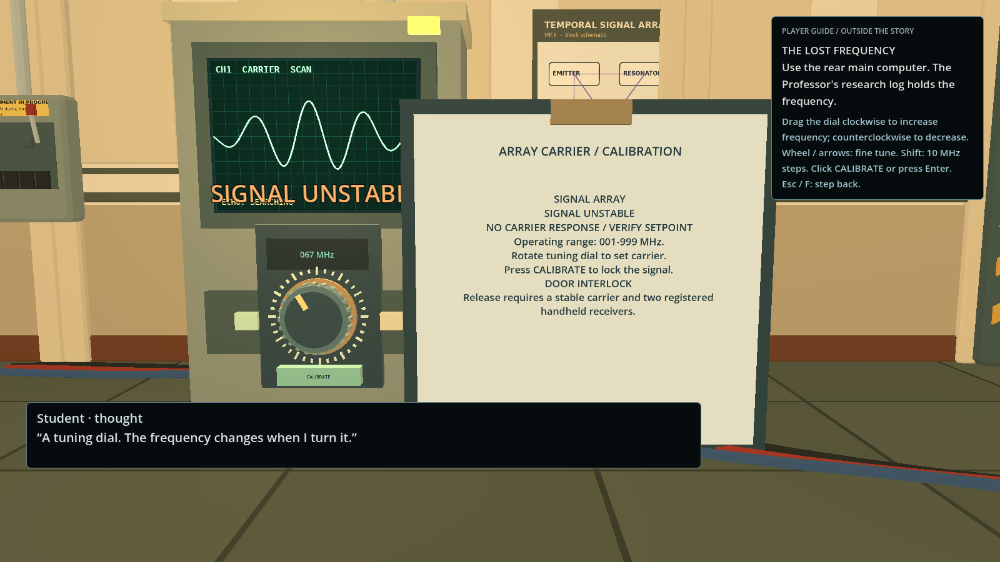
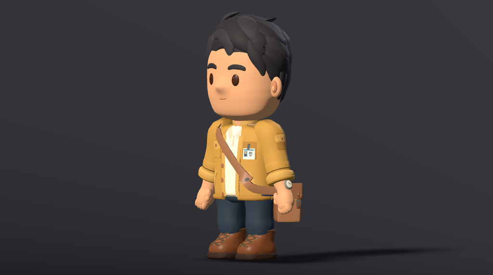
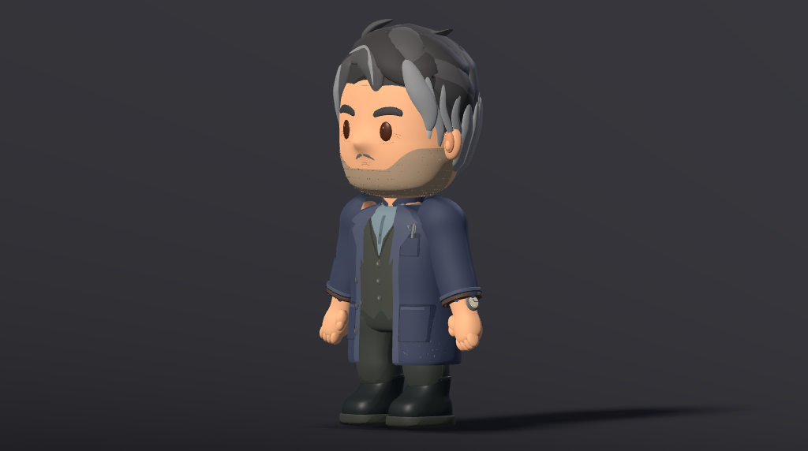
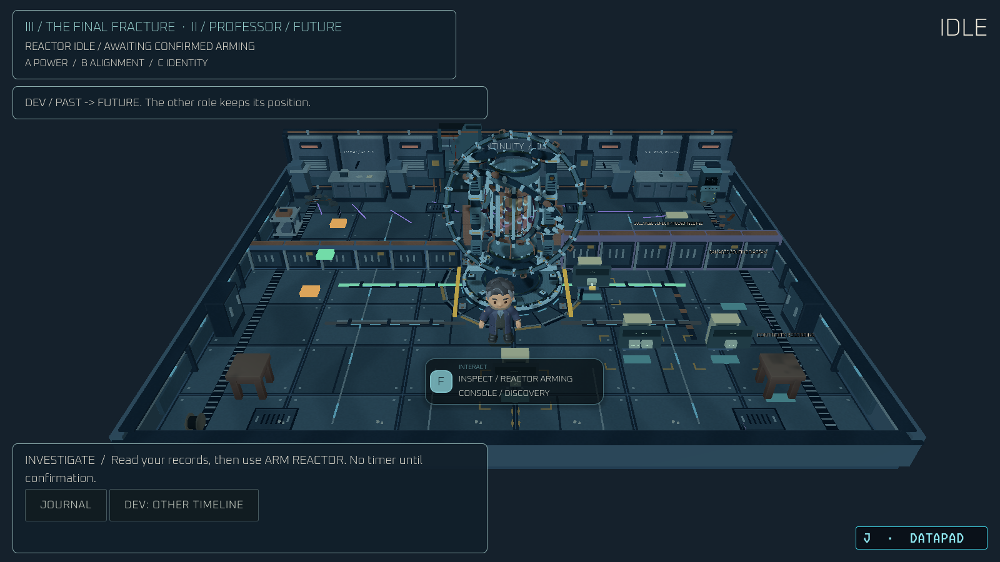
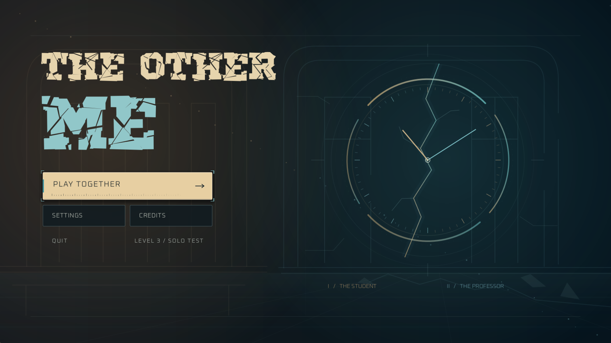

# Past-Future

[](https://godotengine.org)
[](https://microsoft.com/windows)
[-green>)](assets/third_party/kaykit_character_animations/License.txt)
[](https://itch.io)

An asymmetric cooperative mystery and puzzle adventure developed in **Godot 4.7.2** for the **Reboot CHECKPOINT Game Jam 2026**, built around the theme **"TWO"**.

Two players control different temporal versions of the exact same individual, separated by an irrevocable gap of **31 years**:

- **The Student (Age 18)**: Conducting research in an intact university laboratory in the **Past**.
- **The Professor (Age 49)**: Standing in the catastrophic, decayed ruins of the same building in the **Future**.

The experimental temporal device has suffered a catastrophic fracture. But this was no accident—the Professor deliberately activated the device and overrode safety containment. Cooperate across time, reshape the environment, and discover why your future self caused the collapse.

---


<h1 align="center">THE OTHER ME</h1>

<p align="center">
  <strong>Your only way forward is the person you become.</strong><br>
  Two lives. One facility. Thirty-one years apart.
</p>

<p align="center">
  
</p>

<p align="center">
  <strong>Asymmetric co-op · Sci-fi mystery · 3D puzzle adventure</strong><br>
  Windows PC · Godot 4.7.2 · Two-player LAN + solo exploration<br>
  Created for <strong>Reboot CHECKPOINT Game Jam 2026</strong> · Theme: <strong>TWO</strong>
</p>

<p align="center">
  <a href="#gameplay-screenshots">Screenshots</a> ·
  <a href="#explore-the-three-levels">The levels</a> ·
  <a href="#how-to-play">How to play</a> ·
  <a href="#installation-and-running">Run from source</a>
</p>

## About the Game

An impossible connection brings two versions of the same person together. In the Past, an 18-year-old Student explores a working university laboratory. Thirty-one years later, his older self, a 49-year-old Professor, searches its damaged remains.

An experimental device has fractured time. Each player sees a different side of the same facility: intact machinery and research notes in one era, broken equipment and surviving records in the other. Share what you find, test each other's theories, and watch changes in the Past reshape the Future.

**The Other Me** pairs exploration with hands-on puzzles and a mystery about trust, memory, and consequences. What you learn together—and what you choose to share—matters.

<sub>Developed under the name <strong>Past-Future</strong>; the repository and some technical documents retain that name.</sub>

## Gameplay Screenshots

<table>
  <tr>
    <td width="50%" align="center"><strong>PAST / The Student</strong></td>
    <td width="50%" align="center"><strong>FUTURE / The Professor</strong></td>
  </tr>
  <tr>
    <td></td>
    <td></td>
  </tr>
  <tr>
    <td align="center">Warm light, working instruments, a world still intact.</td>
    <td align="center">Cold blue shadows, damaged equipment, traces of what happened.</td>
  </tr>
</table>

<p align="center">
  <br>
  <em>Get close to the equipment. Your partner has information your instruments cannot provide.</em>
</p>

All images on this page are existing gameplay captures or character renders from the repository. Captures span development revisions, so HUD details may differ from the current build.

## Key Features

- **Two perspectives, one problem.** Cooperate as the Student and Professor, with different clues, equipment, and responsibilities.
- **Actions that cross time.** Restore power and adjust machinery in the Past to change the paths and systems available in the Future.
- **Hands-on 3D puzzles.** Inspect devices up close, turn tuning dials, operate switches, and work with physical mechanisms.
- **An investigation worth sharing.** Follow story dialogue and collect separate evidence in the Student's notebook and Professor's DataPad.
- **Three playable environments.** Explore the laboratory, maintenance corridor, and temporal research core, with cinematic room introductions.
- **Decisions with consequences.** Discover private choices and four possible narrative outcomes in The Final Fracture.
- **A changing soundscape.** Timeline-specific ambience, spatial machinery, and an adaptive score follow the reactor countdown.
- **Keyboard and gamepad input.** Xbox and DualSense mappings, contextual prompts, and vibration are implemented; some actions still require a keyboard or mouse.

## Meet the Characters

<table>
  <tr>
    <td width="50%" align="center"><strong>The Student — Past</strong></td>
    <td width="50%" align="center"><strong>The Professor — Future</strong></td>
  </tr>
  <tr>
    <td align="center"></td>
    <td align="center"></td>
  </tr>
  <tr>
    <td>Curious and close to the source. At 18, the Student has access to intact research equipment and service machinery. His notebook records observations; his actions can change what survives.</td>
    <td>Experienced and surrounded by consequences. At 49, the Professor works through damaged systems and recovered records. His DataPad holds clues that can guide his younger self.</td>
  </tr>
</table>

## Explore the Three Levels

<table>
  <tr>
    <td width="33%" align="center"><strong>01 / Signal Laboratory</strong></td>
    <td width="33%" align="center"><strong>02 / Maintenance Corridor</strong></td>
    <td width="33%" align="center"><strong>03 / The Final Fracture</strong></td>
  </tr>
  <tr>
    <td></td>
    <td></td>
    <td></td>
  </tr>
  <tr>
    <td align="center">Make first contact.</td>
    <td align="center">Change the route ahead.</td>
    <td align="center">Hold the fracture together.</td>
  </tr>
</table>

### Level 01 — Signal Laboratory

A familiar research room becomes the site of an impossible conversation. Find the radios, compare surviving records with working instruments, and tune a connection across time. Communication opens the way out.

### Level 02 — Maintenance Corridor

The facility's service systems have become an obstacle course. Coordinate power, emergency equipment, cargo handling, and structural supports across both eras. Explore the archive while weighing shortcuts against the evidence they could cost.

### Level 03 — The Final Fracture

At the temporal research core, investigation gives way to a **150-second reactor challenge**. Divide responsibilities, align equipment, and synchronize across timelines as the room grows unstable. The final decisions belong to both of you.

## How to Play

**Two-player LAN co-op** is implemented through the main menu's **PLAY TOGETHER** page. Each player uses a separate computer: the host is the Student in the Past; the joining player is the Professor in the Future. Talk in person or use a separate voice call to exchange clues. In-game radios deliver story dialogue; live voice chat is not implemented.

**Solo Exploration** starts in the laboratory. Press **T** to switch roles and **G** to toggle the other timeline's holographic echo. This is an offline way to explore and test both sides of the puzzles. **LEVEL 3 / SOLO TEST** starts an isolated finale session.

**Access every level:** open the pause menu with **Escape**, then choose **LEVEL SELECT**. The pause menu also offers restart and skip options. In a LAN session, the host controls level changes. The laboratory leads to the corridor, but the corridor currently ends with its own summary; use **LEVEL SELECT → Level 3** or **SKIP TO LEVEL 3** to reach the separate finale.

**Same-PC split-screen** is marked **COMING SOON** and disabled. Remote internet play through Tailscale is documented as an experimental route and still needs real cross-network validation. See [development status](#development-status) for verification limits.

<details>
<summary>View the title screen</summary>

<p align="center">
  
</p>

</details>

## Controls

Bindings below follow `project.godot` and the runtime input setup, including their current limitations.

| Action | Keyboard / mouse | Xbox | DualSense |
| --- | --- | --- | --- |
| Move / menu navigation | WASD / arrow keys | Left stick / D-pad | Left stick / D-pad |
| Sprint | Hold Shift | Left stick click (LS) | L3 |
| Interact | F | A | Cross |
| Inspect | I | X | Square |
| Use / pick up / put down item | E | Y | Triangle |
| Investigation journal | J | Keyboard J | Keyboard J |
| Mission Log | M | View | Create / touchpad click |
| Switch role in solo mode | T | Keyboard T | Keyboard T |
| Toggle solo temporal ghost | G | RB | R1 |
| Pause | Escape | Menu | Options |
| Back / cancel | Escape | B | Circle |
| Confirm menu / focused UI | Enter / left click | A | Cross |
| Physical device controls | Left click; drag / wheel to turn dials | See note below | See note below |

**Device inspection:** keyboard arrows adjust a laboratory dial; **Tab** switches between frequency and amplitude. The laboratory's physical inspector requires keyboard/mouse input; Level 3 also provides focusable device controls for gamepads. Use the on-screen prompts for context-specific actions. The journal and solo role switch currently have no dedicated gamepad binding.

## Installation and Running

### Run from source

Use **Godot 4.7.2-stable**, the version recorded in the setup documentation and confirmed by the local engine binary. The project declares Godot **4.7**, uses the **GL Compatibility** renderer, and enables **Jolt Physics**. Windows PC is the documented target; other platforms have not been validated in this README review.

```powershell
git clone https://github.com/hussainhht/Past-Future.git
cd Past-Future
```

1. Open Godot's Project Manager and choose **Import**.
2. Select this repository's **project.godot** and open the project.
3. Allow the initial asset import to finish, then press **F5** to run the main menu.
4. Choose **PLAY TOGETHER**, then **SOLO EXPLORATION** or a LAN option.

If the Godot executable is on your PATH, you can also launch from the repository root:

```powershell
godot --path .
```

The public GitHub releases list contained **no published releases** when checked on **22 October 2026**. Run from source; local export files and test builds are not presented here as verified public downloads.

### Host or join a LAN session

1. Put both computers on the same local network and run the same project revision.
2. **Host:** choose **PLAY TOGETHER → HOST ON WI-FI**. Share the local IP address displayed in the lobby.
3. **Guest:** choose **PLAY TOGETHER → JOIN ON WI-FI**, enter that address, then select **JOIN GAME**.
4. The guest selects **I'M READY**; the host selects **START GAME**.
5. Allow Godot/the game through the host's firewall for **UDP port 7000**. Guest Wi-Fi or client isolation may prevent the computers from reaching one another.

For developer scene launches, tests, and the experimental remote-network setup, see [Setup and Testing](PROJECT_CONTEXT/10_SETUP_AND_TESTING.md) and the [design document's multiplayer architecture](GAME_DESIGN_DOCUMENT.md#9-multiplayer-architecture). These documents contain puzzle and story spoilers; some older menu labels and controls have changed.

## Technology Stack

**Godot Engine 4.7.2 · GDScript · Jolt 3D Physics · ENet multiplayer over UDP**

Stylized 3D environments and animated characters use a fixed-angle perspective camera. Blender source files and Python asset tools are included for development; they are not required to run the game in Godot. System details live in the [architecture guide](PROJECT_CONTEXT/02_PROJECT_ARCHITECTURE.md).

## Development Status

The repository contains a **three-level playable prototype**: both timeline characters, cooperative puzzle rules, dialogue and journals, device inspection, room introductions, and four finale outcomes are implemented. Level selection and host-controlled navigation provide access to all three areas; the normal corridor-to-finale story transition is not connected.

- **Existing verification:** project reports record automated puzzle, scene, and ENet loopback checks. Those historical results are not a fresh full-game validation of this checkout.
- **Still unverified:** physical two-computer LAN play, remote Tailscale play, and cross-platform exports. Controller mappings exist, with the keyboard/mouse requirements listed above.
- **Remaining work:** same-PC split-screen, the normal finale transition, cross-device playtesting, and a verified public release package.

See [Development Progress](PROJECT_CONTEXT/08_DEVELOPMENT_PROGRESS.md) and [Known Issues](PROJECT_CONTEXT/09_BUGS_AND_TECHNICAL_DEBT.md) for engineering context. These historical reports include spoilers and may describe earlier revisions; this page follows the current menu and source.

## Credits and Acknowledgements

- **CHECKPOINT** — project credit in the game menu; created for **Reboot CHECKPOINT Game Jam 2026**, theme **TWO**.
- **Hussain Ali and Bader Alafoo** — contributors recorded in the repository's Git history.
- **Kay Lousberg** — KayKit Character Animations and Furniture Bits, **CC0**. See the [animation license](assets/third_party/kaykit_character_animations/License.txt), [Furniture Bits license](assets/third_party/kaykit_furniture_bits/LICENSE.txt), and [environment attribution](assets/environment/licenses/THIRD_PARTY_ATTRIBUTION.md).
- **Kenney, SpliceSound, Kinoton, BenjaminNelan, thegoose09, SketchMan3, and yd** — audio and music sources recorded in the [audio credits](docs/AUDIO_ASSET_CREDITS.md).
- **SRG774 and bart**, alongside reused Kenney and ambience assets — sources for the later levels' sound design and reactor score; see [Level 2 and Level 3 audio credits](docs/LEVEL2_LEVEL3_AUDIO.md).
- **Font creators and open-source type projects** — bundled families and their individual terms are listed in the [font credits](assets/fonts/README.md), including the [Broken font notice](assets/fonts/licenses/Broken-NOTICE.txt).

Third-party licenses apply to their respective assets. The repository currently has no project-wide license file; the CC0 asset licenses do not license the entire game.

---

<p align="center">
  <strong>THE OTHER ME</strong><br>
  Chapter 0 — The First Fracture<br><br>
  <a href="PROJECT_CONTEXT/00_START_HERE.md">Developer documentation</a> ·
  <a href="GAME_DESIGN_DOCUMENT.md">Game design document (spoilers)</a> ·
  <a href="https://github.com/hussainhht/Past-Future/issues">Report an issue</a>
</p>
