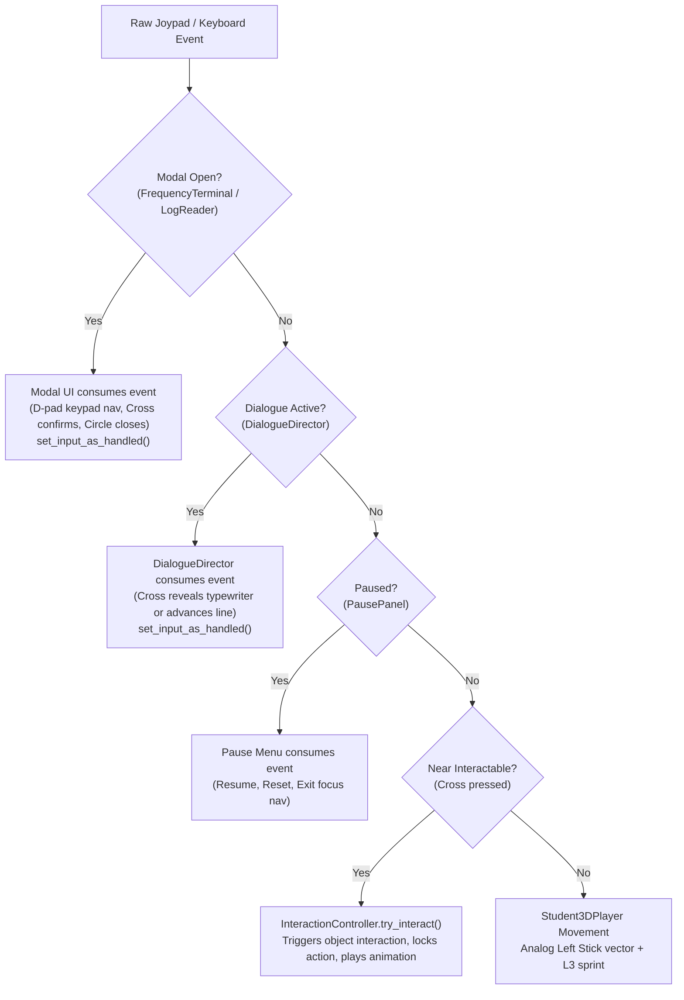

# PAST-FUTURE — PlayStation 5 DualSense Controller Support

This document details the architecture, configuration, button mappings, UI focus flows, puzzle interactions, and developer extension guides for PlayStation 5 DualSense controller support in **Past-Future** (Godot 4.7.2, typed GDScript 2.0).

---

## 1. Architecture Overview

Controller support is built directly on Godot 4 native `InputMap`, `InputEventJoypadButton`, and `InputEventJoypadMotion` APIs without requiring external controller emulation software (such as DS4Windows or Steam Input). Both Keyboard/Mouse and DualSense controllers function concurrently and seamlessly.

### Core Architecture Components

```
+-----------------------------------------------------------------------------------+
|                                Godot Engine 4.7.2                                 |
|      Input (OS events)  ·  InputMap  ·  Control Focus  ·  Vibration APIs          |
+-----------------------------------------------------------------------------------+
                                          |
                                          v
+-----------------------------------------------------------------------------------+
|                        InputManager (`scripts/input/input_manager.gd`)            |
|  - Standard action registration (move_*, interact, inspect, sprint, pause, etc.)  |
|  - Active device modality tracking (KEYBOARD vs CONTROLLER)                       |
|  - Controller brand detection (DualSense / Xbox / Generic)                        |
|  - Noise-filtered analog stick switching (>0.35 threshold)                        |
|  - Dynamic button prompt generation (✕ / □ / △ / ○ vs F / I / E / Esc)            |
|  - Device assignment and ownership abstraction (per-player IDs)                   |
|  - Haptic feedback & rumble management                                            |
+-----------------------------------------------------------------------------------+
       |                            |                           |
       v                            v                           v
+------------------+     +--------------------+     +------------------------+
| Character System |     | Interaction System |     | UI & Modal Systems     |
| Student3DPlayer  |     | InteractionPrompt  |     | Frequency Terminal     |
| - Left stick vec |     | - Dynamic badge:   |     | - On-screen Keypad     |
| - L3 sprint      |     |   `[F]` <-> `[✕]`  |     | - Focus navigation     |
| - Rot & anim     |     | InteractionRig     |     | Main & Pause Menus     |
|                  |     | InteractionContr.  |     | DialogueDirector       |
+------------------+     +--------------------+     +------------------------+
```

---

## 2. Controller Button Mapping

Godot standardizes gamepads across platforms using standardized button constants. On a PlayStation 5 DualSense connected to Windows (USB or Bluetooth), the physical buttons map as follows:

| PS5 Physical Control | Godot Constant | Gameplay Action | Keyboard Equivalent |
|---|---|---|---|
| **Left Stick** | `JOY_AXIS_LEFT_X`, `JOY_AXIS_LEFT_Y` | 360° Analog Movement | `W`, `A`, `S`, `D` / Arrow Keys |
| **L3 (Left Stick Click)** | `JOY_BUTTON_LEFT_STICK` (7) | Sprint / Run | `Left Shift` |
| **Cross (✕)** | `JOY_BUTTON_A` (0) | Interact / Confirm / Advance Dialogue | `F` / `Enter` / Left Click |
| **Square (□)** | `JOY_BUTTON_X` (2) | Inspect Object / Read Document | `I` |
| **Triangle (△)** | `JOY_BUTTON_Y` (3) | Pick Up / Put Down / Use Item | `E` |
| **Circle (○)** | `JOY_BUTTON_B` (1) | Back / Cancel / Close Modal / Cancel Ready | `Escape` |
| **D-Pad (↑ ↓ ← →)** | `JOY_BUTTON_DPAD_*` (11–14) | UI Focus Navigation / Digital Movement | Arrow Keys |
| **Options** | `JOY_BUTTON_START` (6) | Pause / Resume Game | `Escape` |
| **Right Stick** | `JOY_AXIS_RIGHT_*` | *Unused (camera is fixed 35° perspective)* | *None* |

> [!NOTE]
> The right stick deliberately does not rotate the camera. Past-Future uses a fixed 35-degree downward perspective designed for temporal observation.

---

## 3. Godot InputMap Configuration

The following actions are configured in `project.godot` and verified at runtime by `InputManager.setup_standard_actions()`:

```ini
[input]
move_left:  Key A, Left Arrow, Joypad Axis 0 (-) [Left Stick Left], Joypad Button 13 [D-Pad Left] (deadzone: 0.20)
move_right: Key D, Right Arrow, Joypad Axis 0 (+) [Left Stick Right], Joypad Button 14 [D-Pad Right] (deadzone: 0.20)
move_up:    Key W, Up Arrow, Joypad Axis 1 (-) [Left Stick Up], Joypad Button 11 [D-Pad Up] (deadzone: 0.20)
move_down:  Key S, Down Arrow, Joypad Axis 1 (+) [Left Stick Down], Joypad Button 12 [D-Pad Down] (deadzone: 0.20)
interact:   Key F, Joypad Button 0 [Cross ✕] (deadzone: 0.20)
inspect:    Key I, Joypad Button 2 [Square □] (deadzone: 0.20)
use_item:   Key E, Joypad Button 3 [Triangle △] (deadzone: 0.20)
sprint:     Key Shift, Joypad Button 7 [L3] (deadzone: 0.20)
cancel:     Key Escape, Joypad Button 1 [Circle ○] (deadzone: 0.20)
pause:      Key Escape, Joypad Button 6 [Options] (deadzone: 0.20)
ui_accept:  Key Enter, Key Space, Joypad Button 0 [Cross ✕]
ui_cancel:  Key Escape, Joypad Button 1 [Circle ○]
```

---

## 4. Input Context and Priority Policy

To prevent a single button press from triggering conflicting actions (such as advancing dialogue while interacting with an object behind it), input consumption follows strict priority ordering:



1. **Modal Interface / Terminal**: Has highest priority. Locks character body controls (`controls_enabled = false`) and blocks detector prompts (`set_interaction_blocked(true)`). Consumes `ui_cancel` (Circle) to close.
2. **Dialogue System**: When a conversation is active, `DialogueDirector._unhandled_input()` handles `ui_accept` (Cross). It finishes the typewriter reveal first, then advances to the next line, calling `viewport.set_input_as_handled()`. Background interactions are not triggered.
3. **Menu / Pause**: Options or Circle toggles pause. When paused, `%ResumeButton` automatically grabs focus.
4. **Gameplay Interactions**: Handled via `Student3DPlayer._unhandled_input()`. Pressing Cross verifies that `InteractionController.is_interaction_available()` is true, executes `try_interact()`, triggers haptic vibration, and marks input handled.
5. **Gameplay Locomotion**: Read during `_physics_process()` using `Input.get_vector()` with analog magnitude scaling and rotation steering.

---

## 5. Movement & Analog Integration

`scripts/characters/student_3d_player.gd` extends the existing movement system:

- **Analog Steering**: Uses `Input.get_vector("move_left", "move_right", "move_up", "move_down")`. Preserves the exact length of the analog vector (0.0 to 1.0) so tilting the stick slightly produces slow, gradual walking.
- **Deadzone**: Standardized to `0.20`. Small joystick noise around the center produces zero velocity, preventing stick drift.
- **Sprint**: Controlled by `Input.is_action_pressed("sprint")` (L3) or keyboard `Shift`. Sprinting does not toggle or stick; releasing L3 returns movement immediately to standard walk speed.
- **Footsteps & Animation**: Footstep audio emitters and animation transitions (`Idle_A`, `Walking_A`, `Running_A`) remain driven by true ground velocity length.

---

## 6. Frequency Terminal (67 MHz Puzzle)

Entering the required calibration frequency (**67 MHz**) is fully accessible via controller without needing a keyboard:

1. **Approaching & Opening**:
   - The player approaches the central laboratory console.
   - The prompt displays `[✕] Use Computer`.
   - Pressing **Cross (✕)** opens the terminal modal.
2. **On-Screen Keypad Grid**:
   - An accessible 3x4 focusable numeric keypad grid (`1` to `9`, `⌫`, `0`, `CLR`) is integrated into the terminal UI.
   - When opened with a controller, focus automatically lands on button `[1]`.
   - Players navigate with D-Pad or Left Stick to `[6]`, press **Cross (✕)**. The input field displays `"6"`.
   - Players navigate to `[7]`, press **Cross (✕)**. The input field displays `"67"`.
3. **Calibration Confirmation**:
   - Navigating down focuses the `CALIBRATE SIGNAL` button.
   - Pressing **Cross (✕)** triggers `submit_frequency()`.
   - Authoritative validation by `PuzzleManager` confirms 67 MHz.
   - Status updates to `TEMPORAL RADIO LINK ESTABLISHED` or `SIGNAL LOCKED`, and low-intensity rumble triggers.
4. **Closing & Restoring Controls**:
   - Pressing **Circle (○)** or navigating to `CLOSE [○]` closes the terminal.
   - Character movement and gameplay interactions are restored immediately.

---

## 7. Dynamic Prompts & Automatic Device Detection

`scripts/input/input_manager.gd` listens for user input events continuously:

- When keyboard or mouse input is detected, active device switches to `KEYBOARD`. Prompts display `[F] Interact`, `[Esc] Back`, etc.
- When any joypad button or analog stick deflection exceeding `0.35` is detected, active device switches to `CONTROLLER`.
- Prompts dynamically update without reopening menus or restarting the game:
  - If a Sony / DualSense controller is detected: prompts display PS5 icons (`✕`, `□`, `△`, `○`, `L3`, `Options`).
  - If an Xbox or generic controller is detected: prompts display standard ABXY labels (`A`, `X`, `Y`, `B`, `LS`, `Menu`).

---

## 8. Level Flow & Transition Integration

GameFlowManager transitions function cleanly with DualSense:

- **Exits**: Approaching room exit boundaries triggers `[✕] Proceed to Next Area`.
- **Readiness**: Pressing **Cross (✕)** marks the player ready (`GameFlowManager.request_transition()`).
- **Cancellation**: Pressing **Circle (○)** while ready cancels readiness (`GameFlowManager.cancel_transition_request()`).
- **Transition Input Lock**: During fade-out, asset loading, and fade-in, `GameFlowManager._set_input_locked(true)` holds player velocity and ignores button inputs.
- **Input Restoration**: Once the transition commits and fade-in finishes, `_set_input_locked(false)` restores full controller input.
- **Role Authority**: Multiplayer host (Student / Past) and client (Professor / Future) authority rules are strictly preserved.

---

## 9. Optional Haptic Feedback

Low-intensity controller rumble is supported via Godot's native `Input.start_joy_vibration()` API:

- `&"interaction"`: Short 0.1s gentle tap (weak motor 0.15).
- `&"radio_connect"`: 0.4s resonant pulse (weak 0.35, strong 0.5) when temporal link is established.
- `&"puzzle_complete"`: 0.5s confirmation burst (weak 0.4, strong 0.65).
- `&"narrative_event"`: 0.3s subtle rumble (weak 0.25, strong 0.35).

Haptics are non-blocking, safe across all driver configurations, and respect `InputManager.haptics_enabled`.

---

## 10. Verification Sandbox & Automated Tests

### Standalone Test Sandbox
- **Scene**: `scenes/testing/controller_sandbox.tscn`
- **Script**: `scripts/testing/controller_sandbox.gd`

Features:
- Live controller diagnostic HUD (Active device, Controller model, Analog stick vector magnitude, Sprint state, Connection banner).
- Real `Student3DPlayer` instance with KayKit Rig_Medium animations.
- Interactive terminal prop, `FrequencyTerminalUI`, dialogue director, and pause menu.
- Visual connection/disconnection notifications.

### Automated Test Suite
- **Script**: `tests/controller_system.gd`
- **Runner**: `python tests/run_controller_tests.py`

Covers all 20 required specifications:
1. InputMap action registration.
2. Keyboard bindings preserved.
3. Joypad buttons mapped correctly.
4. Left-stick axis mapping.
5. Deadzone behavior.
6. Movement input.
7. Sprint input.
8. Interaction input.
9. One interaction per press.
10. Input-mode switching.
11. Menu focus behavior.
12. Pause navigation.
13. Dialogue input.
14. Terminal frequency input.
15. Modal input blocking.
16. Controller disconnection.
17. Controller reconnection.
18. Level transition input recovery.
19. Host/client role preservation.
20. Existing gameplay regression tests.

---

## 11. Manual DualSense Physical Testing Checklist

When connecting physical DualSense hardware on Windows:

- [ ] Connect DualSense via USB-C cable or Windows Bluetooth Settings ("Wireless Controller").
- [ ] Launch `res://scenes/testing/controller_sandbox.tscn` or `main_menu.tscn`.
- [ ] Observe device banner: confirms "Active Device: CONTROLLER (SONY PS5 DUALSENSE)".
- [ ] Tilt Left Stick in a full circle: verify smooth 360° locomotion and character orientation.
- [ ] Tilt Left Stick slightly (<0.20): verify character remains stationary with no drift.
- [ ] Click L3 while moving: verify character transitions from walk to run (`Running_A`).
- [ ] Approach the terminal prop: verify prompt changes dynamically to `[✕] Use Frequency Terminal`.
- [ ] Press Cross (✕): verify terminal modal opens and focus begins on keypad `[1]`.
- [ ] Use D-pad to navigate to `[6]`, press Cross (✕), navigate to `[7]`, press Cross (✕): verify input reads `"67"`.
- [ ] Navigate down to `CALIBRATE SIGNAL`, press Cross (✕): verify signal locked and haptic vibration triggers.
- [ ] Press Circle (○): verify terminal closes and gameplay controls recover.
- [ ] Press Options: verify pause menu opens and `Resume` button is focused.
- [ ] Press Circle (○) or Options: verify pause menu closes and gameplay resumes.
- [ ] Click "Test Dialogue": verify Cross (✕) reveals typewriter text, then advances conversation.
- [ ] Unplug USB cable: verify banner reports controller disconnection and prompts fall back to keyboard `[F]`.
- [ ] Replug USB cable: verify controller reconnects and prompts switch back to `[✕]`.

---

## 12. Known Limitations & Future Split-Screen Support

1. **Text IP Entry in LAN Menu**: Direct free-form text editing of custom remote IP addresses is handled through the standard Godot LineEdit. On Windows PC, typing a numeric IPv4 address is most convenient with physical keyboard input.
2. **Split-Screen Extensibility**: `InputManager` provides `set_player_device(player_index, device_id)` and `is_event_for_player(event, player_index)`. While current gameplay is networked (1 local player per instance), the component architecture allows assigning separate controller IDs to Player 0 and Player 1 for future local co-op.
3. **Advanced DualSense Console Features**: Features such as adaptive trigger resistance curves, touchpad gestures, integrated speaker streaming, and motion gyro are proprietary PlayStation console features not part of standard PC SDL/DirectInput joypad APIs; these are safely omitted in favor of universal PC driver compatibility.

