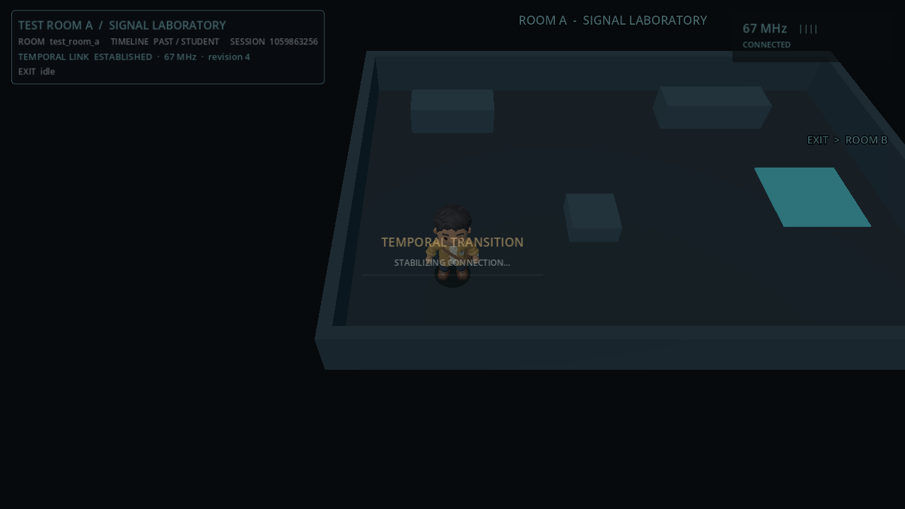
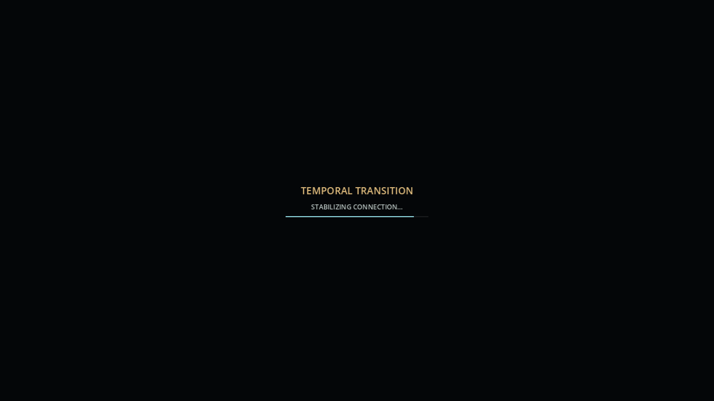
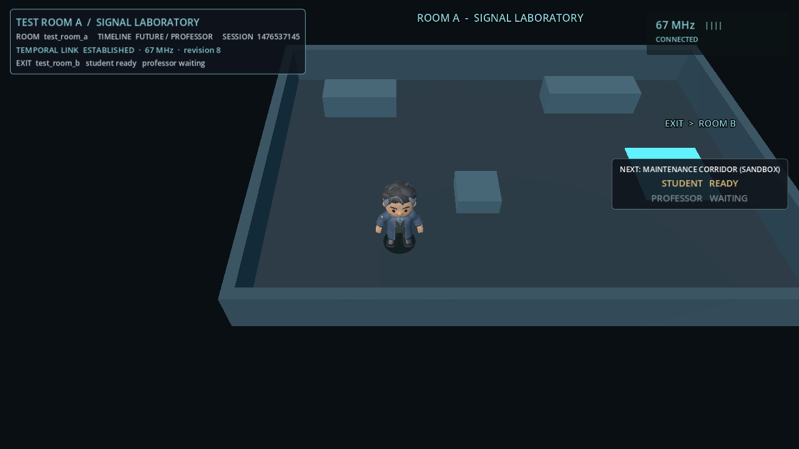
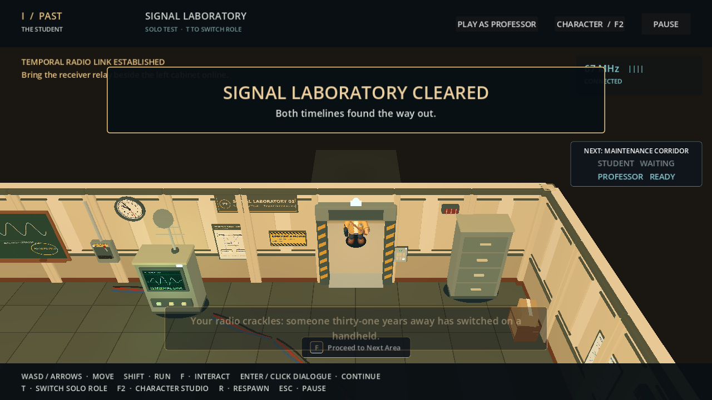
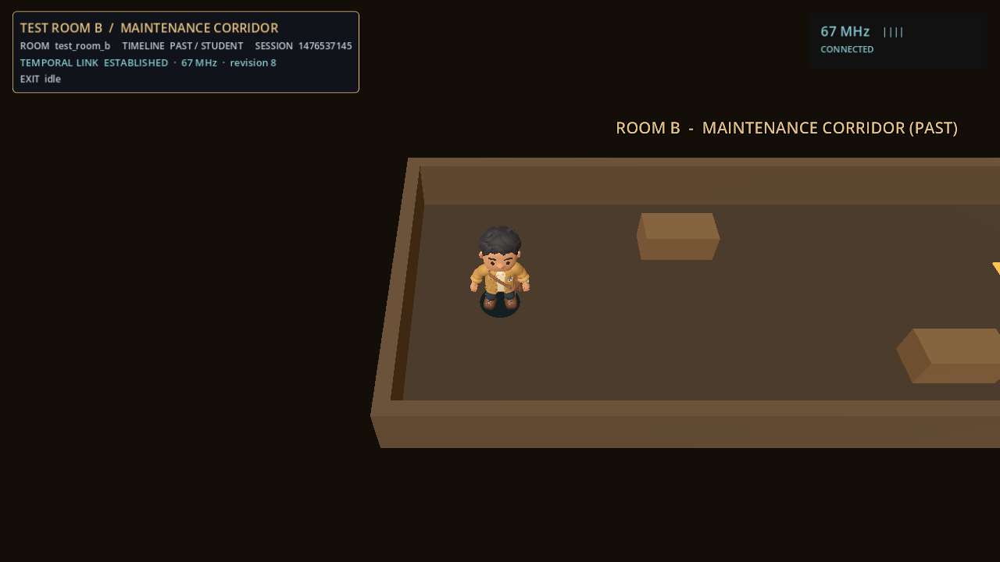
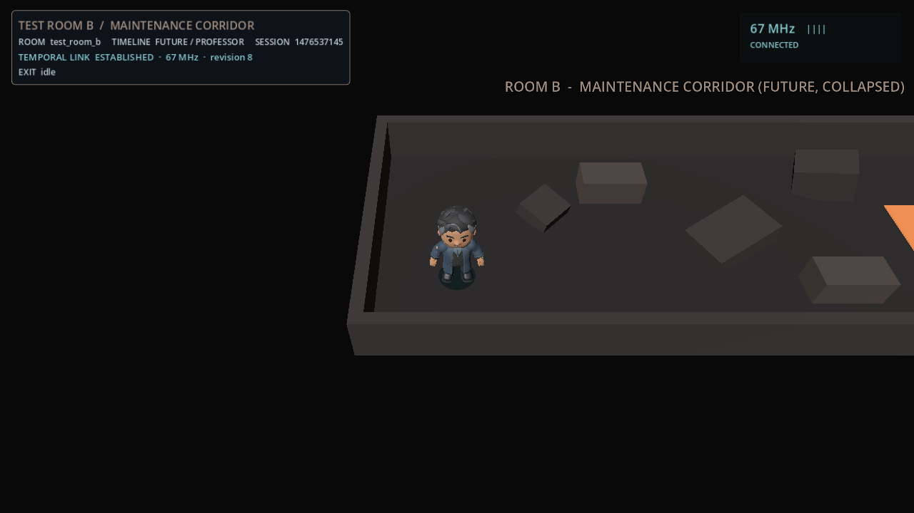

# Level Transition & Game Flow System

`GameFlowManager` (autoload) moves both players from one room to the next without touching the ENet
connection, the `PuzzleManager` session, puzzle progress, radio ownership or the Past/Future roles.
Rooms are described by `RoomDefinition` resources; adding a level is a `.tres` plus its scenes.

Verified against the repository at the time of writing (Godot 4.7.2, GL Compatibility). Where this
document and an older document disagree, the code wins.

## 1. What it guarantees

| Guarantee | Where it is enforced |
|---|---|
| Only the host (Student, Past) starts a transition. The guest can only say "I am ready to go to X". | `_rpc_set_ready` is the guest's only entry; every begin/commit/abort is `authority`-mode. |
| The guest cannot make anyone load a path. Only room IDs cross the network, resolved against each peer's own registry. | Messages carry `String` IDs; `register_room` is local and validates paths. |
| Roles come from the connection, never from a payload. | `_from_guest()` / `_from_host()` use `get_remote_sender_id()` and `NetworkManager`. |
| The session is never restarted. | Transitions never call `NetworkManager.start_game()` or `PuzzleManager.begin_session()`. Tests assert the session ID, revision and ENet peer object are unchanged. |
| Stale or duplicate messages are ignored. | Every RPC carries the session ID; transition IDs only rise (`_highest_tid`); duplicate acks are dropped. |
| One transition at a time, no duplicate completion. | `_phase`, `_tid`, `_committed`; the host also waits for the guest's `finished` before the next begin. |
| A failure never leaves the screen black or input locked, and never resets progress. | Section 9. |

## 2. Files

```text
scripts/game_flow/
  game_flow_manager.gd         autoload "GameFlowManager": registry, readiness, protocol, loading, lock
  room_definition.gd           class RoomDefinition (Resource)
  level_exit_interactable.gd   class LevelExitInteractable (an Interactable3D)
  transition_overlay.gd        class TransitionOverlay (CanvasLayer): fade, loading text, readiness panel, notices
scenes/game_flow/transition_overlay.tscn
resources/levels/room_01.tres                      production: the Signal Laboratory
resources/levels/test/test_room_a.tres, test_room_b.tres   sandbox rooms (not auto-registered)
scenes/testing/transition_flow_sandbox.tscn        launcher
scenes/testing/transition_room_a.tscn              Room A, shared by both timelines
scenes/testing/transition_room_b.tscn              Room B, Past version
scenes/testing/transition_room_b_future.tscn       Room B, Future version (collapsed)
scripts/testing/transition_room.gd, transition_flow_sandbox.gd
tests/game_flow_system.gd, game_flow_peer.gd, game_flow_render.gd
tests/run_game_flow_tests.py, run_game_flow_render.py
tests/fixtures/never_ready_room.{tscn,gd}, dialogue_stub.gd
```

The "level transition controller" is part of `GameFlowManager`; a separate class would only have
forwarded calls.

## 3. Ownership of the current room

`GameFlowManager` owns *which room is current*. `get_current_room_id()` returns the ID while the room's
scene node is alive and in the tree, and `""` otherwise (menu, loading, a scene replaced behind its
back). Three things set it:

* a transition (`_swap_in`),
* `GameFlowManager.start_room("test_room_a")`, for the first room of a session (no fade, no network),
* `GameFlowManager.attach_room("room_01", self)`, for a scene entered outside the manager. The Signal
  Laboratory calls this from `_ready()` because the menu loads it with `change_scene_to_file`.

Canonical state is never stored in a room. `PuzzleManager` keeps puzzle state, `NetworkManager` keeps the
session and roles; rooms and their presenters (for example `TemporalRadio`) are re-created on every
entry and read the confirmed state in `_ready()`.

## 4. `RoomDefinition`

```gdscript
extends Resource
class_name RoomDefinition
```

| Field | Meaning |
|---|---|
| `room_id` | Unique stable ID, at most 64 characters. The only thing sent over the network. |
| `display_name` | Shown in the readiness panel ("NEXT: ..."). |
| `shared_scene` | One scene for both timelines (it switches presentation by role). |
| `past_scene` / `future_scene` | A timeline's own scene. It overrides `shared_scene` for that timeline. |
| `past_spawn_id` / `future_spawn_id` | Name of the `Marker3D` where that timeline enters. Default `past_entry` / `future_entry`. |
| `next_room_id` | The room reached by this room's main exit. |
| `allowed_exits` | Other rooms reachable from here without conditions, such as a way back. |
| `required_puzzles` | Puzzle IDs that must be solved before leaving through `next_room_id`. Return links are never gated. |
| `locked_message` | Shown when `required_puzzles` are not solved. |
| `require_both_ready` | Both players must confirm before leaving this room (default `true`). Offline only the local player is awaited. |

`required_puzzles` describes **leaving** the room through its main exit, so Room 01 says "you may not
leave until `puzzle_01_frequency` is solved". Different rooms can require different puzzles; nothing is
hard-coded.

`validate()` rejects: an empty or padded ID, a timeline with no scene, scene paths that are not `res://`
`.tscn`/`.scn`, `next_room_id` pointing at the room itself, and `required_puzzles` without a
`next_room_id`. `register_room()` also refuses a duplicate ID unless `replace = true`. File existence is
reported separately by `missing_scenes()` (a warning at registration, `scene_missing` when someone tries
to leave), so a room can be registered while its scene is still being built.

### Scene selection

`RoomDefinition.get_scene_path(role)` returns the timeline's scene, otherwise the shared one. Each peer
resolves it from **its own** role, `PuzzleManager.get_local_role()` (the connection's role in a LAN game,
`offline_role` in solo preview). Nothing from the network picks a scene.

### Spawn points

Put a `Marker3D` named after the spawn ID in the room, preferably in the group `spawn_point`
(the sandbox rooms do). The persistent manager never holds a path into a room:

```gdscript
var marker := GameFlowManager.find_spawn_point(GameFlowManager.get_entry_spawn_id(role), self)
player.position = marker.global_position   # character root Y = 0 on level ground
```

`find_spawn_point()` also works from the room's own `_ready()`, because the manager points at the new
room before it is added to the tree. The Signal Laboratory needs no change: `room_01.tres` names its
existing `SpawnPoint` as the entry for both timelines.

### The optional room interface

All of these are looked up by `has_method`; a room implements only what it needs.

| Method | Called | Use |
|---|---|---|
| `game_flow_suspend()` | On the old room when a transition starts (input lock taken). | Close modals and conversations. |
| `is_game_flow_ready() -> bool` | Polled after the room enters the tree. | Delay the "loaded" acknowledgement until the room has finished its own set-up (default: ready). |

## 5. Adding a room

1. Build the scene(s). Add `Marker3D` entry points and, where players leave, a `LevelExitInteractable`
   with a `CollisionShape3D` covering the exit zone.
2. Create `resources/levels/room_03.tres`:

```text
[gd_resource type="Resource" script_class="RoomDefinition" format=3]

[ext_resource type="Script" path="res://scripts/game_flow/room_definition.gd" id="1"]

[resource]
script = ExtResource("1")
room_id = "room_03"
display_name = "Control Room"
past_scene = "res://scenes/levels/room_03_past.tscn"
future_scene = "res://scenes/levels/room_03_future.tscn"
past_spawn_id = &"past_entry"
future_spawn_id = &"future_entry"
next_room_id = "room_04"
allowed_exits = PackedStringArray("room_02")
required_puzzles = PackedStringArray("puzzle_02_whatever")
locked_message = "The control room is still dark."
require_both_ready = true
```

3. Point the previous room at it (`next_room_id = "room_03"` in `room_02.tres`).

Every `.tres` directly inside `res://resources/levels/` is registered when the game starts
(`load_room_directory()`); exported builds are handled (`.tres.remap`). `GameFlowManager` is not edited.
Rooms can also be registered from code with `GameFlowManager.register_room(definition)` and removed with
`unregister_room()`.

## 6. Public API

```gdscript
# Registry
register_room(definition: RoomDefinition, replace := false) -> bool
load_room_directory(directory := "res://resources/levels") -> int
unregister_room(room_id) -> bool
has_room(room_id) -> bool
get_room(room_id) -> RoomDefinition
get_room_ids() -> PackedStringArray
get_room_display_name(room_id) -> String

# State
get_current_room_id() -> String            # "" when no room is current
get_current_room() -> RoomDefinition
get_current_room_node() -> Node
is_transitioning() -> bool
get_phase() -> GameFlowManager.Phase       # IDLE, FADING_OUT, LOADING, WAITING_FOR_PEERS, FADING_IN
get_transition_id() -> int
is_input_locked() -> bool

# Entering rooms
start_room(room_id) -> bool                # first room of a session; no fade, no network
attach_room(room_id, node) -> bool         # a scene entered outside the manager
get_entry_spawn_id(role := "") -> StringName
find_spawn_point(spawn_id, scene_root = null) -> Marker3D

# Rules and requests
get_block_reason(room_id) -> String        # "" or a reason code
can_enter_room(room_id) -> bool
get_missing_puzzles(room_id) -> PackedStringArray
get_reason_message(reason) -> String
request_transition(room_id) -> String      # "I am ready to go"; "" when accepted, else a reason
cancel_transition_request() -> void
is_local_ready(destination := "") -> bool
get_readiness() -> Dictionary              # {"destination", "past", "future"}
begin_transition(room_id) -> String        # host/offline only: skip readiness (narrative events)
abort_transition(reason := "cancelled") -> bool   # host/offline only, before the commit
add_ready_blocker(id, check: Callable) / remove_ready_blocker(id)
```

Reason codes: `busy`, `partner_busy`, `unknown_room`, `not_adjacent`, `puzzle_incomplete`, `no_partner`,
`no_session`, `no_current_room`, `scene_missing`, `not_authority`, `blocked`.

### Signals

```gdscript
transition_requested(from_room, to_room)       # someone is ready to leave (first ready player)
readiness_changed(destination, past_ready, future_ready)
request_rejected(destination, reason, message) # message is a player-facing sentence
transition_started(from_room, to_room)         # the host authorised it; this peer began leaving
transition_progress_changed(progress)          # 0..1
room_unloading(room_id)                        # old room about to be removed
room_loading(room_id)                          # black screen is up, scene is loading
room_changed(room_id)                          # new room is in the tree, hidden and locked
transition_completed(room_id)                  # committed, faded in, controls back
transition_failed(reason)                      # cancelled and restored, or ended safely
phase_changed(phase)
input_lock_changed(locked)
```

Do not start or cancel a transition from `phase_changed`; the other signals are safe observation points.

## 7. Readiness

* The exit interactable (or any code) calls `request_transition("room_02")`. That means "the local player
  is ready".
* The host validates, records the role (taken from the connection), and tells the guest who is ready
  (`_rpc_ready_state`). `TransitionOverlay` shows both players: `STUDENT READY` / `PROFESSOR WAITING`.
* When everyone required is ready the host starts the transition itself. With `require_both_ready = false`
  one ready player is enough.
* Readiness can be withdrawn with `cancel_transition_request()`; `LevelExitInteractable` does this when
  the player presses the key again or walks out of its collision shape.
* Readiness is cleared when a transition begins, when the destination changes, when the room changes,
  when the guest disconnects and when the session ends. A disconnected partner never leaves the panel up.
* **Offline** (solo preview) waits for nobody: one ready player begins at once.
* A player cannot mark ready while a `dialogue_director` is playing a conversation
  (`block_during_dialogue`, default on) or while a local blocker objects:

```gdscript
GameFlowManager.add_ready_blocker(&"terminal", func() -> String:
	return "Close the terminal first." if terminal.visible else "")
```

## 8. Multiplayer protocol

All coordination is reliable RPCs on the `GameFlowManager` autoload, which exists on both peers at
`/root/GameFlowManager` and survives every room change. Every message carries
`PuzzleManager.get_session_id()`; a message from another session is ignored.

```text
guest                          host
  | set_ready(dest) ---------->  validate sender == guest, session, dest, prerequisites
  |  <------- ready_state       publish who is ready
  |           (both ready)      begin: tid = ++seq, lock input, start fading and loading
  |  <------- begin(tid, from, to)
  | lock input, fade, load      fade out, load (worker thread), swap, wait for the room to settle
  | loaded(tid) -------------->  count the guest and the host
  |  <------- commit(tid)       (all loaded)
  | fade in, unlock             fade in, unlock
  | finished(tid) ------------>  host may begin another transition
```

| RPC | Direction / mode | Checked before acting |
|---|---|---|
| `_rpc_set_ready(session, dest, ready)` | guest -> host, `any_peer` | sender is the connected guest; session; `dest` length; `get_block_reason(dest)` |
| `_rpc_request_rejected` | host -> guest | from host; session |
| `_rpc_ready_state` | host -> guest | from host; session; guest idle |
| `_rpc_begin(session, tid, from, to)` | host -> guest | from host; session; `tid > highest`; guest idle; `to` is registered here; `from` is the guest's current room |
| `_rpc_loaded(session, tid)` | guest -> host | sender; session; `tid` is the active one; not yet committed; not a duplicate |
| `_rpc_load_failed(session, tid, reason)` | guest -> host | same; leads to an abort |
| `_rpc_commit(session, tid)` | host -> guest | from host; `tid` active; guest is in `WAITING_FOR_PEERS` |
| `_rpc_abort(session, tid, reason)` | host -> guest | from host; `tid` active |
| `_rpc_finished(session, tid)` | guest -> host | sender; the tid the host is waiting on |

Transition IDs rise monotonically on the host. A guest that receives `begin` while still fading in from the
previous (already committed) transition finishes that one first; the host also does not begin again until
`finished` arrives (or its safety timeout passes).

### Phases (per peer)

`IDLE` -> `FADING_OUT` (input locked, modals closed, scene loading on a worker thread in parallel) ->
`LOADING` (black screen up; old room removed, new room added, hidden and locked) -> `WAITING_FOR_PEERS`
(the room has settled: two process frames, one physics frame, and `is_game_flow_ready()`; the guest has
sent `loaded`, the host is waiting for it) -> commit -> `FADING_IN` -> `IDLE`.

The new room exists and is locked *before* the commit, but is never playable before it. The old room is
only removed once the new scene has been loaded and instantiated, so a missing or unloadable scene is
caught while the previous room is still intact.

## 9. Failure and recovery

Each row of this table is exercised by `tests/game_flow_system.gd` or `tests/game_flow_peer.gd`; the
fatal paths after it are covered as stated there.

| Situation | Result |
|---|---|
| Unknown or non-adjacent destination, unmet puzzle, partner busy, no partner | Request refused with a reason and a notice. Nothing fades. |
| A scene file is missing on the host | Refused before anything fades (`scene_missing`). |
| A scene file is missing or unloadable on the guest | The guest reports it; the host aborts (`partner_load_failed`). |
| A scene file is unloadable on the host | The host aborts (`scene_load_failed`) and tells the guest. |
| The guest has no such room registered | The guest refuses `begin` and is immediately free; the host aborts. |
| A room never becomes ready | The host aborts after `transition_timeout_seconds` (`timeout`). |
| The guest disconnects before the commit | The host aborts (`peer_disconnected`); the guest recovers (`host_disconnected`). |
| Forged, stale, duplicate or wrong-session message | Ignored. Forged authority RPCs are refused by the engine. |
| After the commit | Never rolled back; disconnects then just show the room's own "partner left" handling. |

**Abort.** A peer that never left its room fades back in. A peer that already entered the new room
**reloads the room it left** (from its own registry, still hidden behind the black screen) and fades in;
it never reports success. Puzzle state, the session and the radio link are untouched throughout.

**Fatal.** If the previous room cannot be reloaded (`rollback_failed`), does not settle within
`transition_timeout_seconds` (`rollback_timeout`), or a guest hears nothing from the host for
`transition_timeout_seconds + 5 s` (`host_unresponsive`), the transition ends with
`transition_failed(reason)`: input is released, the screen cleared, `NetworkManager.leave_game()` is called
and `fallback_scene` (the main menu) is shown. Puzzle progress is **not** reset by this code; leaving the
game ends the session through `NetworkManager`/`PuzzleManager` as it always does. `rollback_failed` and
`rollback_timeout` are tested; `host_unresponsive` is implemented but has no test, because it needs a host
that stays connected yet falls silent. Seamless rollback is only claimed for the abort cases above.

A watchdog snaps the overlay clear if it is ever covering while the manager is idle.

## 10. Input lock and UI

While a transition runs, `GameFlowManager` locks the *current room's* local input:

* every `CharacterBody3D` exposing `controls_enabled` is set to `false` (and its velocity zeroed);
* every node named `InteractionController` gets `set_interaction_blocked(true)`;
* the room's `game_flow_suspend()` is called first, to close modals.

On completion each body gets back the value it had, controllers are unblocked, and `input_lock_changed(false)`
fires. A room that manages these flags itself (the Signal Laboratory's `_sync_controls`) should include
`GameFlowManager.is_input_locked()` in its own "paused" test and resync on `input_lock_changed`, otherwise
its own sync could release the character mid-transition. No movement or interaction code was changed.

`TransitionOverlay` lives on the autoload (layer 100): the fade, "TEMPORAL TRANSITION / STABILIZING
CONNECTION...", a thin progress bar, and, docked at the right below the radio HUD, the readiness panel and
refusal notices. Fade lengths are `fade_out_seconds` (0.45) and `fade_in_seconds` (0.55).

## 11. Puzzle progress and the temporal radio

Nothing about a transition touches `PuzzleManager`. Puzzle logic registered with `PuzzleManager` survives
scene changes, and state is only dropped when the session ends. After a transition:

* `PuzzleManager.get_session_id()`, `get_revision(...)` and `is_solved(...)` are unchanged;
* `puzzle_completed` is not emitted again (a re-created presenter reads state, it does not replay events);
* a new `TemporalRadio` reads `owns_radio` and `can_receive()` from the confirmed state in `_ready()`;
* the radio-link conversation is not replayed, because the lab's adapter keys off puzzle events.

`tests/game_flow_peer.gd` checks all of this on two real peers across eight transitions and the failure
cases, including that the host and the guest agree on the session and revision.

## 12. Exits, narrative events and the dialogue system

**An exit.** Add a `LevelExitInteractable` (an `Interactable3D`, so the existing detector and prompt are
used) with a collision shape. `destination_room_id` is optional: empty means "this room's
`next_room_id`". The prompt reads "Proceed to Next Area" and becomes "Cancel (waiting for your partner)"
once the player is ready. It never calls `change_scene_to_file()`.

**A narrative event.** On the host (or offline), call `begin_transition`; it skips the ready step but not
the destination rules:

```gdscript
func _on_narrative_event(event_id: String) -> void:
	if event_id == "leave_lab" and PuzzleManager.is_authority():
		GameFlowManager.begin_transition("room_02")
```

`DialogueDirector.narrative_event_requested(event_id)` is the existing announcement that a story event
happened ("this system only announces; listeners decide"); connecting it like this is a pattern, not
something wired in production.

**Dialogue.** A player cannot become ready while a conversation plays, so important dialogue always
finishes first. When a transition does start, `game_flow_suspend()` lets the room stop the director.
Dialogue sequences already played are the dialogue system's own state; room entry does not replay them.

## 13. Audio

The audio system is untouched. Hook it to the signals: `transition_started` (fade the old ambience),
`room_unloading`, `room_changed` (start the new soundscape; each peer uses its own timeline's),
`transition_completed`. Music is not synchronised over the network.

## 14. Offline mode and split-screen

Offline (`NetworkManager.state == IDLE`) the manager is its own authority. It acts for
`PuzzleManager.get_local_role()`, waits for nobody, and loads that role's scene. Switching the preview role
with T is blocked during a transition by the lab's own pause test.

**Split-screen does not exist in this repository** (the project docs list it as NOT STARTED), so
compatibility is neither claimed nor tested. A future implementation would need one readiness flag per
local player; the offline path currently treats the single local player as sufficient.

## 15. Production integration (Signal Laboratory = `room_01`)

| Change | Why |
|---|---|
| `project.godot`: autoload `GameFlowManager` after `NetworkManager` and `PuzzleManager`. | The manager depends on both. |
| `resources/levels/room_01.tres` | Registers the lab: shared scene, `SpawnPoint` as entry, gated on `puzzle_01_frequency`, next room `room_02`. |
| `scripts/world/spawn_area.gd`: `attach_room("room_01", self)`, resync controls on `input_lock_changed`, `is_gameplay_paused()` includes `is_input_locked()`, and a `game_flow_suspend()` that closes overlays. | The lab is entered by the menu, and it manages its own controls. |
| `scenes/gameplay/laboratory_gameplay.tscn`: a `Props/LevelExit` interactable in the corridor beyond the security door, at (6.2, 0, -10.1). | The door is already the room's exit; its corridor is unreachable until the link opens it. |

`room_02` is deliberately **not** registered in production: its scenes do not exist. Until they do, the
corridor exit answers "That area is not available yet." When the Maintenance Corridor exists, add
`resources/levels/room_02.tres` (and a way back in `allowed_exits`); nothing else changes.
`tests/game_flow_system.gd` registers a placeholder Room 02 at run time to prove the full round trip with
the real laboratory.

## 16. Running it

**Standalone launcher (no menu):**

```bash
godot --path . res://scenes/testing/transition_flow_sandbox.tscn
```

Choose solo Student, solo Professor, or host / join. Inside a room: **WASD** moves, **F9** establishes the
67 MHz link through the real puzzle actions (in a LAN game each player presses it for their own radio, the
host also tunes), then walk onto the glowing pad and press **F**. Press **F** again, or step off the pad, to
cancel. Room B's pad returns to Room A. Either room scene can also be run directly with F6.

Automation switches after `--`: `--flow-solo past|future`, `--flow-host [port]`, `--flow-join <ip> [port]`.

**Two windows on one machine:**

```bash
godot --path . res://scenes/testing/transition_flow_sandbox.tscn -- --flow-host
godot --path . res://scenes/testing/transition_flow_sandbox.tscn -- --flow-join 127.0.0.1
```

**Through the real menu:** start the game, solo or LAN, complete the Lost Frequency, walk through the open
door and press **F** at the corridor pad.

## 17. Tests

```bash
export GODOT_BIN=/path/to/Godot_v4.7.2-stable_linux.x86_64
python tests/run_game_flow_tests.py          # offline suite + two ENet processes (full, host_leaves)
python tests/run_game_flow_render.py         # real renderer (xvfb-run if there is no DISPLAY); saves screenshots
```

| Suite | Covers |
|---|---|
| `game_flow_system.gd` (offline) | RoomDefinition rules, registry, scene/timeline selection, spawn markers, signal order and phases, input lock, the real exit interaction, repeated transitions (no duplicate characters, HUDs or nodes), dialogue and custom ready blockers, scripted transitions, the real laboratory entering and leaving a room, the launcher and a directly opened room, every single-peer failure path including rollback and the fatal path. |
| `game_flow_peer.gd` (two processes) | Roles and spawns; forged and invalid requests; one-sided readiness and cancel; same transition ID and destination on both peers; the right timeline scene on each; commit ordering; movement afterwards; link, revision and session unchanged; stale, duplicate and wrong-session messages ignored both ways; real exits including leave-zone cancel; busy refusal; eight transitions; load failures, a missing scene, a peer without the room, a stuck room (timeout, rollback on both peers); the guest or the host disconnecting mid-transition. |
| `game_flow_render.gd` | Pixels: the fade darkens the frame, the black screen shows the loading text, readiness panel and notices appear and expire, a stuck room rolls back to a visible room, the laboratory exit prompt. |

Engine `ERROR:` lines that the failure tests provoke on purpose (forged authority RPCs; the scene written
broken on purpose) are the only ones the runner accepts.

## 18. Screenshots

Frames captured by `run_game_flow_render.py` with a real renderer (software GL, 1280 x 720).

| | |
|---|---|
|  |  |
| Fade-out, half way | Black screen while the next room loads |
|  |  |
| The Professor, from a real two-process run: the Student is ready, they are not (the refusal notice below it is from the forged requests earlier in that run) | The real laboratory: the corridor exit prompt and the readiness panel docked clear of the banner and HUD |
|  |  |
| Room B on the Student's machine (clean) | Room B on the Professor's machine (collapsed), same session, same radio link |

## 19. Known limits

* `scene_instantiate_failed` is a defensive branch. A file cannot be made to fail `instantiate()` without
  also failing to parse, so it has no test.
* Scene loading uses one worker thread: Godot's sub-thread loading leaked loader objects at exit in this
  build.
* A room is expected to be the only scene with gameplay in the tree. Two rooms alive at once (which the
  manager never does) would both react to the same puzzle events.
* Real Room 02 scenes, audio and dialogue hooks are not part of this work (section 15, 13, 12).
