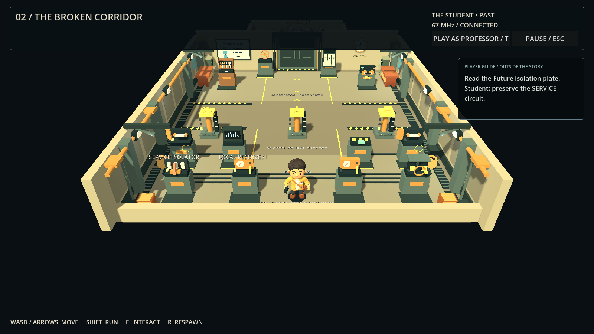
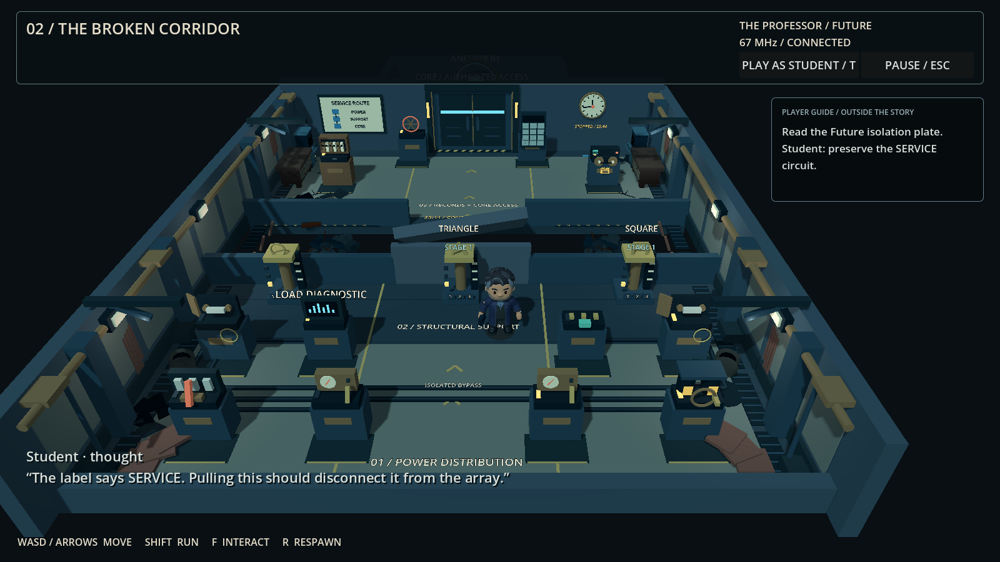
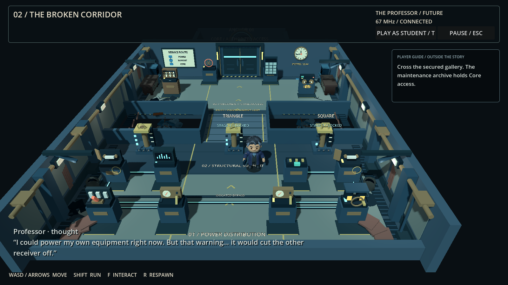
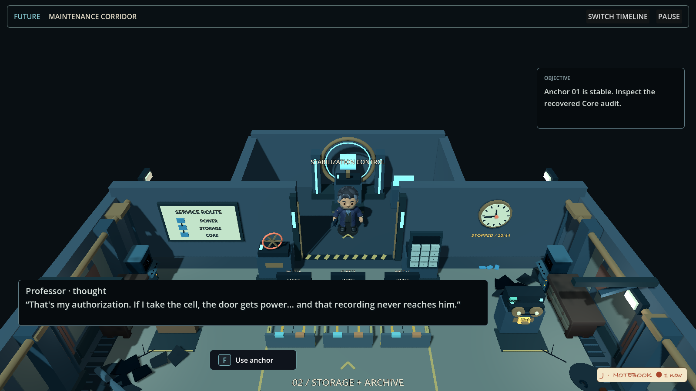
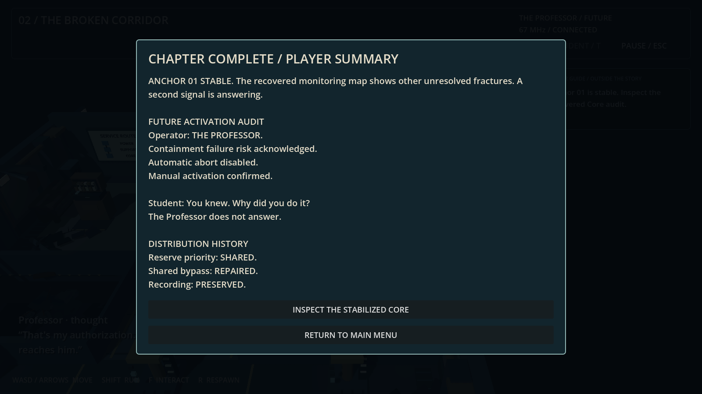
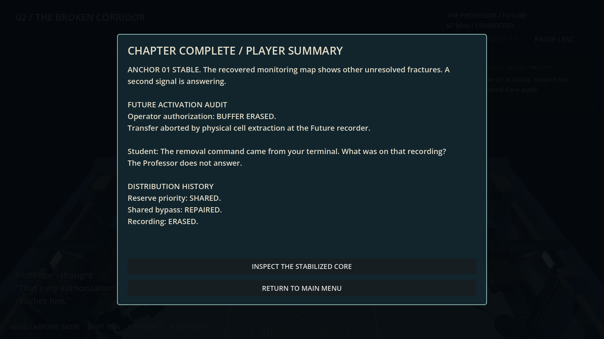

# Level 02 — The Broken Corridor

Implemented 2026-10-21. The Maintenance Gallery is now playable after the Signal Laboratory in solo preview and LAN co-op. It includes the service circuit, support crossing, two private shortcut choices, archive, Core access and a small chapter finale. The separate full Temporal Anchor puzzle and countdown remain outside this implementation.

## Enter and play

Temporary shortcut: select **Play → LEVEL 2 / TEMPORARY SOLO TEST** in the main menu. This starts a fresh offline corridor run with both radios acquired and linked at 67 MHz; Level 02 remains unsolved. Press **T** to switch timelines.

Complete the existing laboratory: acquire both radios, calibrate 67 MHz, and leave through the north door. Walking through the exit or pressing **F** at the corridor exit marks readiness through `GameFlowManager`. LAN travel waits for both roles; solo travel proceeds after the local exit. Finish any active conversation before leaving. The manager fades, loads the gallery, waits for both peers and releases input without resetting the puzzle session or ENet connection. Press **T** or the role button to operate the other timeline in solo. Each role retains its position. The entrance offers **Return to Laboratory** through the same readiness flow.

To test Level 02 directly, open `scenes/world/maintenance_corridor.tscn` and press **F6**. A fresh offline direct run seeds the completed radio prerequisite. Normal travel preserves the real puzzle session and never seeds or resets it. Running the static layout scene alone does not create gameplay.

Controls: WASD/arrows move, Shift runs, F interacts, Escape closes a device or opens pause, R returns to the entry landing. The pause screen offers Return to Menu and an offline Restart Chapter option. Losing the LAN connection blocks local gameplay and leaves the menu available.

Equipment now opens a close-up of the actual 3D machine. Click its lever, wheel, fuse, selector or button; the authorization code is entered on the machine's physical keypad. Optional key shortcuts and objectives live in a separate right-side player guide. Story records and private character observations are distinct from this assistance. See [Discovery and physical interaction](PLAYER_EXPERIENCE.md) for controls and screenshots, including the laboratory console's rotatable frequency dial.

Inspection records appear in a compact foreground card beside the machine, with scrolling for long text. The camera fits each device into its own area so the card stays readable without covering the equipment, including at smaller window sizes.

## Puzzle route and choices

1. The Professor reads the isolation plate on **Load Diagnostic**. The Student isolates **SERVICE** on the entry cabinet. The Professor charges **Emergency Cell** at the crank.
2. The Future diagnostic describes BRACE / PIN / RETRACT. The Past support controls supply their extension-stage mapping. Set **Circle 3, Triangle 2, Square 1** and use **Apply Support Plan**. The Future slab settles into a guarded crossing; its supports then lock.
3. The Professor crosses to **Maintenance Archive**, reads service code **3142**, and discovers the shared identity/watch detail. He then inspects **Incident Recorder**.
4. Resolve the recorder, authorize/release the Core entrance, and latch the stabilization controls in both timelines. Actions latch independently; there is no timing window.

The two private shortcuts are physical device interactions:

| Decision | Immediate benefit | Cost and recovery |
|---|---|---|
| Either role engages **Local Reserve** after reading its service instructions | Charges that side immediately. Past gains a local load decoder; Future gains early door power. | The other auxiliary feed drops. First allocation persists. The Past fuse and Future ground lead restore a shared bypass without removing the distribution history. |
| Professor selects **Release Backup Cell** | Powers the Future manual release without waiting for Past authorization. | Erases the untransferred authorization evidence and interrupts the Past monitor feed unless the bypass is already repaired. The extraction remains in the hardware log. |

The cooperative route leaves the reserve disengaged, charges the normal battery, repairs both bypass ends, and selects **Export Recording**. Preserving the recorder requires the isolated supply. Erased evidence cannot be restored by later repairs.

A player with a disrupted auxiliary feed can still move, inspect clues and reach their repair station. The secured crossing and opened doors stay available, so both players can recover after a shortcut. No choice permanently traps the partner or requires restarting the laboratory.

The ending changes with the evidence: a preserved recording identifies the Professor's acknowledged override; an erased recording leaves an incomplete audit and a suspicious extraction log. Both show the actual distribution and recording history. Neither uses a “betray your partner” prompt.

Private information is presented only on the appropriate role's devices. Puzzle state still uses the existing shared replication protocol; this is not a new encrypted-information or anti-cheat system.

## Editable content

- `scenes/world/maintenance_corridor.tscn`: playable scene, camera, character, audio, UI and dialogue.
- `scenes/environment/rooms/maintenance_layout.tscn`: authored native meshes, floors, barriers, doors, props, signage and device markers. Existing environment props retain their timeline palette and asset provenance.
- `tools/build_maintenance_map.py`: regenerates that layout; change its device positions to move a stand and its interaction marker together. Regeneration replaces manual layout edits.
- `scripts/world/maintenance_corridor.gd`: composition, role switching, confirmed-state presentation and device screens.
- `scripts/puzzles/implementations/maintenance_corridor_puzzle.gd`: host rules, prerequisites, guarded actions, irreversible choices and completion.
- `resources/dialogue/maintenance/*.tres`: editable conversations. Skipping or cancelling dialogue cannot change puzzle progression.
- `scripts/ui/maintenance_panel.gd`: adapts the room's devices to the physical inspector and keeps gameplay guidance separate from story text.
- `scripts/gameplay/devices/device_inspector_3d.gd`: close-up camera, ray-picked physical controls, persistent keypads and local digit entry.

The Future has a real guarded gap. Route collision remains blocked during the slab animation and becomes walkable once it settles. Reloads apply the secured layout immediately. This uses authored states rather than dynamic rubble physics.

The detailed map uses native industrial meshes and existing project props. Floor stencils separate the power bay, support crossing and records bay; arrows, hazard stripes, bridge tracks and a facility diagram lead toward the Core. Wall panels, drains, conduit drops, cabinet racks and cable reels give the room a working maintenance setting. The Future adds leaks, cracked tiles, fallen panels and the stopped 23:44 clock in the same architectural footprint.

Each station has its own equipment: fuse isolator, reserve meters, battery cans and crank, open bypass boxes, diagnostic graph, support-plan switches, binder archive, tape reels, numeric keypad and release wheel. The Core now contains a ring assembly, grounded machine base, illuminated pylons and an audit terminal. The doorway's overhead beam and sign cut away when the player enters the Core, keeping the fixed camera's view clear.

Visual feedback follows confirmed puzzle state. Mint circuit strips show a working feed, red shows a disrupted feed, and the bypass illuminates after both ends are repaired. Support lamps show extension stages. The isolator lever changes position, an extracted recorder cell disappears, and the Core lights confirm stabilization. Station labels appear nearby for the current role, with a longer viewing range for the next required station; floor markings and equipment silhouettes remain visible at distance. These cues do not submit actions or alter puzzle rules.

## Verification

- `maintenance_rules.gd`: **133 checks passed**, covering all six reserve/recording combinations, forged fields/roles, unsafe plans, recovery, immutable decisions, codes, duplicate completion and preservation of the radio prerequisite.
- `maintenance_corridor.gd`: **104 checks passed** through the actual detector, camera rays on physical equipment, real bridge collision, private role restrictions, Escape behavior, damaged-feed recovery, Core ending, reload and walking through the actual lab exit. This also checks role-specific labels, confirmed circuit colors, the removed recorder cell, stabilized Core lights and restored presentation after reload, including completion of the transition fade.
- `maintenance_peer.gd`: **both real ENet processes passed**, including two-role arrival, retained session/radios, non-optimistic client requests, forged-role rejection, power diversion, erased recorder, early door release, completion, snapshot and client room reload. This is loopback validation, not a physical two-computer Wi-Fi test.
- Existing `signal_lab.gd` and `gameplay_integration.gd`: **passed**; the latter now has **84 checks**, including mouse dragging of the physical tuning dial, wheel/arrow adjustments, range limits, ignored digit keys, camera-ray CALIBRATE, keyboard Enter and the incoming audio cues. The legacy laboratory inspection test explicitly disables travel so it can still inspect/reset that room after crossing its exit.

Run `python3 tests/run_maintenance_tests.py` for Level 02. Set `GODOT_BIN` if Godot is not on PATH. `--skip-lan` runs offline checks; `--lan-only` runs the two-process scenario. The runner checks exit status, required PASS markers and engine/script errors.

## Actual screenshots

Generated by `tools/render_maintenance_review.gd` in Godot Compatibility. These are gameplay captures, not concept art.

| Past gallery | Future blocked crossing |
|---|---|
|  |  |

| Secured crossing | Recorder dilemma |
|---|---|
|  |  |

| Future records bay | Stabilized Core |
|---|---|
|  |  |

| Preserved recording ending | Erased recording ending |
|---|---|
|  |  |
