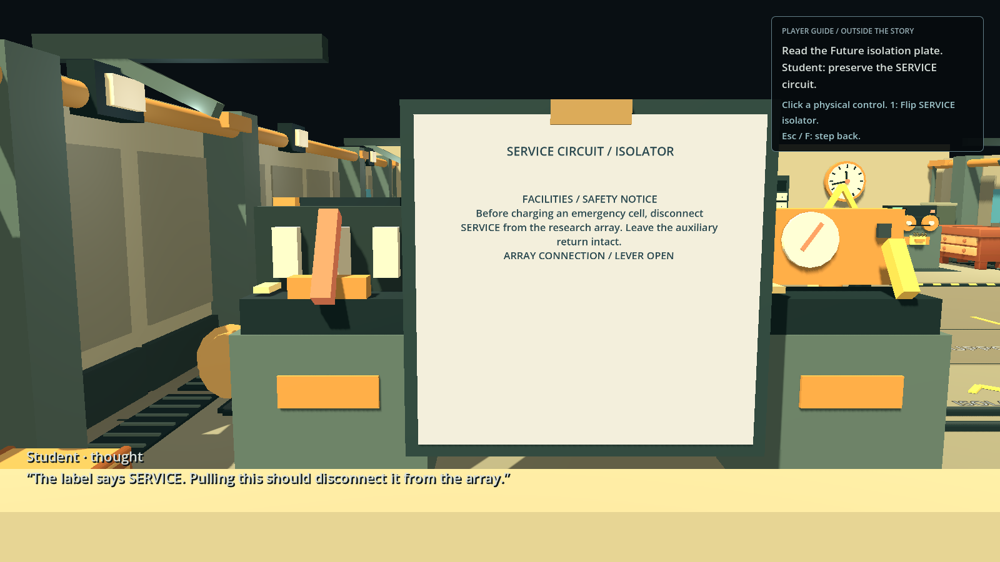
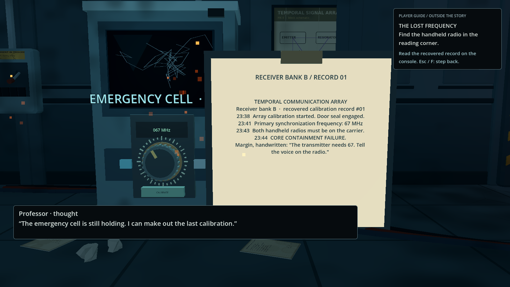

# Discovery and physical interaction

The playable laboratory and maintenance gallery now distinguish what the character knows from what the player needs to operate the game.

Story information comes from printed service instructions, equipment readouts, retained records, and named character thoughts. A document does not address “both players” or identify a machine as “Future only.” Characters infer changes from what they have seen; the corridor dialogue no longer asserts an unexplained theory of how the link anchors their memories. The identity reveal still happens through the personnel record and the private watch inscription.

Controls, objectives, network confirmations, and puzzle help appear on the right, explicitly labelled **PLAYER GUIDE / OUTSIDE THE STORY** or **PLAYER FEEDBACK / NOT DIALOGUE**. Character observations appear separately as **Student · thought** or **Professor · thought**. These local thoughts are not conversations transmitted to the other character. The ending overlay is labelled a player summary; the physical audit terminal contains only its retained machine record.

Text uses separate screen areas. Guide, feedback and status messages stack in a bounded, scrollable column, below the laboratory radio status. Thoughts wait while a dialogue is visible, including its fade, and resume afterwards. Long dialogue scrolls within its panel above the interaction prompt and footer. Pause and document overlays suppress background messages. Opaque text panels prevent signs behind them from showing through the writing. Floating station captions are culled when their projected rectangles would overlap another caption or a reserved text area.

Device framing adapts to window width, and printed instructions fit their card independently of the title. `tests/text_layout.gd` exercises simultaneous long messages, dialogue, deferred thoughts, real GUI clicks, inspection and resize at 1600×900, 1280×720 and 960×540. The maintenance test runner includes these checks. Optional `TEXT_LAYOUT_REVIEW_DIR` captures the six stress views with a graphics device.

## Operating equipment

Walk to equipment and press **F**. The camera moves to a close-up of the actual device. Click its lever, wheel, fuse, battery handle, selector, or button. **Esc / F** steps back and restores the camera and character. The right-side guide lists optional number-key shortcuts; using a shortcut operates the same physical control.

- SERVICE and reserve levers rotate after the host confirms their actions.
- The emergency charging crank turns when a normal charge is confirmed.
- The three jack selectors, support commit switch, export button, release wheel, and stabilization lever are actual map geometry.
- The recorder's removable cell remains absent after extraction and after a room reload.
- The laboratory console has a persistent 3D tuning dial and a frequency readout. Drag the knob clockwise to increase the setting or counterclockwise to decrease it. The wheel over the knob and arrow keys adjust by 1 MHz; Shift makes those steps 10 MHz. The range is 1–999 MHz. Click the physical CALIBRATE button, or press Enter, to submit the setting. Turning the knob stages a local value; a confirmed carrier locks it. Number keys do not enter a frequency.

The dial assembly is scaled to 62% of its original size and mounted below the CRT; its frequency digits are smaller too. The console's waveform and status readout remain visible above the controls.
- The Core authorization unit retains its physical keypad. Click its number keys, or type digits; Backspace presses DEL and Enter submits the access code. Staging a code never changes puzzle progression.
- The recovered log and service instructions are readable on a physical service card beside the controls rather than a full-screen device menu.

During close-ups, floating wayfinding labels and the room HUD hide. Foreground meshes that obscure the equipment temporarily cut away; their collision stays intact and their previous visibility returns when the inspection closes. Movement and role switching remain locked until the character steps back. Pause/disconnection also suspends device input.

## Source and validation

`scripts/gameplay/devices/device_inspector_3d.gd` owns the local camera, physical controls, ray picking, dial dragging, local drafts and cutaways. It emits requests and never edits authoritative puzzle state. `scripts/ui/lab_ui.gd` owns the distinct guide, feedback and character-thought presentations.

`scripts/gameplay/devices/laboratory_devices.gd` connects physical console controls to the established frequency submission logic. The older terminal and reader controls remain as compatibility models for existing standalone puzzle scenes and tests; their CanvasLayer is hidden in the playable laboratory. `scripts/ui/maintenance_panel.gd` now delegates equipment interaction to the 3D inspector.

Verified through **104 maintenance scene checks**, **84 laboratory gameplay checks**, the laboratory environment suite, **133 maintenance rule checks**, and a two-process maintenance LAN scenario. Scene tests ray-pick physical equipment; the laboratory test drags the tuning knob with actual mouse events, operates its calibration button, and checks wheel/arrow tuning, range limits, suspension, ignored digit keys and the confirmed lock. Wrong frequencies leave the authoritative revision unchanged. LAN rules still wait for the host's confirmation. The incoming transition system also passes its offline and two-peer suites; production travel loads the playable gallery. Its readiness and refusal notices reserve space above the room's scrollable guide, with layout checks at all three supported review sizes.

Actual Godot captures:

| Console tuning dial | Physical SERVICE lever |
|---|---|
|  |  |

| Recovered console record | Incident recorder |
|---|---|
|  |  |
