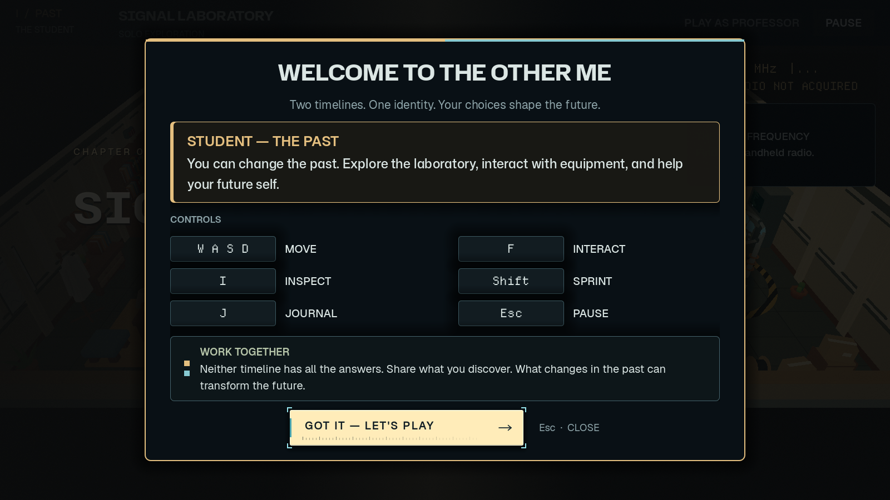

# First-time tutorial popup

`scenes/ui/tutorial_popup.tscn` + `scripts/ui/tutorial_popup.gd` (`TutorialPopup`, a CanvasLayer on layer 90).

## Triggering
* **First visit:** `spawn_area.gd` (Room 01) calls `_show_first_time_tutorial()` at the end of `_ready()`. It polls until the room
  intro / level flow, dialogue, modals and player actions are idle, then opens the popup for the local role (`timeline`).
  Each machine does this for its own player, so a LAN partner is never asked to dismiss it. Headless runs skip it
  (`tutorial_auto_show`).
* **Any time:** pause menu -> **HOW TO PLAY** (`%HowToPlayButton`). Closing returns to the pause menu. Nothing is reset.

## Behaviour
* Local lock only: `LaboratoryGameplay.has_modal()` asks `tutorial.is_open()`, so the existing `sync_controls()` disables the local
  player and interaction, and the journal cannot open. The SceneTree is never paused and nothing touches `PuzzleManager` or the network.
* Input: `spawn_area._input` calls `tutorial.handle_input()` first (same pattern as the settings overlay). Escape / controller Back /
  pause close it and are consumed, so the pause menu does not open underneath.
* The popup stays "open" until its fade-out ends, and only then does the room restore controls (no leaked press).
* Room-initiated closes (`close_overlays()`: transitions, lost connection) close it without saving.
* Respects **Reduced Motion** (`user://menu_settings.cfg`, via `CinematicTransitionManager.is_reduced_motion()`): fade only.
* Glyphs come from `InputManager.get_action_label()` (added `move` and `journal`) and refresh on `device_changed_signal`.
  The journal has no gamepad binding in `project.godot`, so it always shows `J`.

## Stored preference
`user://tutorial.cfg`, section `[tutorial]`, key `dismissed = true` (`ConfigFile`), written when the player dismisses it.

## Tests
`python tests/run_tutorial_tests.py` (needs `GODOT_BIN`). Set `TUTORIAL_REVIEW_DIR` and run `tests/tutorial_popup.gd` with a
rendering driver to save screenshots.
