# Final environment report: Signal Laboratory (Puzzle 01, "Lost Frequency")

Date: 2026-10-20. Branch: `claude/great-franklin-ufe6zm`, based on `main` at `1431fb3` (which includes the frequency
puzzle, radio, audio and dialogue work of PR #2). Engine: Godot 4.7.2, GL Compatibility renderer, Jolt physics. This
covers Phases 2 and 3: the Past and Future laboratory, the asset library behind it, Puzzle 01 played in the room from
start to exit, the temporal rift, lighting, audio cues, tests and measurements.

## 1. Summary

**Done**

- **One room, two timelines.** The Signal Laboratory is a single layout. In the Past it is a warm, working academic lab.
  In the Future, thirty-one years on, it is a ruin. The Future uses the same room plan, so the two read as one place,
  but it swaps in damaged geometry, moves and topples props, adds debris and cracked floor, changes every material
  and replaces the lighting.
- **Assets.**
  - 75 models: 63 original procedural models (21,462 triangles, including a handheld radio that replaces the frequency
    puzzle's placeholder box) and 12 KayKit Furniture Bits models (CC0, license verified, 3,044 triangles).
  - 28 original textures.
  - 56 reusable prop scenes, 9 interactive device scenes and one effect scene (the rift).
- **Puzzle 01, played in the room.** Puzzle 01 is the frequency puzzle that PR #2 added to `main` (`puzzle_01_frequency`,
  67 MHz). This branch places its parts in the laboratory and adds the room's consequences:
  1. Each player takes their handheld radio: the Student's from the science bench, the Professor's from the reading
     corner.
  2. The Future player reads the frequency in the recovered log on the damaged console.
  3. The Past player enters it in the calibration terminal on the same console.
  4. The host checks the frequency.
  5. When both radios are owned and the array is calibrated, both timelines get the result: the console and keypad
     change, sounds play, the rift settles, the "TEMPORAL RADIO LINK ESTABLISHED" banner appears and the security
     door opens.
  6. The players walk out through the corridor.

  The room flow is covered by a solo test and by a two-process ENet test, and both pass.
- **Reuse.** The room uses the systems already in `main`:
  - puzzle: `PuzzleManager`, `PuzzleBase`, `PuzzleListener`, and the frequency puzzle's own rules, coordinator,
    calibration computer and terminal, research-log clue and reader, radio pickups, `TemporalRadio`, radio HUD,
    held-radio presenter, radio audio bridge and link presenter;
  - interaction: `Interactable3D`, `InteractionRig`, `InteractionPrompt`, the `interact` action;
  - networking and sound: `NetworkManager` and `AudioDirector`, including its ambience controller.

  A first version of this branch had its own puzzle rules, tuner and log screens and a sound synthesizer. When PR #2
  landed with the same features, those were removed so that no second system ships.

**Not done or not possible here**

- **Other asset packs.** The container's network policy blocked every asset host except GitHub, so no pack other than
  KayKit could be fetched. Every gap is filled with original geometry.
- **Real-GPU performance.** Frame rates were measured only on Mesa llvmpipe, a software renderer, so no real-GPU
  number is claimed.
- **Real LAN and playtesting.** The LAN test ran on loopback, not on two machines over Wi-Fi. No human has playtested
  the room.
- **Dialogue.** The frequency puzzle's radio-dialogue adapter is not wired to the dialogue system; `main` marks that
  integration as pending.

## 2. Asset acquisition

| Source | Result | How | License evidence |
|---|---|---|---|
| itch.io (VNB Office Set, Lab Assets, KayKit page), kenney.nl, opengameart.org, poly.pizza, quaternius.com and their CDNs | **Blocked** (proxy answered HTTP 403 on CONNECT) | Nothing bypassed; no login, CAPTCHA, purchase or mirror workaround tried | Search-result summaries only; stays unverified in `sources.json` |
| KayKit Furniture Bits 1.0 | **Downloaded** | Anonymous `git clone` of the creator's public repository `KayKit-Game-Assets/kaykit-furniture-bits-1.0` (the repository the Godot Asset Library listing links), archived at commit `96d5930` with SHA-256 recorded | `LICENSE.txt` in that repository (CC0); copied unchanged to `assets/third_party/kaykit_furniture_bits/LICENSE.txt`. Status `VERIFIED` |
| Original procedural assets | **Generated** | `tools/assets/meshkit.py` + `build_lab_props.py` (meshes), `build_lab_textures.py` (textures) | Project-owned; status `VERIFIED` (original work) |

How the two sources can be told apart:

- Downloaded models are named `kaykit_*.glb`. Generated models are named `lab_*.glb`.
- `sources.json` records every model under its pack (`kaykit_furniture_bits` or `past_future_original`) with a
  checksum and the tool that produced it.

How the original models were made:

- They are original geometry, built from primitives (boxes, lathes, lofts, extrusions and seeded crystals).
- They model generic lab objects. No restricted or third-party model was traced, copied or imitated.

`tools/assets/validate_assets.py --godot` passes:

- 0 errors.
- 75 models import cleanly in Godot.
- 11 warnings:
  - 9 are poly.pizza entries that are still unverified and are not used.
  - 2 are the KayKit book GLBs, whose origin is at their centre. Their prop scenes lift them by 0.25 to compensate.

To regenerate the assets, run these commands from the repository root. Each step's output is checked in.

```
python tools/assets/build_lab_textures.py    # 28 PNGs  -> assets/environment/textures/
python tools/assets/build_lab_props.py       # 63 GLBs  -> assets/environment/models/<category>/lab_*.glb
python tools/assets/build_lab_scenes.py      # 56 props, 10 devices/effects, the room layout -> scenes/environment/
```

## 3. Asset inventory

The per-category table (A01 to A26, F01 to F11) is in `docs/assets/ASSET_INVENTORY.md` under "Final status". Every
category is present. Each placed prop carries its id in `TimelineProp.asset_id`, and `tests/signal_lab.gd` fails if
any required id is missing from the room.

| Folder | Contents |
|---|---|
| `assets/environment/models/architecture/` | Wall panel, two damaged variants, low south wall, corner, door frame, door leaf, corridor |
| `.../electronics/` | Two CRT monitors, keyboard, keypad, junction box (breaker), cable run, emergency light, signal rack, oscilloscope, signal generator, antenna, handheld radio |
| `.../furniture/` | Drafting chair, bookcase and broken bookcase, binder row, coat stand, desk lamp; KayKit rug, stool, cabinet, table lamp, wall shelf, small table |
| `.../documents/` | Three paper sheets, paper stack, crumpled paper, open notebook |
| `.../decorations/` | Blackboard, three posters, two signs, wall clock, mug, pencil holder, plant and wilted plant, dead cactus, lab coat (hanging and fallen), hanging cables; KayKit cacti and picture frame |
| `.../laboratory/` | Microscope, flask set, broken glass, crate, cardboard box, cable reel |
| `.../temporal/` | Rift core, three fragments, containment emitter (platform, three pylons, ring) |
| `.../debris/` | Two rubble clusters, broken tiles, fallen ceiling panel, broken pipe |
| `.../books/` | KayKit book set and single book |
| `assets/environment/textures/` | Papers, notebook, blackboard, posters and signs (each with a Past and an aged version), clock faces, four monitor screens, keypad display, book spines |

Movable parts are separate nodes, and every model has its pivot where it is used.

| Object | Separate nodes |
|---|---|
| Security door | `Leaf` (slides on +X with its own `AnimatableBody3D`), `StatusLight`, corridor `Lamp` |
| Keypad | `Button_0` to `Button_11`, `Display`, `StatusLed` |
| Breaker | `Lever` (pivot at the hinge), `LedPower`, `LedFault`, `Label` |
| Handheld radio | `Display`, `Led` |
| Monitors, rack, oscilloscope | `Screen` |
| Wall clock | `HourHand`, `MinuteHand`, `SecondHand` (pivot at the dial centre) |
| Rift | `Core`, nine `Fragment` nodes, emitter `Pylon_0` to `Pylon_2` and `Ring` |
| Desk lamp, antenna | `Head`, `Dish` |

The pivots follow fixed rules:

- Floor props stand on y = 0.
- Wall-mounted props sit on the wall plane.
- The rift fragments are centred on their own origin.

**Materials (`scripts/environment/env_palette.gd`).**

- Each imported material is named after a palette slot, such as `wood`, `led_red` or `tex_notebook`.
- `EnvPalette` swaps each slot for one shared `ShaderMaterial` per slot and timeline (`shaders/environment.gdshader`).
- Switching timeline swaps material references. No material is edited in place, so the two timelines never share
  state.
- Textures load by slot, so the Past and Future can use different images, such as a clean paper and an aged one.
- KayKit's textured materials keep their texture; the shader only tints them per timeline.
- The greybox furniture keeps its own `painted_prop.gdshader`. It is now lit like the rest of the room, and in the
  Future it gets world-space grime (an `age` uniform that `lab_prop.gd` sets). It still takes `paint_color` per
  instance, which `tests/spawn_area.gd` checks. The floor shader is lit as well.

## 4. Past laboratory

The room measures 24.8 x 15.6 units. The north wall is 4.2 high and sits at z = -7.8. Walls are 2.48 m modules. The
south wall stays low so the fixed camera can look into the room.

| Zone | Where | What is there |
|---|---|---|
| North wall | z = -7.8 | Blackboard with equations, safety poster, array poster, "Signal Laboratory 01" sign, warning sign, clock, breaker (x -2.6), the console with an antenna on top (x 0), security door and keypad (x 6.2 / 7.78), two existing cabinets |
| Research station | RightTable, x 5.4 | Dual CRT monitors, keyboard, drafting chair, paper stack, open research notebook, desk lamp, mug, pencil holder, photo frame |
| Science bench | LeftTable, x -5.4 | Microscope, flask set, oscilloscope, signal generator, the Student's handheld radio, graph paper, facilities memo, desk lamp, mug, chair |
| Library | West wall | Two stocked bookcases (KayKit books and binders), low cabinet with books, wall shelf with a cactus, coat stand with a lab coat, resonance poster, plants, emergency light |
| Reading corner | South-west | Rug, small table, table lamp, books, notes, two stools; in the Future, the Professor's handheld radio on the table |
| Temporal research | East, around (9.2, 2.3) | Containment emitter and rift, signal rack, poster, a cable bundle running from the console to the emitter, a painted hazard ring on the floor |
| Storage | North-east and south-east corners | Crates, cardboard boxes, cable reel |

These spots are kept clear on purpose, because `tests/spawn_area.gd` walks the player through them:

- the spawn circle;
- the approaches around the left table;
- the east wall at z 4.4 to 5.2.

**Palette.** The palette comes from the brief, in `EnvPalette.SLOTS`, Past column:

- walls: cream `#e9dbbf` and `#dccaa4`;
- trim: olive `#575c4a`;
- baseboard: brown `#70442c`;
- metal: sage `#889181`;
- fabric and lamp shades: ochre `#e4bf7f`;
- wood: `#8a5a3a` and `#c49a62`.

KayKit textures are desaturated by 22 % and warmed slightly so they sit in the same palette.

**Lighting.**

- Three warm ceiling omni lights.
- Two desk-lamp pools.
- The console's screen glow.
- The rift's slow cyan pulse.
- Ambient light: cream (`#f3e3c4`) at 0.62.
- The existing key light, warmed to `#ffe7c2` at 0.95.

## 5. Future laboratory

The Future uses the same layout and the same nodes, so it is recognisably the same room. It differs in five ways
beyond its colours.

| Kind | What changes |
|---|---|
| Geometry swaps | Four wall modules become torn panels with holes, pipes and cables. The bookcases break and lose most of their books. The flask set becomes broken glass. The coat falls to the floor. Plants wilt or die. |
| Displacement (`future_offset` / `future_rotation`) | The research chair tips over and the science chair rolls away. A monitor and the desk lamp topple. The microscope falls over. Papers and the pencil holder land on the floor. Two posters fall. The sign hangs crooked. The low cabinet and wall shelf go askew. A stool tips over. The boxes fall and the reel rolls. The clock hangs crooked. |
| Future-only props | A fallen ceiling panel, three rubble piles and a broken pipe, all with collision. Broken tiles. Three runs of hanging cable. Eight scattered sheets, four crumpled ones and four books on the floor. Crystal shards embedded round the rift. |
| Materials | Each slot has its own Future colour. The walls are slate and navy, not the Past cream tinted blue. Wood, rust, hazard paint and the red emergency lenses stay warm. The shader adds world-space grime, settled dust on upward faces and darkening near the floor. Lamps and screens go dark, and emergency lights and LEDs flicker. |
| Floor | Cracked tiles (Voronoi edges), densest under the ceiling panel, at the door, at the west breach and round the rift. A soft scorch spreads round the rift, and the cracks there glow violet. |
| Lighting | Three red emergency lights (two flicker, one pulses like a beacon). A cold `#557c86` fill. A broken ceiling light that flickers cyan. The rift's violet flicker. Ambient light: `#4a6d7c` at 0.6. The key light is cold and dimmer. |

The story clues are placed in the room:

- The blackboard reads "THE FRACTURE WAS NOT AN ACCIDENT".
- The clock is stopped at 23:44, the minute the containment failed.
- The notebook carries a later, shakier note.
- The recovered log on the console holds the frequency.

**Colour variety.** The Future is not blue all over. Red emergency light, violet crystal light, brown wood, rust and
orange sparks break up the cold palette.

## 6. Puzzle 01: Lost Frequency

**Rules.** Puzzle 01 is `main`'s frequency puzzle, unchanged: `scripts/puzzles/implementations/frequency_puzzle.gd`,
documented in `docs/FREQUENCY_PUZZLE.md`.

- The room's `FrequencyCoordinator` registers it as `puzzle_01_frequency` on every peer, only if no room has done so.
- The frequency is the existing definition: 67 MHz, set on the coordinator. The design documents mention 142.8 MHz,
  but only as an example.

| State field | Meaning |
|---|---|
| `student_radio`, `professor_radio` | Each player has taken their own handheld radio |
| `frequency_calibrated` | The Past player entered the right frequency |

The link, which counts as solved, needs all three. Validation stays with `PuzzleManager` on the host:

- each player may only take their own radio;
- only the Past may calibrate, and only after taking their radio;
- a wrong frequency answers "SIGNAL NOT FOUND" without changing state;
- a repeat changes nothing.

**What this branch adds around it.**

| Room part | What it does |
|---|---|
| Console (`interactive/console_terminal.tscn`) | Carries the puzzle's `FrequencyComputer` (Past, "Use Calibration Computer") and `FrequencyClue` (Future, "Read Research Log"). Their placeholder meshes are hidden, because the existing console is their body. `SignalLab` binds them to the `FrequencyTerminal` and `FrequencyLogReader` screens. The screen texture, readout (`SIGNAL UNSTABLE`, `SIGNAL LOCKED`, `TEMPORAL LINK`; `EMERGENCY CELL · LOG` in the Future), status lamp and sparks follow the confirmed state. |
| Research log text | The clue's `research_text`, rewritten for the room: the recovered calibration record with 67 MHz and the professor's margin note |
| Radio pickups (`interactive/radio_pickup_past/future.tscn`) | The puzzle's `RadioPickup`, one per timeline: the Student's on the science bench, the Professor's in the reading corner. Each wears the new handheld-radio model in place of the placeholder box, which stays in the scene but hidden. |
| Player (`spawn_area.tscn`) | A `TemporalRadio` on the player, set to the player's role. The same radio model in the hand, through the puzzle's `radio_model_presenter.gd`. The puzzle's radio HUD under the header. |
| Rift (`effects/temporal_rift.tscn`) | The puzzle's `TemporalLinkPresenter` drives a link lamp on the emitter: purple until linked, cyan after. The rift's own effect settles when the link is made. |
| Security door, keypad | Listen to the link through a `PuzzleListener`. The puzzle has no door rule; the door only presents the confirmed link. When linked, the door opens in both timelines (smoothly in the Past, in three grinding jerks in the Future) and the keypad reads `OPEN`. |
| `SignalLab` | Wires the parts together. Plays the puzzle's cues through its `RadioAudio` bridge on the room's `AudioDirector`. Turns confirmed changes into room feedback: toasts when the other timeline takes its radio or calibrates, the link banner, and the exit. |

**How it plays.** All of these are real interactions through the existing rig, prompt and F key.

1. **Past.** The console offers the calibration computer, but calibrating is refused until the Student takes the radio
   from the science bench.
   - With the radio, a wrong frequency (for example 66) shows "SIGNAL NOT FOUND" with static.
   - 67 MHz shows "SIGNAL LOCKED", the console readout changes, and the Future player gets a toast.
2. **Future.** The damaged console offers the recovered log, which shows 67 MHz. The Professor's radio waits in the
   reading corner.
3. **The link.** Whichever action completes the conditions establishes the link on the host. Both peers then get:
   - one completion;
   - the "TEMPORAL RADIO LINK ESTABLISHED" banner;
   - the radio HUD showing "67 MHz CONNECTED";
   - the rift and lamp settling to cyan;
   - console and door sounds;
   - the door opening and the corridor light coming on.
4. **The exit.** The open door lets the player into the corridor. Its `ExitZone` reports the exit once, and the room
   shows "SIGNAL LABORATORY CLEARED".

**Other interactions.**

- The keypad, the door, the breaker, the rift and two documents give text in both timelines.
- The documents are the research notebook and the facilities memo, read in `LabUI`. Their Future versions differ.
- The breaker is not part of the puzzle. In the Future it is tripped and sparking, which explains why the console runs
  on its emergency cell.

**Puzzle authority and resets.**

- Clients never decide anything. `PuzzleManager` sends every action to the host and replicates only confirmed state.
- A host reset (`reset_puzzle`) puts both radios back, clears the console and seals the door again.

**New pieces, and why.**

- `LabUI` (`scripts/ui/lab_ui.gd`) is the room's document reader for both timelines, plus toasts and the banner. The
  frequency puzzle's reader is Future-only and specific to the research log.
- `LabDevice` (`scripts/environment/interactive/lab_device.gd`) is a small base class. It turns `PuzzleListener`
  updates and timeline switches into visuals.

## 7. Visual effects and feedback

**Temporal rift** (`scenes/environment/effects/temporal_rift.tscn`, `scripts/environment/temporal_rift.gd`):

- a containment emitter with pylons and a ring;
- a faceted core;
- nine orbiting fragments;
- an energy shell (`shaders/temporal_rift.gdshader`: one additive pass with swirling bands, a fresnel rim, and a
  `fracture` control that breaks the shell into jagged cells);
- CPU particles;
- a pulsing omni light;
- a looping hum (the audio catalog's `rift_hum`);
- the frequency puzzle's link lamp.

The rift behaves differently in each timeline:

| Timeline | Behaviour |
|---|---|
| Past | Contained. The shell is small and cyan, the fragments orbit in a tidy ring and the light pulses slowly. |
| Future | Fractured. The shell is larger, violet and broken. The fragments drift at random radii and heights and tumble. The light flickers, there are more particles, the ring is knocked askew and shards are embedded in the scorched floor. |
| On the temporal link | The shell flashes in both timelines and settles towards cyan. In the Future the fracture closes partly and the fragments are drawn back towards the core over a few seconds. The puzzle's link lamp turns from purple to cyan. |

**Other effects.**

- Rim highlight on the current interaction target (`shaders/interaction_highlight.gdshader`, a pulsing overlay in the
  timeline accent).
- Spark particles at the dead console, the tripped breaker and the door frame.
- Flicker on emissive slots (emergency lenses, amber and red LEDs).
- `light_behaviour.gd` drives each light as steady, pulsing or flickering, with a phase per light.
- Glowing violet floor cracks near the rift.

**Audio.** Every cue comes from the existing `AudioDirector` catalog (`scenes/audio/audio_system.tscn` inside
`SignalLab`):

- `door_open`, `door_locked`, `computer_beep`, `switch_toggle`, `interaction_success`, `interaction_denied`,
  `ui_click` and `ui_hover`;
- the puzzle's own cues (pickup, attempt, static, connected) through its `RadioAudio` bridge;
- the rift's `rift_hum`, looped at the rift (lower in pitch while the Future field is unstable);
- `lab_ambience_past` / `lab_ambience_future`, switched with the timeline through `AmbientAudioController`.

Looping sounds are not started when there is no output device (headless runs), so no playback is left behind at
exit.

**GL Compatibility.**

- Everything uses CPU particles and unshaded additive passes.
- No decals are used. Floor damage is done in the floor shader instead.
- Environment glow was tried and rejected: in this renderer it lifted the whole frame to a blue haze.

## 8. Performance

Measured in the running game with the real camera at 1600 x 900, using Godot's own render monitors. The renderer was
Mesa **llvmpipe**: software OpenGL on the CPU, with no GPU in the container. The frame rates below are therefore far
below what any GPU would give. The draw-call, object and primitive counts do not depend on the renderer.

| Scene | Draw calls | Objects | Primitives | Nodes | FPS (llvmpipe) |
|---|---|---|---|---|---|
| `main` greybox (at `bebb9a5`), Past | 110 | 268 | 24,121 | 142 | 35 |
| `main` greybox (at `bebb9a5`), Future | 110 | 271 | 24,127 | 142 | 37 |
| This branch, Past | 571 | 751 | 72,596 | 923 | 13 to 16 |
| This branch, Future | 608 | 864 | 72,738 | 923 | 13 to 15 |

Budgets kept:

- At most 8 dynamic lights per timeline, so the floor never exceeds Compatibility's lights-per-object limit. This
  includes the console glow, the rift and the corridor light, which is shown only once the door is open.
- No shadows from omni lights.
- No post-processing.
- Particle counts: 24 motes in the Past and 64 in the Future, plus about 10 sparks per emitter.

Where the cost comes from:

- On llvmpipe, most of the drop from the greybox is per-pixel lighting. The greybox was unshaded; the room is now lit
  by up to 8 lights.
- The Future floor shader adds a 3 x 3 Voronoi search per pixel.

Ways to cut draw calls if real hardware needs it:

- Merge the 37 wall-module instances into a MultiMesh or a single static mesh. Each module costs about 5 draw calls,
  one per material.
- Merge small static desk props per zone.

## 9. Testing

All runs used Godot 4.7.2 (`Godot_v4.7.2-stable_linux.x86_64`). The final regression run was on this branch after
merging `main` at `1431fb3`. Testing was kept to the suites the change can affect.

| Test | Command | Result |
|---|---|---|
| Signal Laboratory, solo | `godot --headless --path . --script res://tests/signal_lab.gd` | **PASS** (0 failures) |
| Signal Laboratory, LAN | `python tests/run_signal_lab_tests.py` (solo, then a host and a client process over ENet on loopback) | **PASS**: solo, host, client |
| Frequency puzzle (`main`'s suite) | `python tests/run_frequency_tests.py` | **PASS**: rules 59, integration 72, host 16, client 22 checks |
| Spawn area (movement, collisions, camera, timeline toggle) | `godot --headless --path . --script res://tests/spawn_area.gd` | **PASS** (0 failures) |
| Interaction system | `res://tests/interaction_system.gd` | **PASS** (54 checks) |
| Puzzle system and puzzle sync | `python tests/run_puzzle_tests.py` | **PASS** (131 checks; sync host and client pass) |
| Asset validator | `python tools/assets/validate_assets.py --godot` | **PASS** (0 errors, 11 warnings, 75 models import) |

These ran earlier on this branch, before `main` was merged. They do not touch the files PR #2 changed, and they were
not repeated:

| Test | Result |
|---|---|
| LAN smoke | **PASS** |
| Student 3D | **PASS** (77 clips) |
| Student 3D assets | **PASS** |
| Asset tools | **PASS** (74 checks; 84 with Blender's `bpy` and Godot) |
| Student 2D | **FAIL**, also on pristine `main` (`bebb9a5`): its PNGs (`assets/characters/student_2d/*.png`) were never committed. Not related to this work. |

Not re-run: the dialogue and audio suites from PR #2. This branch only instances `audio_system.tscn` and calls
`AudioDirector`'s public API; it changes no dialogue or audio file.

The new room tests check the following.

**Room contents.**

- Every A and F checklist id is present.
- The devices are present and have their separate parts.
- The room's own interactables stand on floor anchors.
- Every interactable, including the frequency puzzle's, has a rim highlight.

**Timeline switching.**

- Visibility and collision follow the timeline.
- Displaced props return to their authored transform.
- Each timeline uses its own material, and the original Past material comes back.
- The lighting rig and the ambient light switch.

**Puzzle flow.** Both documents in both timelines, then the full puzzle:

- calibrating before taking the radio is refused;
- taking the radio puts it in the player's hand;
- 66 MHz changes nothing;
- 67 MHz locks the array without opening the door;
- the Future log shows 67 MHz;
- the Professor's radio completes the link once, with its banner and sounds;
- the door opens in both timelines and the keypad and console confirm it;
- a repeat calibration changes nothing;
- the sealed door blocks the player and the open one lets them through;
- the exit fires once;
- a host reset puts the radios back and seals the room.

**LAN.** Each process drives its own player.

- A calibration forged from the Future is rejected on the host.
- The client reads the log and gets the "SIGNAL LOCKED" toast.
- The client's radio completes the link.
- Each side sees exactly one completion.
- Both doors open.

**Visual review.** The screenshots below were rendered by the game under Xvfb with llvmpipe, and I looked at them while
tuning the room. That is how the following were found and fixed:

- the glow haze;
- crystal emission blowing out to white;
- UI layering;
- the corridor box showing above the wall;
- the sign hidden by the antenna;
- the prompt overlapping the footer;
- unresolved node references in generated scenes.

**Not tested.**

- Two machines on Wi-Fi.
- A real GPU.
- Hearing the audio: the container has no sound device.
- A human playtest.

## 10. Git

The work is on branch `claude/great-franklin-ufe6zm`, which is not merged into `main`. The commits are listed in the
pull request, in this order:

1. Tools: mesh kit, generators, validator license rule.
2. Asset library: original models and textures, KayKit models, license registry and documents.
3. Timeline materials and environment shaders.
4. Puzzle rules and LabUI.
5. Room scenes, devices, rift and audio.
6. `spawn_area` integration.
7. Tests.
8. Documentation and screenshots (this file).

`main` was not changed directly and nothing was force-pushed.

## 11. Unresolved issues and follow-ups

- **Other asset packs.** VNB Office Set, Lab Assets, the Kenney kits and the poly.pizza models remain unverified and
  unused. Original models stand in for them. To swap any of them in later:
  - verify its license (`LICENSES.md`, "To raise a source to VERIFIED");
  - convert it with `convert_models.py`;
  - point the prop scene at the new GLB.
- **Real-hardware performance** is unmeasured (see section 8), and the draw-call reductions listed there are not done.
- **The camera can hide what the player uses.** The fixed camera looks north from behind the player, so the player
  model covers the console while using it. The prompt and the rim highlight still identify the target.
- **The radio HUD and the banner overlap briefly.** The puzzle's radio HUD sits under the header on the right. The
  link banner covers part of it for its 7 seconds.
- **Radio dialogue is not wired.** Hooking the frequency puzzle's `RadioDialogueAdapter` to the dialogue system is
  marked pending in `docs/FREQUENCY_PUZZLE.md`, and is not done here.
- **Resetting with the player in the doorway.** A puzzle reset snaps the door shut. If the player is standing in the
  doorway at that moment, they overlap the leaf. Resets are a host and debug tool.
- **The exit goes nowhere yet.** It ends at a banner, because the next room (Room B, the Maintenance Corridor) does not
  exist.
- **`PROJECT_CONTEXT/` is outdated.** It still says Puzzle 01 is not started and that the console has two screens. It
  was not edited, so the docs owners can update it.
- **`tests/student_2d.gd` fails on `main`**, because its PNGs are missing (see section 9).
- **The audio is placeholder.** It is the catalog's own placeholder set.

## 12. Screenshots

All screenshots are in-game renders from the real gameplay camera (35° pitch, 48° FOV, perspective), with the HUD as
players see it. They come from the solo preview, which can switch timeline, and were downscaled to 1280 x 720.

| | |
|---|---|
| 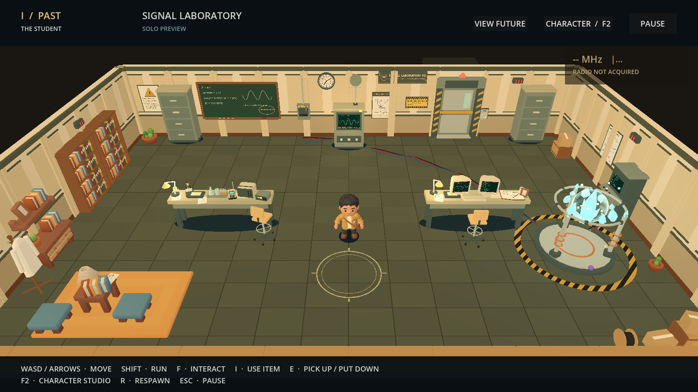 Past overview | 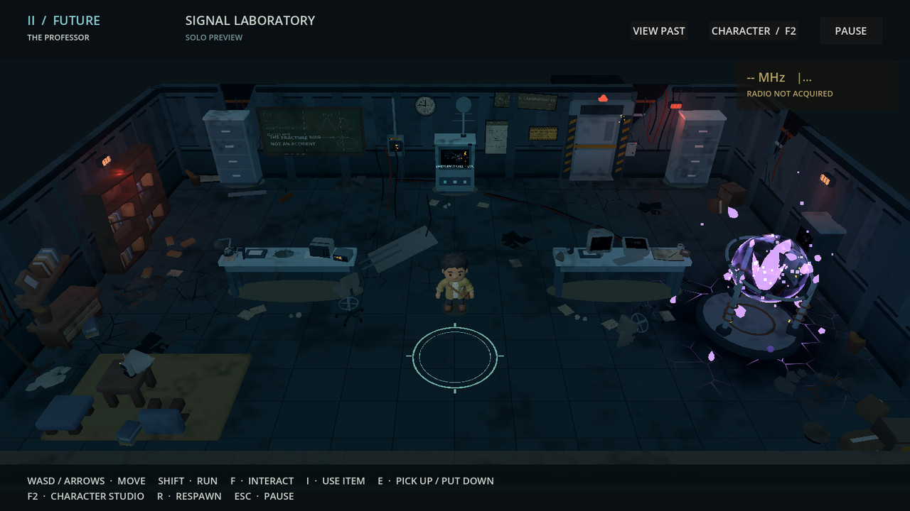 Future overview: the same room, ruined |
| 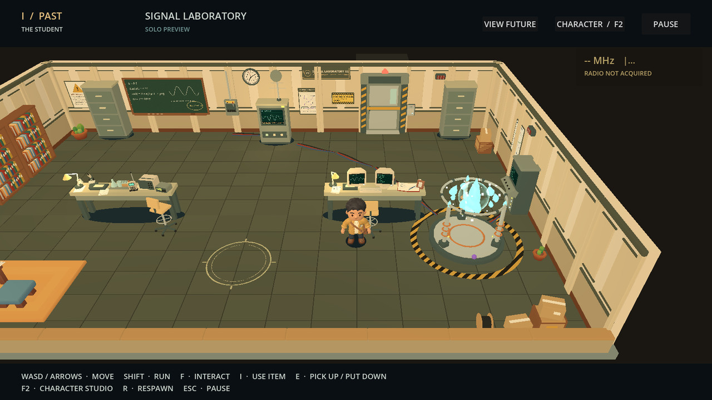 Past research station and rift area | 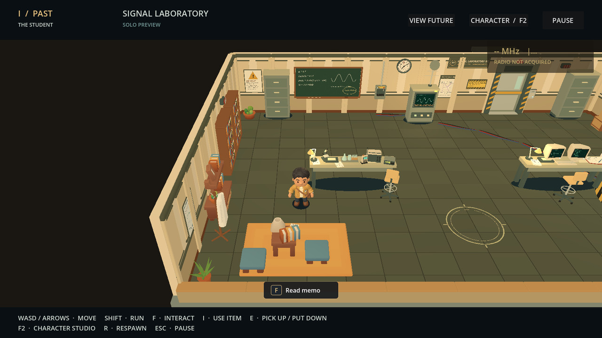 Past library and reading corner |
| 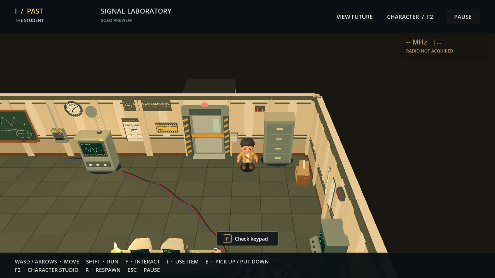 Security door and keypad, prompt shown | 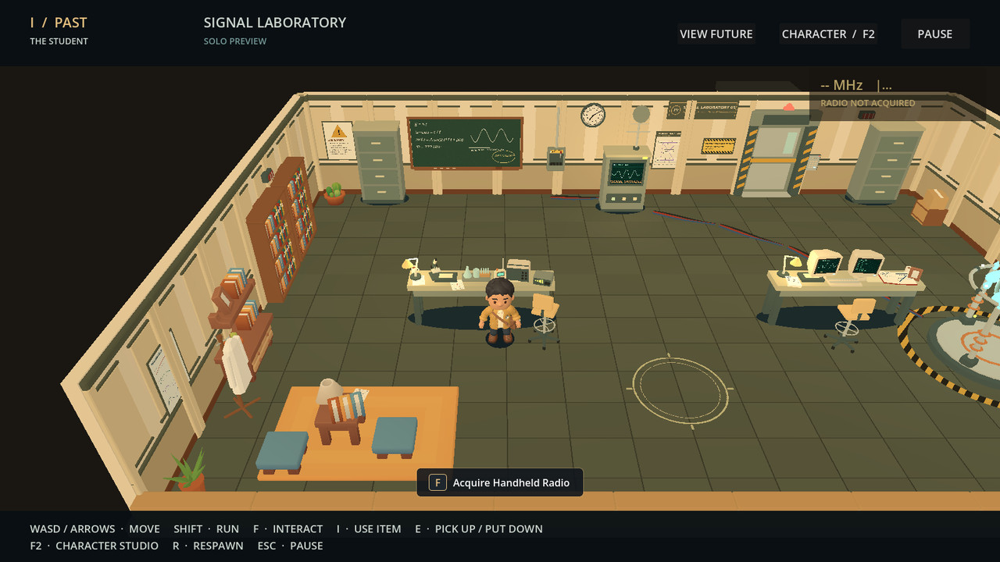 Past: the Student's radio on the science bench |
| 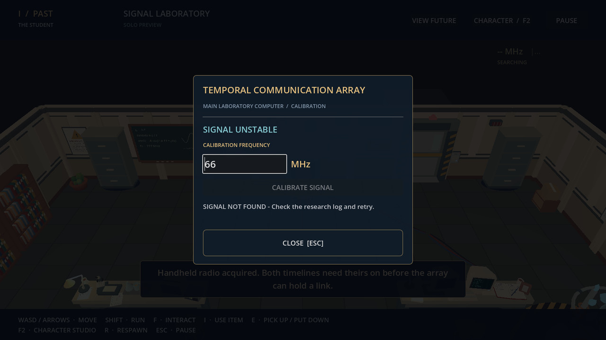 Calibration terminal: 66 MHz, signal not found | 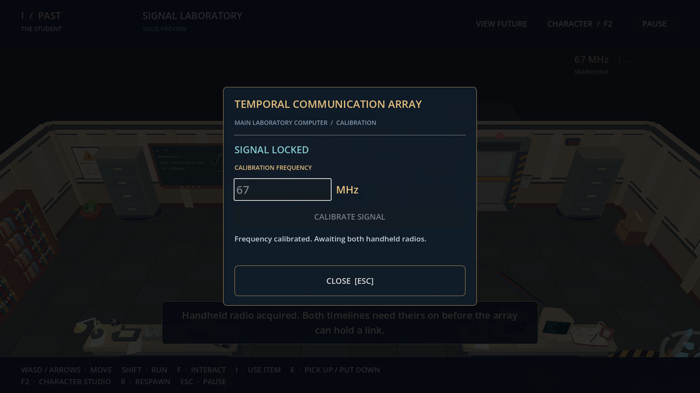 Calibration terminal: 67 MHz locked |
| 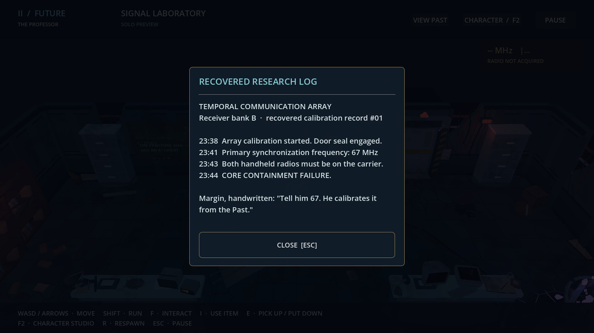 Future console: recovered research log | 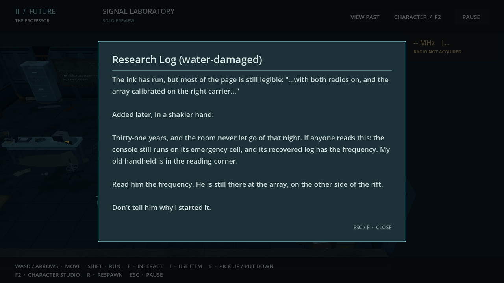 Future research notebook |
| 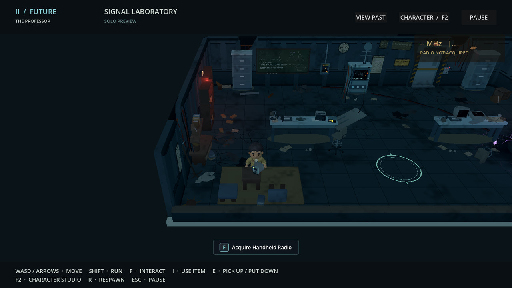 Future: the Professor's radio in the reading corner | 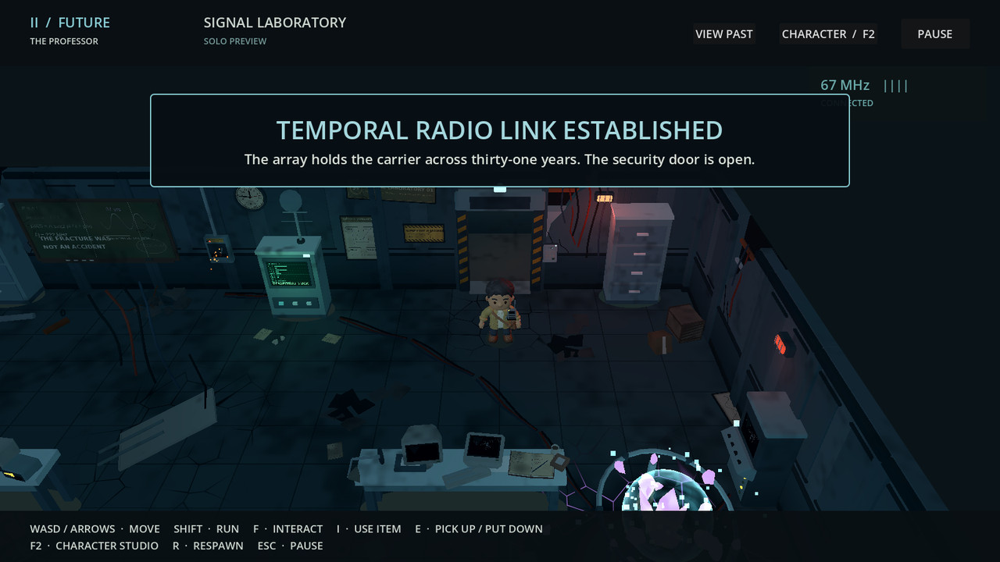 Future: link established, door open, radio in hand |
| 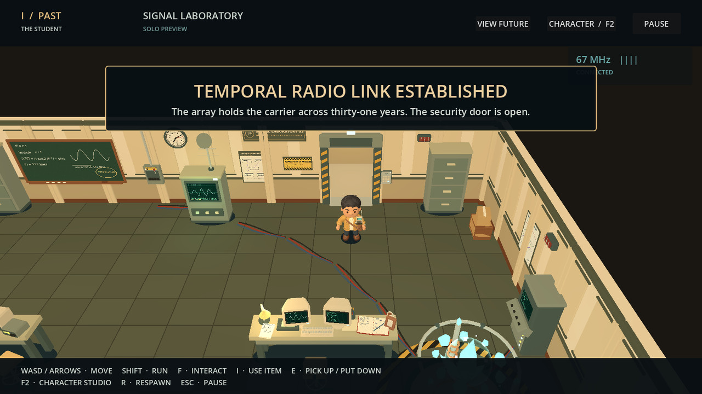 Past: door open | 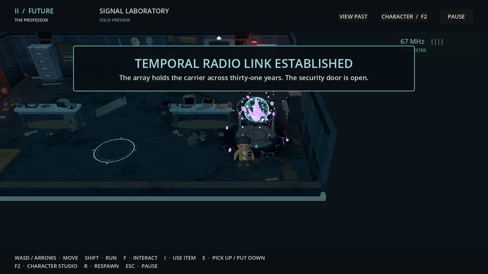 Future rift after the link |
| 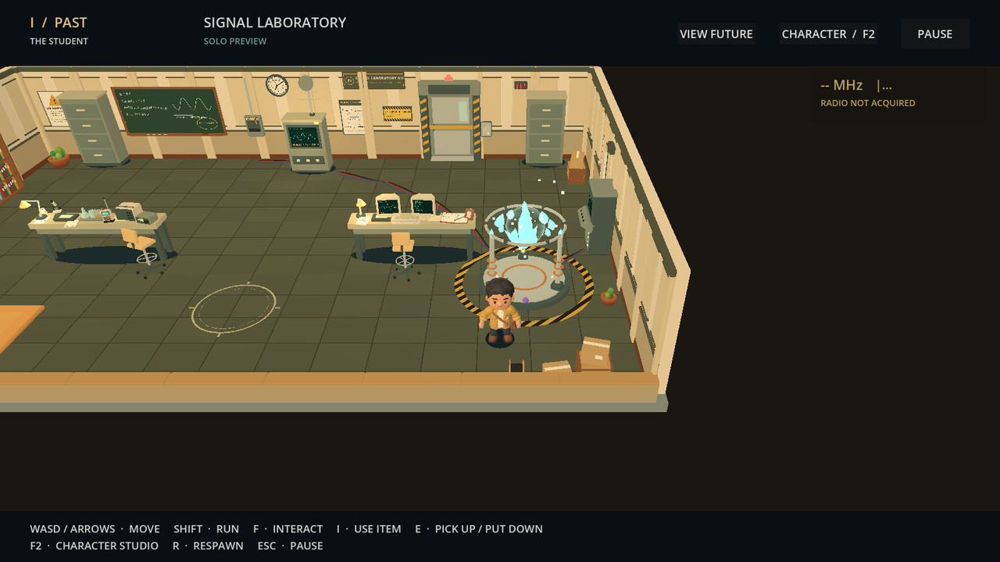 Past rift: contained | 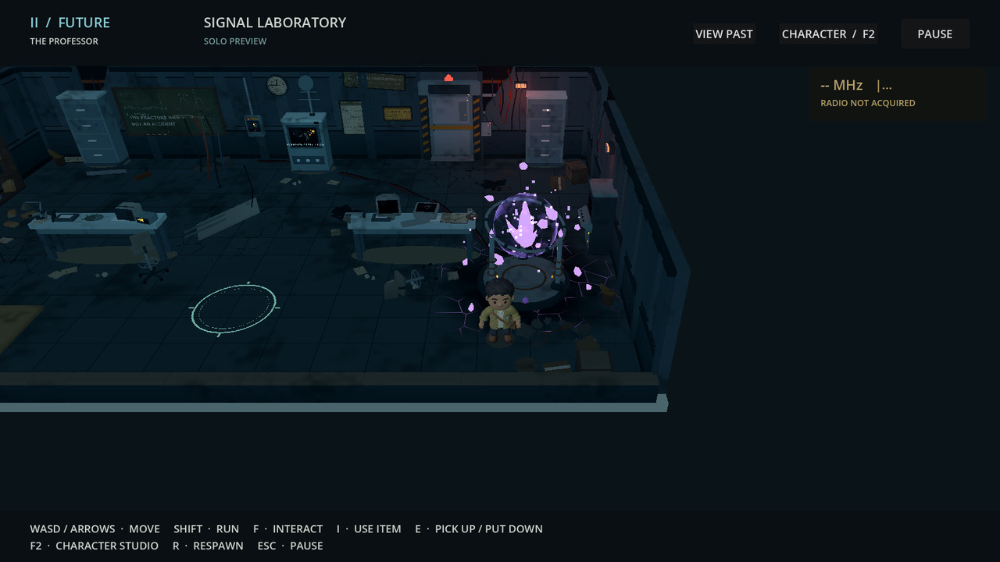 Future rift: fractured |
