# Level 02 — The Broken Corridor

Implemented 2026-10-21. The Maintenance Gallery is now playable after the Signal Laboratory in solo preview and LAN co-op. It includes the service circuit, independent underground preservation lifts, physical archive repair, two private shortcut choices, Core access and a small chapter finale. The separate full Temporal Anchor puzzle and countdown remain outside this implementation.

## Enter and play

Temporary shortcut: select **Play → LEVEL 2 / TEMPORARY SOLO TEST** in the main menu. This starts a fresh offline corridor run with both radios acquired and linked at 67 MHz; Level 02 remains unsolved. Press **T** to switch timelines.

Complete the existing laboratory: acquire both radios, calibrate 67 MHz, and leave through the north door. Walking through the exit or pressing **F** at the corridor exit marks readiness through `GameFlowManager`. LAN travel waits for both roles; solo travel proceeds after the local exit. Finish any active conversation before leaving. The manager loads the gallery under a plain loading cover, waits for both peers and releases input without resetting the puzzle session or ENet connection. There are no animated entry fades or cinematic title cards. Press **T** or the role button to operate the other timeline in solo. Each role retains its position. The entrance offers **Return to Laboratory** through the same readiness flow.

To test Level 02 directly, open `scenes/world/maintenance_corridor.tscn` and press **F6**. A fresh offline direct run seeds the completed radio prerequisite. Normal travel preserves the real puzzle session and never seeds or resets it. Running the static layout scene alone does not create gameplay.

Controls: WASD/arrows move, Shift runs, F interacts, picks up a storage object, or directly loads a carried object onto an available tray, E puts a carried object down on the storage-room floor, Escape closes a device or opens pause, R returns to the entry landing. The pause screen offers Return to Menu and an offline Restart Chapter option. Losing the LAN connection blocks local gameplay and leaves the menu available.

Equipment now opens a close-up of the actual 3D machine. Click its lever, wheel, fuse, selector or button; the authorization code is entered on the machine's physical keypad. Optional key shortcuts and objectives live in a separate right-side player guide. Story records and private character observations are distinct from this assistance. See [Discovery and physical interaction](PLAYER_EXPERIENCE.md) for controls and screenshots, including the laboratory console's rotatable frequency dial.

Inspection records appear in a compact foreground card beside the machine, with scrolling for long text. The camera fits each device into its own area so the card stays readable without covering the equipment, including at smaller window sizes.

## Puzzle route and choices

1. The Student isolates **SERVICE** on the entry cabinet. The Professor reads the **Emergency Cell** charging instructions and turns its crank. Both timelines have a continuous route to the storage room; there is no support-selector puzzle or blocked slab.
2. The Professor crosses to **Maintenance Archive** and discovers three damaged components. A surviving maintenance record lists their sealed shipping weights: optical reader **4.8 kg**, regulator **2.6 kg**, shielded memory **7.2 kg**. The record is only presented in the Future.
3. The Student searches the records/storage room for six cases with distinct colors, sizes and serial labels, plus a loose cable spool. Carry any object to preservation bay **A**, **B** or **C**, press **F** to load it directly onto the raised pressure-plate tray, and read the measured weight. Loading keeps the player in the world and does not lower the lift. Press **F** again to inspect the computer, then choose **Lower tray and store** as a separate action. The Past screens never show required weights or correct/incorrect judgments. Remove and exchange objects until the communicated weights match, then operate that bay's computer to store the object. Its floor hatch opens, the loaded platform descends to the bottom of a real shaft, and the hatch closes. Each lift works independently.
4. A stored tray's contents become preserved equipment below ground in the Future. The Professor operates the bay computer to open its floor hatch and raise the tray. After the lift stops, he collects and carries the equipment to one of three physical archive sockets. Wrong cases and the cable spool survive too: the Professor can identify them, return and lower them into their source vault, and ask the Student to raise the Past loading tray and replace them. Installing all three correct components restores the terminal, revealing service code **3142** and the shared identity/watch detail. Then inspect **Incident Recorder**.
5. Resolve the recorder, authorize/release the Core entrance, and latch the stabilization controls in both timelines. Actions latch independently; there is no timing window.

The underground bays are generic single-object storage. Lowering and sealing accepts every portable object and even an empty bay; it never checks a target weight or component identity. Objects left on the surface do not survive into the Future. Retrieval and installation happen separately, with one carried object per role. Each bay can transfer while the others remain open. A recalled Future tray must be lowered, or a collected object returned and lowered, before its Past source changes; after installation, its source remains sealed to preserve causality and prevent duplicate components. There is no combined three-bay commit or automatic terminal repair.

The two private shortcuts are physical device interactions:

| Decision | Immediate benefit | Cost and recovery |
|---|---|---|
| Either role engages **Local Reserve** after reading its service instructions | Charges that side immediately. The local equipment feed gains power; Future gains early door power. | The other auxiliary feed drops. First allocation persists. The Past fuse and Future ground lead restore a shared bypass without removing the distribution history. |
| Professor selects **Release Backup Cell** | Powers the Future manual release without waiting for Past authorization. | Erases the untransferred authorization evidence and interrupts the Past monitor feed unless the bypass is already repaired. The extraction remains in the hardware log. |

The cooperative route leaves the reserve disengaged, charges the normal battery, repairs both bypass ends, and selects **Export Recording**. Preserving the recorder requires the isolated supply. Erased evidence cannot be restored by later repairs.

A player with a disrupted auxiliary feed can still move, inspect clues and reach their repair station. The storage-room passage and opened doors stay available, so both players can recover after a shortcut. No choice permanently traps the partner or requires restarting the laboratory.

The ending changes with the evidence: a preserved recording identifies the Professor's acknowledged override; an erased recording leaves an incomplete audit and a suspicious extraction log. Both show the actual distribution and recording history. Neither uses a “betray your partner” prompt.

Private information is presented only on the appropriate role's devices. Puzzle state still uses the existing shared replication protocol; this is not a new encrypted-information or anti-cheat system.

## Editable content

- `scenes/world/maintenance_corridor.tscn`: playable scene, camera, character, audio, UI and dialogue.
- `scenes/environment/rooms/maintenance_layout.tscn`: authored native meshes, floors, barriers, doors, props, signage and device markers. Existing environment props retain their timeline palette and asset provenance.
- `tools/build_maintenance_map.py`: regenerates that layout; change its device positions to move a stand and its interaction marker together. Regeneration replaces manual layout edits.
- `scripts/world/maintenance_corridor.gd`: composition, role switching, confirmed-state presentation and device screens.
- `scripts/puzzles/implementations/maintenance_corridor_puzzle.gd`: host rules, prerequisites, guarded actions, irreversible choices and completion.
- `resources/dialogue/maintenance/*.tres`: editable conversations. Skipping or cancelling dialogue cannot change puzzle progression.
- `scripts/gameplay/storage/storage_rules.gd`: item catalog, generic bay validation, carried inventories, return/replacement, and socket installation; all actions are part of the existing host-authoritative maintenance puzzle.
- `scripts/gameplay/storage/storage_room.gd`: floor hatches, underground shafts, sequenced lift motion, computer controls, pressure-plate readouts, portable case models, carried presentation, Future-only shipping record, and physical repair sockets. Props use native Godot meshes and existing materials.
- `scripts/ui/maintenance_panel.gd`: adapts the room's devices to the physical inspector and keeps gameplay guidance separate from story text.
- `scripts/gameplay/devices/device_inspector_3d.gd`: close-up camera, ray-picked physical controls, persistent keypads and local digit entry.

The storage puzzle is the only main puzzle after power restoration. The Circle/Triangle/Square selectors, support-plan cabinet, load diagnostic, blocked slab and their progression fields/actions have been removed. Both eras have a continuous walkable floor through the gallery, including after reload.

Equipment is arranged along the side walls, leaving a continuous central aisle from the laboratory entrance through the Core doorway. The three storage lifts line the left wall and face inward; their authored placement markers also define the floor cutouts. Loose cases, the archive and recorder occupy the right side. Power equipment is grouped along the entry side walls, with door controls beside the Core entrance and stabilization controls off the centre line.

The detailed map uses native industrial meshes and existing project props. Floor stencils separate the power bay and storage/archive room; arrows, floor markings and a facility diagram lead toward the Core. Wall panels, drains, conduit drops, cabinet racks and cable reels give the room a working maintenance setting. The Future adds leaks, cracked tiles, fallen panels and the stopped 23:44 clock in the same architectural footprint.

Each station has its own equipment: fuse isolator, reserve meters, battery cans and crank, open bypass boxes, three underground preservation lifts, pressure plates, damaged archive sockets, tape reels, numeric keypad and release wheel. The Core now contains a ring assembly, grounded machine base, illuminated pylons and an audit terminal. The doorway's overhead beam and sign cut away when the player enters the Core, keeping the fixed camera's view clear.

Visual feedback follows confirmed puzzle state. Mint circuit strips show a working feed, red shows a disrupted feed, and the bypass illuminates after both ends are repaired. The isolator lever changes position, an extracted recorder cell disappears, and the Core lights confirm stabilization. Station labels appear nearby for the current role, with a longer viewing range for the next required station; floor markings and equipment silhouettes remain visible at distance. These cues do not submit actions or alter puzzle rules.

## Verification

- `storage_rules.gd`: **308 checks passed**, including all seven portable objects, independent and empty seals, wrong equipment, return/replacement, malformed fields/roles, duplicate retrieval, physical installation, archive gating and reset.
- `maintenance_rules.gd`: **110 checks passed**, covering all six reserve/recording combinations, forged fields/roles, removed support-action rejection, recovery, immutable decisions, codes, duplicate completion and preservation of the radio prerequisite.
- `maintenance_corridor.gd`: **passed** through the actual detector, camera rays on physical equipment, walking the complete central aisle and Core doorway in both timelines, private role restrictions, Escape behavior, damaged-feed recovery, Core ending, reload and walking through the actual lab exit. This also checks actual case pickup, measured-weight screens, wrong-case installation feedback, Future return, Past unsealing/removal, E put-down, hatch-before-platform sequencing, the real shaft bottom, disabled collection during movement, surface recall, and all three socket installations, plus role-specific labels, confirmed circuit colors, the removed recorder cell, stabilized Core lights and restored presentation after reload, including release of the loading cover.
- `maintenance_peer.gd`: **both real ENet processes passed**, including two-role arrival, retained session/radios, non-optimistic client requests, forged-role rejection, power diversion, erased recorder, early door release, completion, snapshot and client room reload. Storage coverage includes computer recall, retention of a raised tray in full snapshots, and a wrong case being retrieved, returned and replaced, then three confirmed retrieval/install actions with no optimistic client mutation. The fixture waits for both radio acquisitions before tuning, avoiding a startup race. This is loopback validation, not a physical two-computer Wi-Fi test.
- Existing `signal_lab.gd` and `gameplay_integration.gd`: **passed**; the latter now has **84 checks**, including mouse dragging of the physical tuning dial, wheel/arrow adjustments, range limits, ignored digit keys, camera-ray CALIBRATE, keyboard Enter and the incoming audio cues. The legacy laboratory inspection test explicitly disables travel so it can still inspect/reset that room after crossing its exit.

Run `python3 tests/run_maintenance_tests.py` for Level 02. Set `GODOT_BIN` if Godot is not on PATH. `--skip-lan` runs offline checks; `--lan-only` runs the two-process scenario. The runner checks exit status, required PASS markers and engine/script errors.

## Actual screenshots

Generated by `tools/render_maintenance_review.gd` and `tools/render_storage_review.gd` in Godot Compatibility. These are gameplay captures, not concept art.

| Past gallery | Future passage |
|---|---|
| 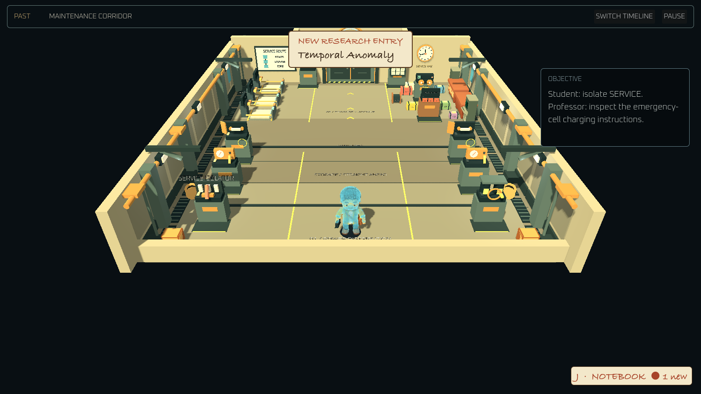 | 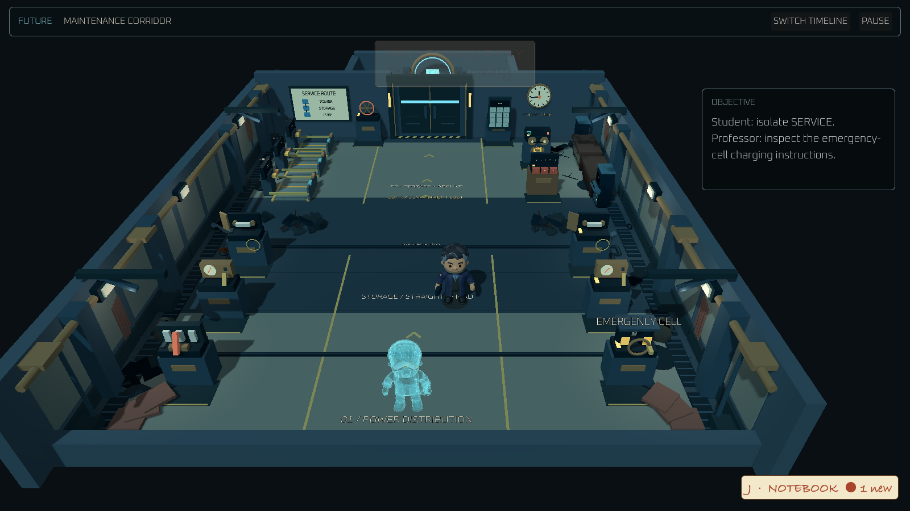 |

| Powered storage passage | Recorder dilemma |
|---|---|
| 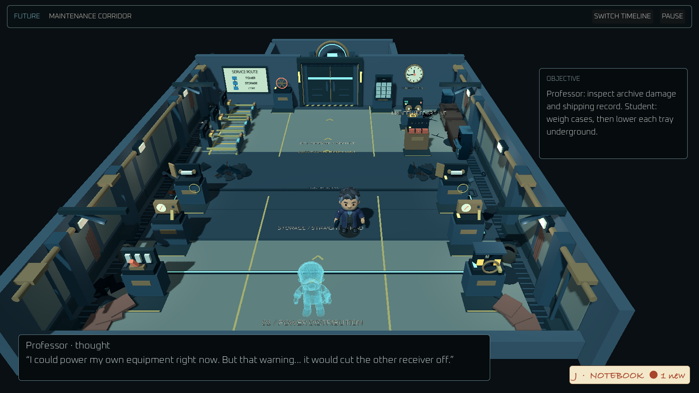 | 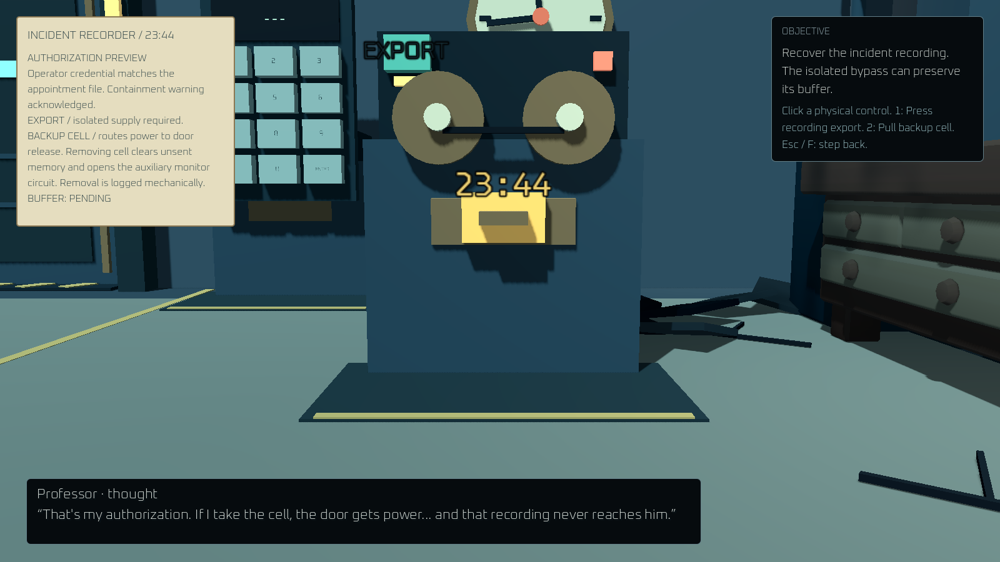 |

| Future records bay | Stabilized Core |
|---|---|
| 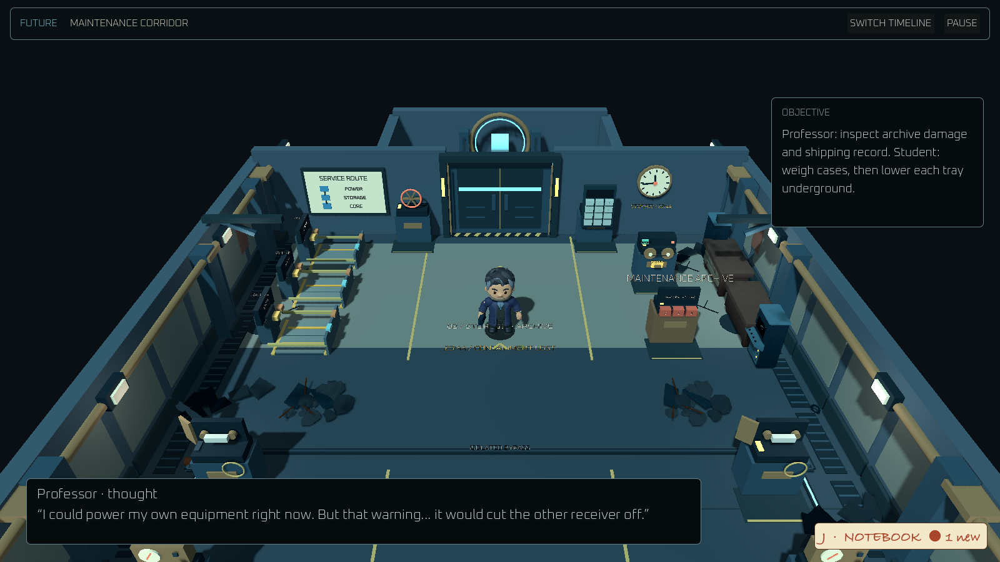 | 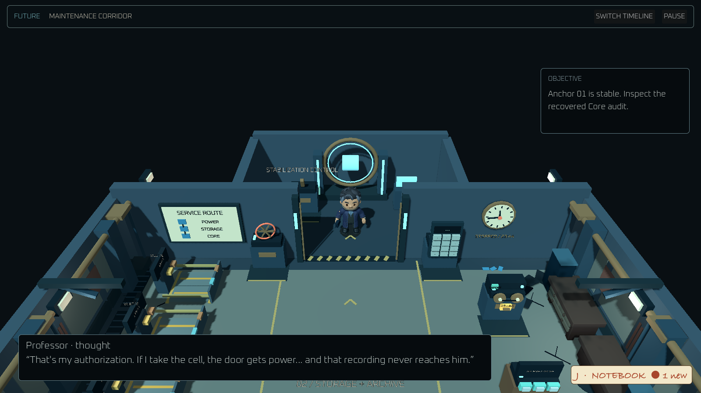 |

| Preserved recording ending | Erased recording ending |
|---|---|
| 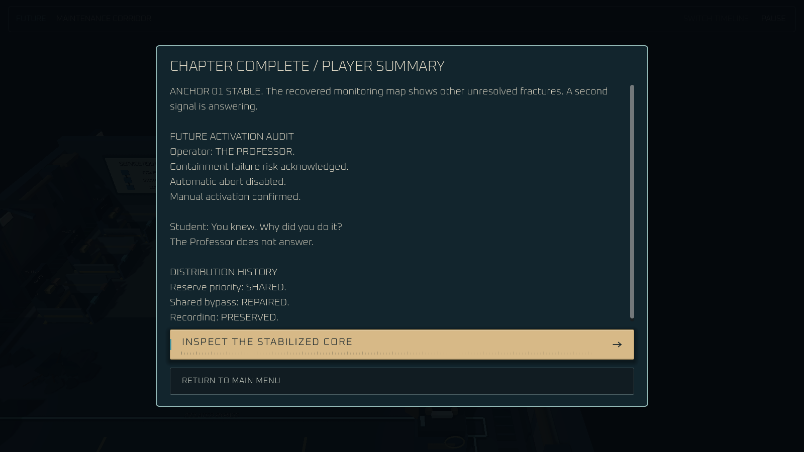 | 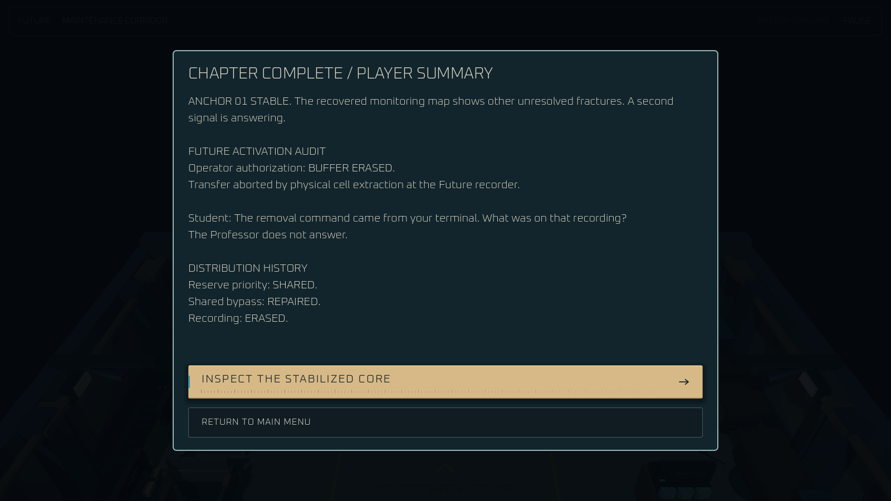 |

| Past storage room | Independent pressure plate |
|---|---|
| 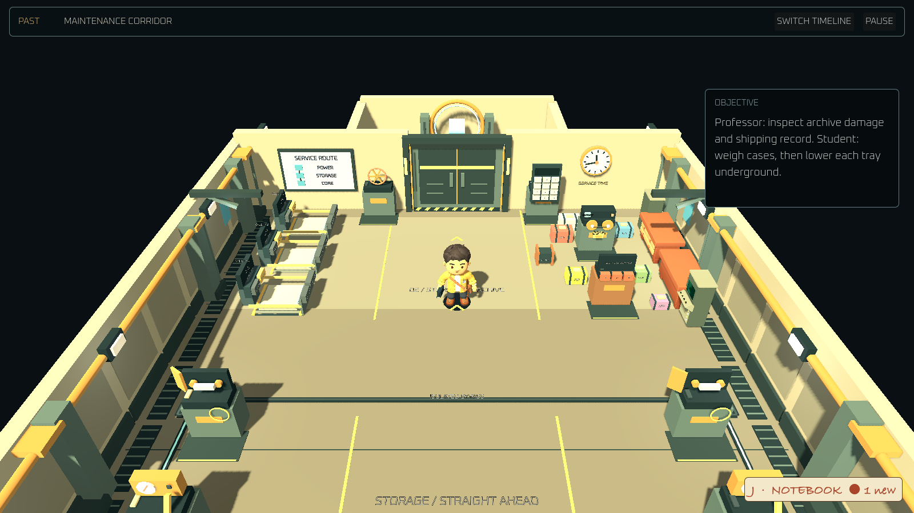 | 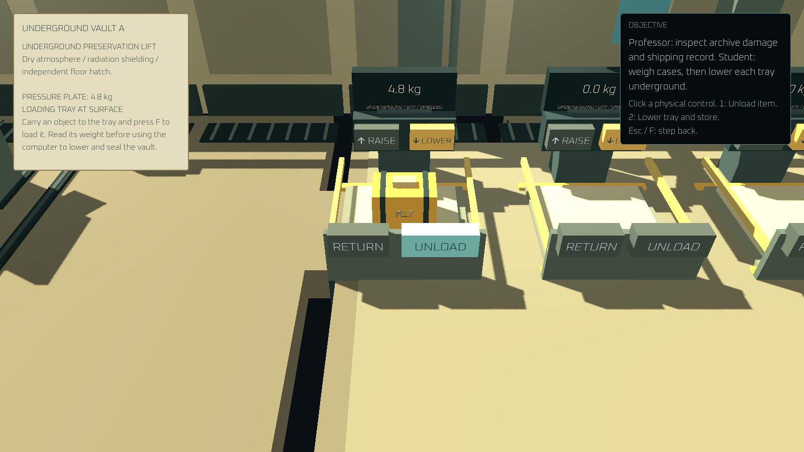 |

| Future shipping record | Physical component installation |
|---|---|
| 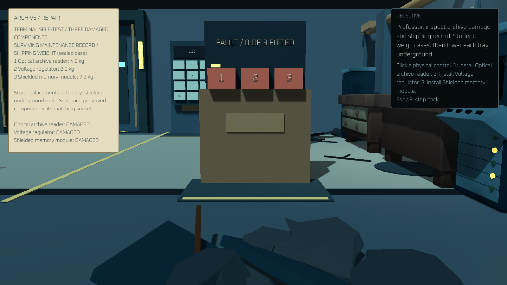 | 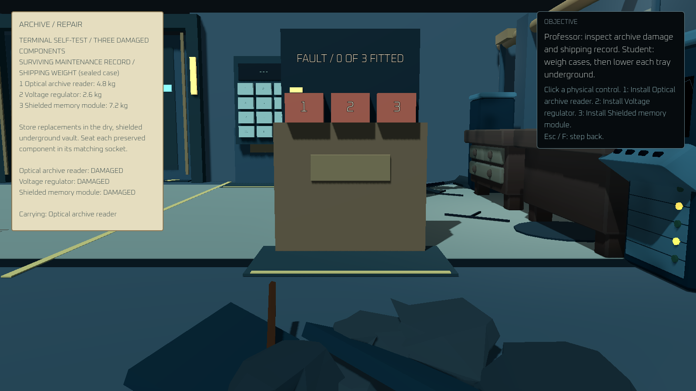 |

| Past hatch opening and tray descending | Stored below a closed floor hatch |
|---|---|
| 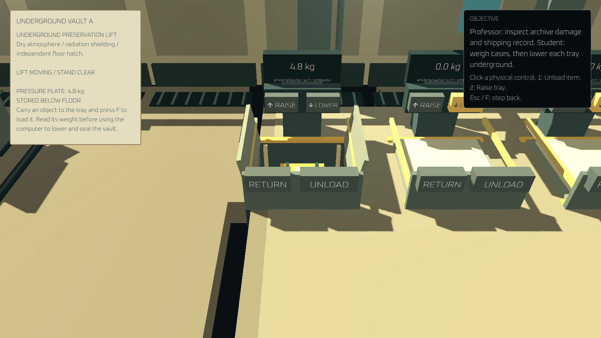 | 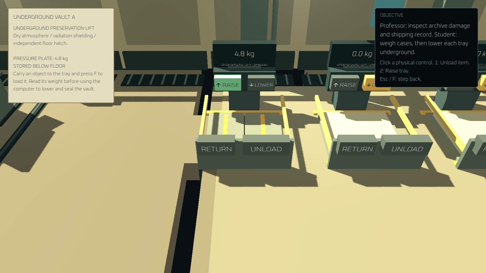 |

| Future computer recalls the preserved tray |
|---|
| 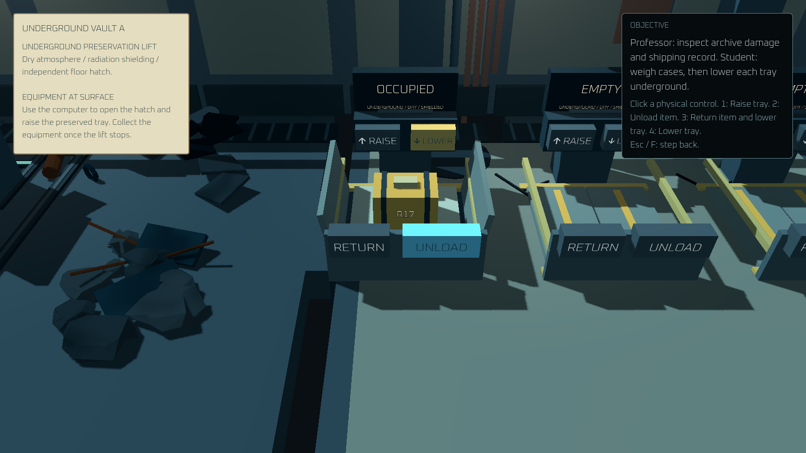 |
