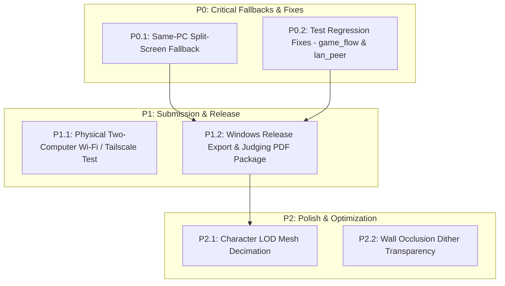

# 12 ROADMAP AND NEXT STEPS: Prioritized Task Backlog & Implementation Plan

> **Snapshot document.** Written on 2026-10-21 as part of the former `PROJECT_CONTEXT/` set, before the repository was reorganized. The code is the final authority; statements here (status, counts, file trees) may be out of date. Current documentation map: [docs/README.md](../README.md).

This document provides a prioritized, actionable engineering roadmap for taking **Past-Future** to a finalized, winning Game Jam release for the **Reboot CHECKPOINT Game Jam 2026**.

---

## 1. Status of Previously Planned Tasks

Every major gameplay, character, and puzzle system from earlier roadmap iterations has been **fully implemented and verified**:

- [x] **P0.1: Host-Authoritative PuzzleManager Autoload** — *COMPLETED & VERIFIED* (`puzzle_manager.gd`)
- [x] **P0.2: Proximity Interaction System & Device Inspector** — *COMPLETED & VERIFIED* (`interactable_3d.gd`, `device_inspector_3d.gd`)
- [x] **P0.3: Puzzle 01 ("Lost Frequency" in Signal Lab)** — *COMPLETED & VERIFIED* (`frequency_puzzle.gd`)
- [x] **P1.1: Maintenance Corridor Level Layout (Room 02)** — *COMPLETED & VERIFIED* (`maintenance_corridor.tscn`)
- [x] **P1.2: Puzzle 02 ("Broken Corridor") & Private Choices** — *COMPLETED & VERIFIED* (`maintenance_corridor_puzzle.gd`)
- [x] **P1.3: Professor Character 3D Model & Authoring Tools** — *COMPLETED & VERIFIED* (`professor.glb`, `build_professor.py`)
- [x] **P1.4: Narrative Dialogue & Investigation Journal** — *COMPLETED & VERIFIED* (`dialogue_director.gd`, `journal_manager.gd`)
- [x] **P2.1: Puzzle 03 ("The Final Fracture") & 4 Endings** — *COMPLETED & VERIFIED* (`temporal_core.tscn`, `core_rules.gd`)
- [x] **P2.2: Solo Temporal Ghost Prototype** — *COMPLETED & VERIFIED* (`temporal_ghost.gd`)
- [x] **P2.3: Audio Subsystem & Sound Catalog** — *COMPLETED & VERIFIED* (`audio_director.gd`, Kenney CC0 audio)
- [x] **P2.4: Gamepad & DualSense Haptics Support** — *COMPLETED & VERIFIED* (`input_manager.gd`)

---

## 2. Priority Tiers for Remaining Work

- **P0: Immediate Critical Tasks**: Essential playable fallback and test regression fixes.
- **P1: Game Jam Submission Polish**: Multi-device verification, release packaging, and judging documentation.
- **P2: Quality of Life & Visual Polish**: LOD mesh decimation and wall transparency dither.
- **P3: Post-Jam Expansion**: Extended chapters, larger campus areas, and full timeline simulation.



---

## 3. P0: Critical Fallback & Bug Tasks

### Task P0.1: Same-PC Split-Screen Fallback Mode
- **Priority**: **P0 (Highest-Impact Next Development Task)**
- **Description**: Enable the disabled `SAME-PC SPLIT-SCREEN` button on `scenes/menu/main_menu.tscn`. Implement an offline split-screen mode running two side-by-side `SubViewportContainer` viewports on a single machine:
  - Left Viewport: Student / Past Timeline (routed to WASD + `F` keys or Controller 1).
  - Right Viewport: Professor / Future Timeline (routed to Arrow keys + `Enter` or Controller 2).
  - Both viewports feed action submissions into the local authoritative `PuzzleManager` instance without requiring network packets.
- **Relevant Files**:
  - [scenes/menu/main_menu.tscn](../../scenes/menu/main_menu.tscn) (Enable button)
  - `scenes/world/split_screen_game.tscn` (New dual-viewport container scene)
  - `scripts/world/split_screen_game.gd` (New input routing controller)
  - [project.godot](../../project.godot) (Add `player2_*` actions to InputMap)
- **Dependencies**: None (`PuzzleManager` already supports local offline submissions).
- **Acceptance Criteria**:
  1. Clicking `SAME-PC SPLIT-SCREEN` launches immediately with internet disconnected.
  2. Both players can move, inspect equipment, and solve Puzzles 01, 02, and 03 simultaneously.
  3. Solving a puzzle in one viewport immediately updates the linked environment in the other.
  4. Both viewports reach the Stage C finale and display the chosen narrative ending.

---

### Task P0.2: Test Regression Clean-Up
- **Priority**: **P0**
- **Description**: Resolve the two minor automated test regressions identified during the audit:
  1. `tests/game_flow_system.gd`: Update line 277 from `check(root.get_child_count() == 5, ...)` to `check(root.get_child_count() == 6, ...)` to account for the addition of `CinematicTransitionManager`.
  2. `tests/lan_peer.gd`: Guard line 127 with `is_instance_valid(current_scene)` to prevent transient null reference errors during scene unload.
- **Relevant Files**:
  - [tests/game_flow_system.gd](../../tests/game_flow_system.gd#L277)
  - [tests/lan_peer.gd](../../tests/lan_peer.gd#L127)
- **Acceptance Criteria**:
  1. `python tests/run_game_flow_tests.py` reports `GAME FLOW SYSTEM: PASS (0 failures)`.
  2. `python tests/run_lan_smoke.py` reports `LAN client: PASS` without script errors.

---

## 4. P1: Game Jam Submission Tasks

### Task P1.1: Physical Cross-Device Wi-Fi & Tailscale Verification
- **Priority**: **P1**
- **Description**: While multi-process ENet loopback testing is fully verified, physical execution across two distinct computers on an active Wi-Fi router (and across separate networks using Tailscale) must be validated.
- **Acceptance Criteria**:
  1. Two separate Windows laptops connect over standard home Wi-Fi on UDP 7000.
  2. Two machines connect across mobile hotspot / external network via Tailscale mesh IP.
  3. All three levels, transitions, and audio synchronize without desync.

---

### Task P1.2: Windows Release Export & Judge Documentation Package
- **Priority**: **P1**
- **Description**: Create `export_presets.cfg` for Godot 4.7.2 Windows Desktop (x86_64). Produce a standalone `.zip` containing the executable, `.pck`, and a 1-page PDF setup guide detailing:
  - How to play in Same-PC Split-Screen (no network required).
  - How to play over Wi-Fi LAN.
  - How to connect via Tailscale for remote judging.
- **Acceptance Criteria**:
  1. Exported `.exe` boots cleanly on a fresh Windows PC without Godot installed.
  2. All audio, shaders, and animations load from the packed data archive.

---

## 5. P2: Polish & Extended Quality of Life

- **Task P2.1: Character LOD Mesh Decimation**: Author automated decimation passes in `tools/build_student_kaykit.py` and `tools/build_professor.py` (LOD0: full 90k/113k; LOD1: 15k triangles) for improved performance on low-end integrated graphics.
- **Task P2.2: Wall Occlusion Dither Fading**: Add height-based dither alpha fade to interior corridor walls so players remain visible when walking behind tall structures.

---

## 6. The Single Best Immediate Next Action

```text
================================================================================
>>> RECOMMENDED IMMEDIATE ACTION: IMPLEMENT TASK P0.1 (SAME-PC SPLIT-SCREEN)
================================================================================
Implement the Same-PC Split-Screen mode (`split_screen_game.tscn`) and enable
the button on `main_menu.tscn`.

WHY THIS FIRST?
The game already has a fully functioning 3-level cooperative campaign with
authoritative puzzles, both character models, and 4 endings. However, it currently
requires two computers or virtual networking (Tailscale) to play.

Providing an offline split-screen mode on a single PC completely eliminates
WAN/NAT judging risk, guaranteeing that any Game Jam evaluator can immediately
boot and experience the entire game with zero network configuration.
================================================================================
```
