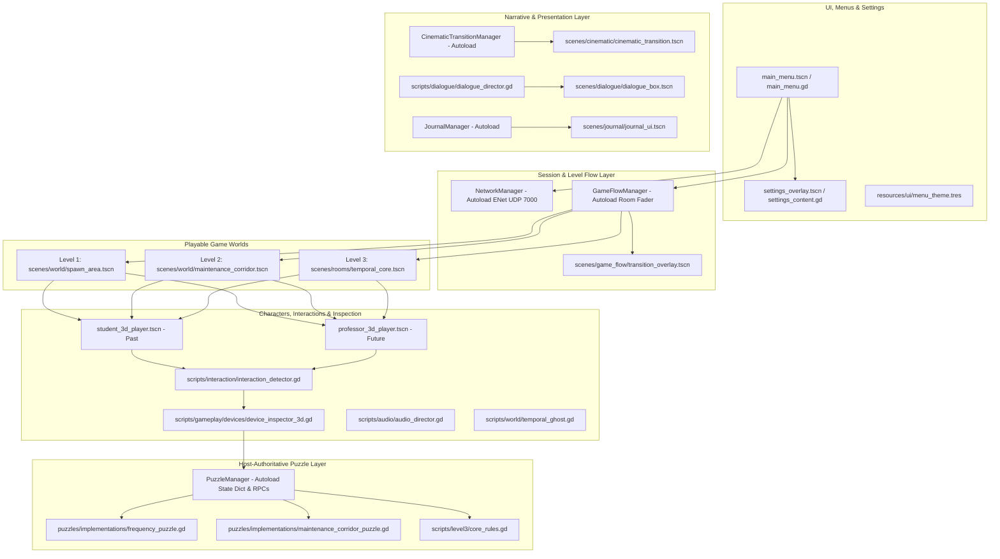

# 02 PROJECT ARCHITECTURE: Codebase Structure & System Interactions

> **Snapshot document.** Written on 2026-10-21 as part of the former `PROJECT_CONTEXT/` set, before the repository was reorganized. The code is the final authority; statements here (status, counts, file trees) may be out of date. Current documentation map: [docs/README.md](../README.md).

## 1. Repository Directory Structure

Below is the verified file tree of the active repository (excluding Git internals, `.godot/` cache, and local `.venv/`):

```text
past-future/
├── .editorconfig
├── .gitattributes
├── .gitignore
├── GAME_DESIGN_DOCUMENT.md
├── icon.svg
├── icon.svg.import
├── project.godot                              <- Engine configuration, Autoloads, Input actions, Physics
├── assets/
│   ├── audio/                                 <- Kenney CC0 sound effects, footstep banks & ambiences
│   │   ├── ambience/ (past, future)
│   │   ├── asset_provenance.json              <- Audio provenance, sources, and hashes
│   │   ├── computer/, documents/, doors/, footsteps/, interactions/, music/, radio/, rift/, ui/
│   │   └── licenses/                          <- Kenney audio license texts (CC0)
│   ├── characters/
│   │   ├── ART_NOTES.md, STUDENT_MODEL.md
│   │   ├── references/                        <- 4-view concept art (.gdignore)
│   │   ├── professor_3d/                      <- ACTIVE 3D Professor assets (49yo)
│   │   │   ├── manifest.json, README.md, REFERENCE_STUDY.md, VALIDATION.md
│   │   │   ├── professor.glb (7.29 MB)        <- Compiled 3D skinned mesh (23 bones, 77 clips)
│   │   │   ├── review/, source/ (professor.blend)
│   │   ├── student_2d/                        <- (Legacy 2D prototype files; PNGs deleted)
│   │   └── student_3d/                        <- ACTIVE 3D Student assets (18yo)
│   │       ├── manifest.json, README.md, REFERENCE_STUDY.md, VALIDATION.md
│   │       ├── student.glb (7.33 MB)          <- Compiled 3D skinned mesh (23 bones, 77 clips)
│   │       └── review/, source/ (student.blend)
│   ├── environments/                          <- Modular lab props, textures & models
│   ├── third_party/
│   │   └── kaykit_character_animations/       <- CC0 source animation GLBs (.gdignore)
│   └── ui/                                    <- Vector graphics & temporal dials
├── docs/                                      <- Comprehensive system guides, reports & screenshots
│   ├── AUDIO_SYSTEM.md, CINEMATIC_ROOM_TRANSITIONS.md, CONTROLLER_SUPPORT.md
│   ├── DIALOGUE_SYSTEM.md, FREQUENCY_PUZZLE.md, GAMEPLAY_INTEGRATION.md
│   ├── GAME_FLOW_SYSTEM.md, INTERACTION_SYSTEM.md, JOURNAL_SYSTEM.md
│   ├── LEVEL_02.md, LEVEL3_FINAL_FRACTURE.md, PERFORMANCE.md, PLAYER_EXPERIENCE.md
│   └── TEMPORAL_GHOST.md
├── resources/
│   ├── audio/                                 <- Audio bus layouts & presets
│   ├── cinematic/                             <- Room intro definitions & style presets
│   │   ├── presets/ (past_memory, future_signal, neutral, finale)
│   │   └── rooms/ (signal_laboratory, maintenance_corridor, temporal_core)
│   ├── dialogue/                              <- Dialogue sequence resources (.tres)
│   │   ├── intro/, laboratory/, maintenance/, core/
│   │   └── speakers/ (student, professor, system, radio)
│   ├── journal/                               <- JournalEntry resources for notebook & DataPad
│   │   ├── student/ (clues & observations)
│   │   └── professor/ (clues & logs)
│   ├── levels/                                <- RoomDefinition resources
│   │   ├── room_01.tres                       <- Signal Laboratory
│   │   ├── room_02.tres                       <- Maintenance Corridor
│   │   ├── room_03.tres                       <- The Final Fracture / Temporal Core
│   │   └── test/                              <- Test room definitions
│   └── ui/
│       └── menu_theme.tres                    <- Shared UI theme for menus, buttons & panels
├── scenes/
│   ├── audio/                                 <- audio_system.tscn, footstep_emitter_3d.tscn
│   ├── characters/
│   │   ├── student_3d_player.tscn             <- ACTIVE Student player scene
│   │   ├── student_3d_studio.tscn             <- In-game Student animation review studio (F2)
│   │   ├── professor_3d_player.tscn           <- ACTIVE Professor player scene
│   │   ├── professor_3d_studio.tscn           <- In-game Professor animation review studio
│   │   └── (student_player, student_2d_player, etc. - legacy deprecated scenes)
│   ├── cinematic/
│   │   └── cinematic_transition.tscn          <- Room intro title card overlay (CanvasLayer 40)
│   ├── dialogue/
│   │   ├── dialogue_box.tscn                  <- Dialogue box UI (portrait, text, click advance)
│   │   └── dialogue_system.tscn               <- Director + box container
│   ├── environment/
│   │   ├── effects/ (temporal_rift.tscn)
│   │   ├── interactive/ (console_terminal, security_door, junction_box, radio_pickup_*, etc.)
│   │   └── rooms/ (signal_lab.tscn, maintenance_layout.tscn)
│   ├── game_flow/
│   │   └── transition_overlay.tscn            <- Full-screen fade overlay for level travel (Layer 100)
│   ├── gameplay/
│   │   └── laboratory_gameplay.tscn           <- Signal lab interactables, triggers & dialogue hooks
│   ├── journal/
│   │   └── journal_ui.tscn                    <- Notebook/DataPad inspection UI (Layer 90)
│   ├── menu/
│   │   └── main_menu.tscn                     <- Title screen, settings, credits, play modes & LAN lobby
│   ├── props/
│   │   ├── lab_prop.tscn                      <- Reusable base prop with collision footprint
│   │   ├── table_visual.tscn, cabinet_visual.tscn, console_visual.tscn
│   ├── rooms/
│   │   └── temporal_core.tscn                 <- ACTIVE Level 3 / Room C production room
│   ├── testing/                               <- Sandbox scenes for audio, controllers, dialogue, etc.
│   │   ├── temporal_core_sandbox.tscn         <- Level 3 standalone testbed with dev switcher
│   │   └── transition_flow_sandbox.tscn
│   ├── ui/
│   │   ├── interaction_prompt.tscn            <- Dynamic contextual prompt widget
│   │   └── settings_overlay.tscn              <- Settings modal overlay
│   └── world/
│       ├── spawn_area.tscn                    <- ACTIVE Level 1 / Signal Laboratory room
│       ├── maintenance_corridor.tscn          <- ACTIVE Level 2 / Maintenance Corridor room
│       └── room_02_placeholder.tscn          <- Standalone corridor greybox
├── scripts/
│   ├── audio/                                 <- audio_director.gd, ambient_audio_controller.gd, footstep_emitter_3d.gd, sound_catalog.gd
│   ├── characters/                            <- student_3d_player.gd, student_3d_studio.gd, etc.
│   ├── cinematic/                             <- cinematic_transition_manager.gd (AUTOLOAD), cinematic_transition.gd, room_intro_data.gd, room_intro_style.gd
│   ├── dialogue/                              <- dialogue_director.gd, dialogue_box.gd, dialogue_sequence.gd, dialogue_line.gd, dialogue_trigger.gd
│   ├── environment/                           <- signal_lab.gd, temporal_rift.gd, env_palette.gd
│   ├── game_flow/                             <- game_flow_manager.gd (AUTOLOAD), room_definition.gd, transition_overlay.gd
│   ├── gameplay/
│   │   ├── laboratory_gameplay.gd             <- Signal Lab coordinator
│   │   └── devices/                           <- device_inspector_3d.gd, device_inspector_interactable.gd
│   ├── input/                                 <- input_manager.gd (controller auto-detect, glyphs, rumble)
│   ├── interaction/                           <- interactable_3d.gd, interaction_detector.gd, interaction_controller.gd, puzzle_interactable_3d.gd
│   ├── journal/                               <- journal_manager.gd (AUTOLOAD), journal_ui.gd, journal_entry.gd, journal_unlock.gd
│   ├── level3/                                <- temporal_core.gd, core_rules.gd, core_ui.gd, core_launcher.gd
│   ├── menu/                                  <- main_menu.gd, menu_button.gd, temporal_backdrop.gd
│   ├── network/                               <- network_manager.gd (AUTOLOAD: ENet LAN host/join)
│   ├── puzzles/                               <- puzzle_manager.gd (AUTOLOAD), puzzle_base.gd, puzzle_listener.gd
│   │   └── implementations/                   <- frequency_puzzle.gd, maintenance_corridor_puzzle.gd, power_switch_puzzle.gd
│   ├── testing/                               <- Sandboxes and mock helpers
│   ├── ui/                                    <- interaction_prompt.gd, lab_ui.gd, maintenance_panel.gd, settings_content.gd, settings_overlay.gd, world_text_layout.gd
│   └── world/                                 <- follow_camera.gd, lab_floor.gd, lab_prop.gd, maintenance_corridor.gd, spawn_area.gd, temporal_ghost.gd
├── shaders/
│   ├── environment.gdshader                   <- Lit environment shader
│   ├── interaction_highlight.gdshader         <- Outline/fresnel highlight for active interactables
│   ├── lab_floor.gdshader                     <- Procedural tile grid & timeline base switch
│   ├── painted_prop.gdshader                  <- Lambertian normal face lighting for furniture
│   ├── temporal_ghost.gdshader                <- Translucent cyan hologram silhouette & fade
│   └── temporal_rift.gdshader                 <- Swirling distortion and fracture energy
├── tests/                                     <- 13 Automated test suites & headless GDScript verifiers
└── tools/                                     <- Python procedural mesh builders & asset exporters
```

---

## 2. Godot Engine Configuration (`project.godot`)

- **Application**:
  - Name: `"Past-Future"`
  - Main Scene: `"res://scenes/menu/main_menu.tscn"`
  - Engine Features: `PackedStringArray("4.7", "GL Compatibility")`
- **Autoload Singletons (Execution Priority Order)**:
  1. `NetworkManager` (`*res://scripts/network/network_manager.gd`)
  2. `PuzzleManager` (`*res://scripts/puzzles/puzzle_manager.gd`)
  3. `GameFlowManager` (`*res://scripts/game_flow/game_flow_manager.gd`)
  4. `JournalManager` (`*res://scripts/journal/journal_manager.gd`)
  5. `CinematicTransitionManager` (`*res://scripts/cinematic/cinematic_transition_manager.gd`)
- **Display & Viewport**:
  - Virtual Viewport: $1600 \times 900$
  - Window Override: $1280 \times 720$ (Minimum: $960 \times 540$)
  - Stretch Mode: `"canvas_items"`
- **Physics**:
  - 3D Physics Engine: `"Jolt Physics"`
  - Layer 4: `"Interaction"` (`3d_physics/layer_4="Interaction"`)
- **Input Map**:
  - `move_left` (`A` / D-pad Left / Left Stick Left)
  - `move_right` (`D` / D-pad Right / Left Stick Right)
  - `move_up` (`W` / D-pad Up / Left Stick Up)
  - `move_down` (`S` / D-pad Down / Left Stick Down)
  - `interact` (`F` / DualSense Cross / Xbox A)
  - `inspect` (`I` / DualSense Square / Xbox X)
  - `use_item` (`E` / DualSense Triangle / Xbox Y)
  - `sprint` (`Shift` / R2 / RT)
  - `journal` (`J` / Select / Touchpad)
  - `cancel` / `pause` (`Escape` / Start / Options)

---

## 3. High-Level Architectural System Layers



---

## 4. System Interactions & Event Flows

### 4.1 Host-Authoritative Puzzle Replication
All puzzle interactions follow strict host authority:
```text
[Client Player Action]
       │
       ▼ (RPC request_puzzle_action)
[Host (Peer 1) PuzzleManager]
       │
       ├─► 1. Verify Sender Peer ID & Authenticated Role
       ├─► 2. Validate Prerequisites, Station Distance & Payload Schema
       ├─► 3. Mutate Canonical State Dictionary
       └─► 4. Increment State Revision (Monotonic Counter)
       │
       ▼ (RPC apply_puzzle_state, call_local)
[Both Peers' PuzzleManagers]
       │
       ├─► Store Confirmed State & Emit puzzle_state_updated
       └─► Notify Registered PuzzleListeners / DeviceInspectors
```
Clients **never mutate puzzle state optimistically**. Pending actions remain visual until host confirmation arrives.

### 4.2 Room Transitions (`GameFlowManager`)
Moving between rooms is decoupled from network transport and puzzle sessions:
1. **Request / Ready**: Players reach an exit door. Interacting marks readiness.
2. **Authorization**: In multiplayer, travel requires both roles to report ready (`require_both_ready = true`).
3. **Execution**:
   - Host authorizes and broadcasts `transition_started`.
   - Both peers fade screen to black (`fade_out_seconds = 0.45`).
   - Old room is unloaded; ambience fades; new room instantiates and attaches.
   - Initial snapshot is restored without resetting the puzzle session or ENet connection.
   - Screen fades in (`fade_in_seconds = 0.55`); input lock is released.
   - `CinematicTransitionManager` triggers the room title card presentation two frames after `_ready()`.

### 4.3 3D Physical Device Inspection (`DeviceInspector3D`)
Equipment is manipulated in-world:
1. Player approaches an interactive station and presses `F` (or controller `Cross`/`A`).
2. The fixed camera smoothly interpolates to an inspection framing position.
3. Ray-picked collision shapes allow direct clicking on 3D dials, switches, and keypads.
4. An accompanying readable document panel appears alongside the equipment, formatted by `WorldTextLayout`.
5. Pressing `Escape` or backing out restores the standard follow camera and returns player movement.

---

## 5. Autoload Singletons API Reference

### 5.1 `NetworkManager` (`scripts/network/network_manager.gd`)
- **Role**: Manages ENet multiplayer peer lifecycle on UDP port `7000`.
- **Properties**:
  - `state: State` (`IDLE`, `HOSTING`, `CONNECTING`, `CONNECTED`)
  - `role: String` (`"past"` on Host, `"future"` on Guest)
  - `guest_ready: bool`: Readiness state in lobby
  - `in_game: bool`: True when actively in a gameplay room
- **Signals**: `state_changed`, `game_started`
- **RPCs**: `_register_client`, `_apply_lobby`, `_request_ready`, `_begin_game`

### 5.2 `PuzzleManager` (`scripts/puzzles/puzzle_manager.gd`)
- **Role**: Authoritative host state dictionary and RPC replication pipeline.
- **Key Methods**:
  - `submit_action(id, action, payload)`: Client-facing submission method.
  - `get_state(id)`: Returns confirmed dictionary for puzzle `id`.
  - `is_solved(id)`: Returns whether puzzle `id` has completed.
  - `refresh_puzzle(id)`: Host-only hook for active timed puzzles (e.g. Level 3 reactor clock).
  - `get_session_id()`: Returns monotonic session identifier.
- **Signals**: `puzzle_state_updated(id, state)`, `puzzle_completed(id)`, `session_started`, `session_ended`

### 5.3 `GameFlowManager` (`scripts/game_flow/game_flow_manager.gd`)
- **Role**: Level flow, multi-peer transition synchronization, screen fades, and room registration.
- **Key Methods**:
  - `start_room(room_id)`: Enters room directly (used by tests and menu preview buttons).
  - `set_ready(destination)`: Marks local peer ready to travel.
  - `is_input_locked()`: Returns whether transition overlay has locked player controls.
- **Signals**: `transition_requested`, `readiness_changed`, `transition_started`, `room_changed`, `transition_completed`, `transition_failed`

### 5.4 `JournalManager` (`scripts/journal/journal_manager.gd`)
- **Role**: Session-long evidence and investigation tracker (Student Notebook / Professor DataPad).
- **Key Methods**:
  - `unlock_entry(entry_id, role)`: Unlocks evidence for a specific timeline.
  - `is_unlocked(entry_id)`: Checks if current role has discovered the clue.
  - `toggle_journal()`: Opens/closes UI overlay (`J` key).
- **Signals**: `entry_unlocked(entry)`, `journal_opened`, `journal_closed`, `state_changed`

### 5.5 `CinematicTransitionManager` (`scripts/cinematic/cinematic_transition_manager.gd`)
- **Role**: Presentation-only room introduction title cards on CanvasLayer 40.
- **Key Methods**:
  - `show_room_intro(room_id, timeline)`: Triggers title card overlay.
  - `dismiss()`: Immediately fades out current intro.
- **Signals**: `intro_started(room_id, timeline)`, `intro_finished(room_id, completed)`
